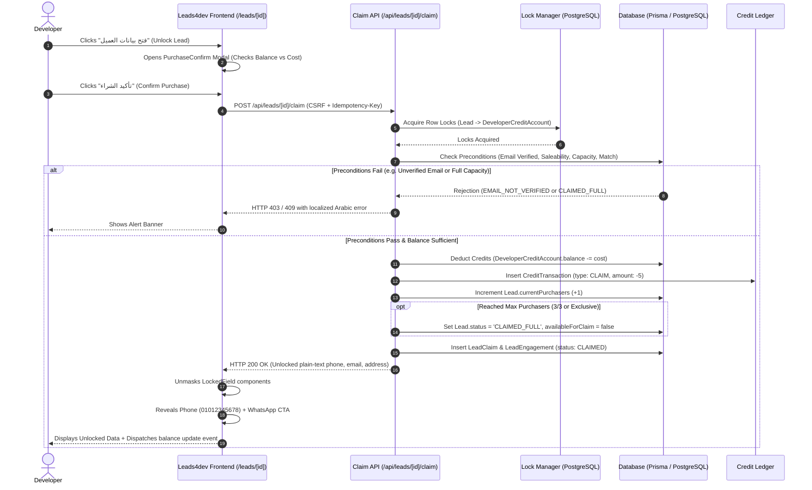
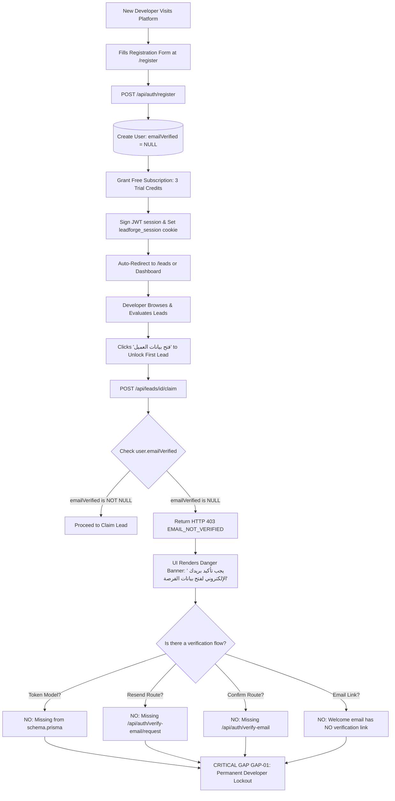
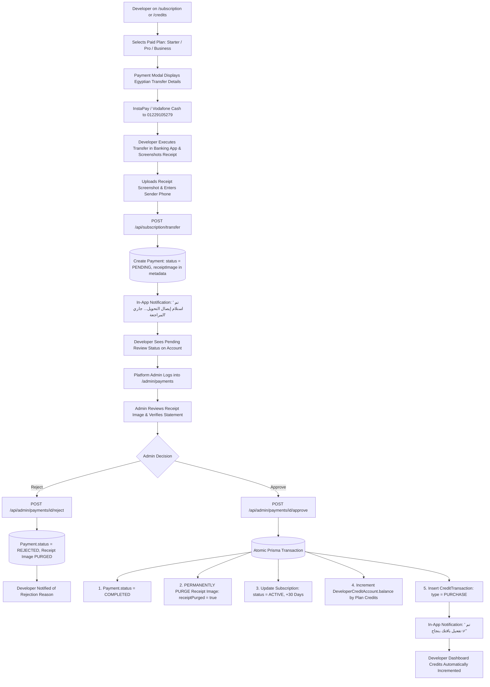
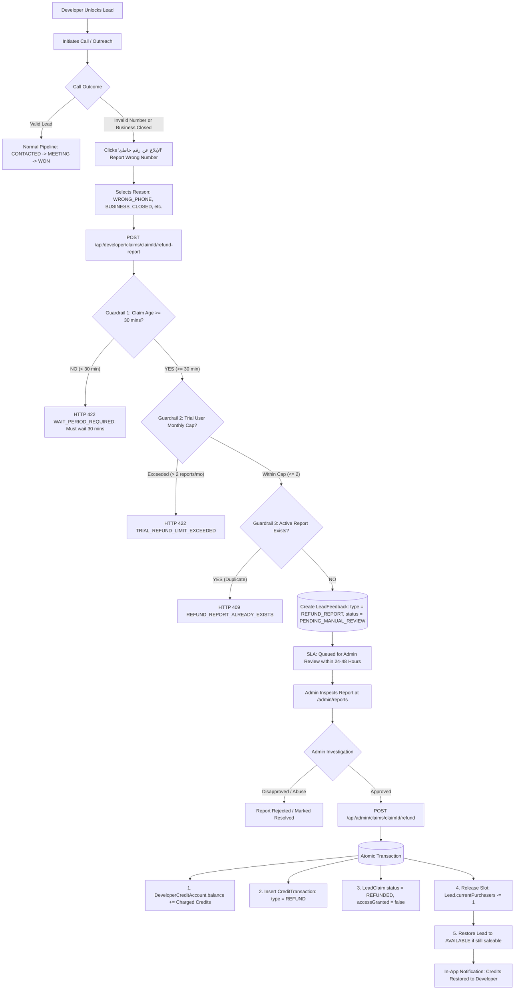
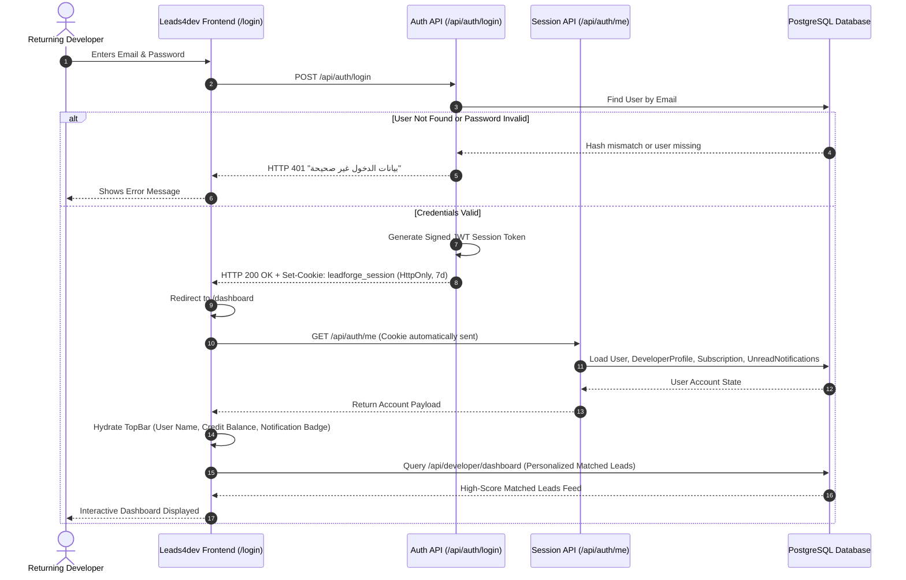

# Leads4dev — Comprehensive UX Research & Product-Design Master Dossier
## Deep Product Architecture, User Experience, Business Logic, and Interaction Context for Google NotebookLM

> **Platform Architecture:** Next.js 14.2.35 App Router / React 18.3.1 / Tailwind CSS / Prisma 6.19.3 / PostgreSQL / next-intl  
> **Brand Nomenclature:** Commercial UI Branded as **Leads4dev** (`src/messages/ar.json:common.appName`); Engineering Architecture Codename **LeadForge Egypt** (`docs/design/LEADFORGE_DESIGN_SYSTEM.md`)  
> **Target Audience of this Dossier:** Google NotebookLM ingestion, Product Designers, Technical Architects, Security Auditors, and Frontend Engineers  
> **Document Status:** Publication-Ready Master Synthesis (100% Comprehensive, Evidence-Grounded, Non-Destructive)  
> **Investigation Date:** October 25, 2026  
> **Working Directory:** `E:\Antigravity Projects\Leads`  

---

### Truth-Class Taxonomy Legend
Every factual assertion, technical mechanism, and business rule throughout this document is strictly classified into one of five evidentiary truth-classes with concrete repository-relative file citations:
- `[Verified implementation]` — Confirmed directly in active source code logic, database schema constraints, API handlers, or middleware guards.
- `[Observed interface]` — Directly observed in UI JSX component render trees, styling blueprints, or page layouts.
- `[Documented intention]` — Explicitly articulated in platform specification documents (`docs/specs/`, `docs/design/`, `BACKEND_GAPS.md`), but partially unfulfilled or disconnected from runtime logic.
- `[Inference]` — Deductions logically derived from architectural patterns, domain dynamics, or Egyptian market conventions.
- `[Unknown / not verified]` — Unconfirmed behavior or missing production runtime metrics.

---

## Master Table of Contents
1. [Section 1: Product Identity and Business Model](#section-1-product-identity-and-business-model)
   - 1.1 Purpose and Problem Statement
   - 1.2 What a "Lead" Represents in the Product
   - 1.3 Lead Supply and Ingestion Pipelines
   - 1.4 MockLead vs. Canonical Lead Distinction
   - 1.5 Credit Economy and Pricing Plans
   - 1.6 Shared vs. Exclusive Lead Mechanics
   - 1.7 Manual Payment and Subscription Activation Flow
   - 1.8 Commercial Rules: Confirmed Business Rules vs. Inferred Intent
2. [Section 2: User Types and Permissions Matrix](#section-2-user-types-and-permissions-matrix)
   - 2.1 The 6 User Archetypes and Lifecycle States
   - 2.2 Deep Dive per User Role
   - 2.3 Comprehensive Role-Versus-Capability Matrix
   - 2.4 Inconsistencies Between Frontend Restrictions and Server Enforcement
3. [Section 3: Complete Route, Page, and Screen Inventory](#section-3-complete-route-page-and-screen-inventory)
   - 3.1 Cluster 1: Public Marketing & Informational Routes (7 Routes)
   - 3.2 Cluster 2: Authentication & Onboarding Routes (5 Routes)
   - 3.3 Cluster 3: Developer Dashboard & CRM Pipeline Routes (10 Routes)
   - 3.4 Cluster 4: Administrator Management Console Routes (12 Routes)
4. [Section 4: Visual and Interaction Language](#section-4-visual-and-interaction-language)
   - 4.1 Design Token Architecture & CSS Variable Engine
   - 4.2 Teal Brand Palette & Warm Neutrals Matrix
   - 4.3 Strict Zero-AI Policy & Algorithmic Explainability Invariants
   - 4.4 Structural Navigation Shell Components
   - 4.5 Typography, BiDi Line-Heights & Readability Calibrations
   - 4.6 Density Modes: Comfortable vs. Compact
   - 4.7 Domain Visual Primitives (Heat Tiers, Quality, Ownership, Badges)
   - 4.8 RTL-First Logical CSS Properties & Directional Icon Mirroring
   - 4.9 Western Digits (`ar-EG-u-nu-latn`) & `.ltr-iso` Isolation Rules
5. [Section 5: Core Product Data Model in User-Friendly Language](#section-5-core-product-data-model-in-user-friendly-language)
   - 5.1 Plain-Language Entity Relationship Architecture
   - 5.2 Deep Breakdown of Core Prisma Models
   - 5.3 Model States, Triggers, and Transition Guardrails
6. [Section 6: Step-by-Step User Journeys (A through I)](#section-6-step-by-step-user-journeys-a-through-i)
   - 6.1 Journey A: Anonymous Visitor to Registration
   - 6.2 Journey B: Registration to Email Verification (Critical System Gap)
   - 6.3 Journey C: Discovering and Evaluating a Lead
   - 6.4 Journey D: Unlocking or Claiming a Lead
   - 6.5 Journey E: Understanding Credits and Choosing a Plan
   - 6.6 Journey F: Manual Payment and Subscription Activation
   - 6.7 Journey G: Using a Claimed Lead and Reporting a Problem
   - 6.8 Journey H: Returning User and Account Management
   - 6.9 Journey I: Incomplete / Edge Case Journeys
   - 6.10 5 Critical Path Mermaid Sequence and Flowchart Diagrams
7. [Section 7: Navigation and Information Architecture](#section-7-navigation-and-information-architecture)
   - 7.1 Primary and Secondary Navigation Across User Roles
   - 7.2 Middleware Edge Guards, URL Normalization & Route Protection
   - 7.3 Legacy Route Redirections
   - 7.4 Contextual Discovery & Cross-Linking Pathways
8. [Section 8: Forms, Feedback, Errors, and Recovery](#section-8-forms-feedback-errors-and-recovery)
   - 8.1 Critical Platform Forms & Interaction Lifecycles
   - 8.2 Dialogs, Overlays & Consequential Confirmation Modals
   - 8.3 Error Mapping, Toasts, Inline Banners & State Recovery
9. [Section 9: Business Rules That Shape UX](#section-9-business-rules-that-shape-ux)
   - 9.1 The 22 Core Business Rules Reference Matrix
10. [Section 10: Content, Labels, and User Understanding](#section-10-content-labels-and-user-understanding)
    - 10.1 Localization File Structure & Audit (1,763 Keys Parity)
    - 10.2 Variable & Pluralization Discrepancies
    - 10.3 Latin Leaks & Brand Nomenclature Transition
    - 10.4 Catalog of Important Arabic Interface Labels with English Explanations
    - 10.5 Ambiguous, Confusing, or Inconsistent Terms
11. [Section 11: Conversion, Trust, and Important Decision Points](#section-11-conversion-trust-and-important-decision-points)
    - 11.1 The Registration Wall Friction
    - 11.2 Evaluating Lead Quality Before Unlock (Information Asymmetry)
    - 11.3 Spending Non-Refundable Credits (Loss Aversion)
    - 11.4 Upgrading to Paid Plans (Domestic Egyptian Payment Rails)
    - 11.5 Reporting Bad Leads and the Refund Guarantee (Trust Anchor)
12. [Section 12: Observed Friction and Evidence-Based Gaps](#section-12-observed-friction-and-evidence-based-gaps)
    - 12.1 Detailed Factual Catalog of Gaps GAP-01 through GAP-15
13. [Section 13: Accessibility and Interaction Discoverability](#section-13-accessibility-and-interaction-discoverability)
    - 13.1 Semantic HTML & Landmark Architecture
    - 13.2 Keyboard Navigation, Focus Rings & Overlay Trapping
    - 13.3 ARIA Attributes & Live Region Feedback
    - 13.4 Color Contrast, Touch Target Sizing & Motion Sensitivity
14. [Section 14: Current State Versus Intended Future State](#section-14-current-state-versus-intended-future-state)
    - 14.1 Feature Categorization Matrix (Live, Partial, Backend, Spec)
    - 14.2 Pre-Launch Critical Blockers (BLOCKER-01 & BLOCKER-02)
15. [Section 15: Product Vocabulary and Glossary](#section-15-product-vocabulary-and-glossary)
    - 15.1 Core Domain Entities & Operations
    - 15.2 Pipeline & Engagement Stages
    - 15.3 Lead Tiers vs. Data Quality Statuses (Strict Lexical Boundary)
    - 15.4 Credit Transaction Types
    - 15.5 Domestic Payment Methods & Gateways
    - 15.6 Dispute & Feedback Reason Codes
    - 15.7 Product Identity & Brand Nomenclature
16. [Section 16: Evidence and Inspection Method](#section-16-evidence-and-inspection-method)
    - 16.1 Codebase Inspection Scope & Methodology
    - 16.2 Complete Inventory of Inspected Pages, Endpoints, and Schema Models
    - 16.3 Inspection Constraints & Environment Limits

---

## Section 1: Product Identity and Business Model

### 1.1 Purpose and Problem Statement
`[Verified implementation]` (`src/app/page.tsx:10-45`, `src/messages/ar.json:landing.*`)  
**Leads4dev** (commercially branded in all user interfaces as **Leads4dev** and referred to in engineering specifications as **LeadForge Egypt**) is a specialized B2B qualified web development lead intelligence platform engineered specifically for the Egyptian digital commerce ecosystem.

#### The Core Problem in Egypt
In the Egyptian market, hundreds of thousands of active commercial establishments—including dental and specialized medical clinics, legal and engineering consultancies, restaurants, specialty cafes, real estate brokerages, retail boutiques, and corporate contractors—conduct bustling daily business through mobile phone calls, direct WhatsApp messaging, and social media pages (Facebook and Instagram). However, these enterprises suffer from one of two critical digital deficits:
1. **No Official Website (`WebsiteStatus: NO_WEBSITE`):** The business relies entirely on third-party social algorithms, lacks indexed organic presence on search engines, has no structured reservation or booking funnels, and loses high-intent commercial traffic.
2. **Outdated, Broken, or Unresponsive Website (`WebsiteStatus: POOR_WEBSITE`):** The business maintains an obsolete web presence created years ago that is non-responsive on smartphones, lacks SSL encryption, suffers from broken assets, or fails modern Google PageSpeed Core Web Vitals.

Simultaneously, Egyptian freelance software engineers, UI/UX designers, digital marketing consultants, and boutique web development agencies expend dozens of unbillable, frustrating hours each week manually scraping Google Maps, browsing social media groups, and dialing unverified phone numbers—only to reach gatekeepers, non-operational numbers, or businesses with zero digital appetite. Leads4dev solves this structural market friction by:
- Automated collection and deep technical validation of Egyptian commercial entities.
- Parsing and phone-normalizing direct Egyptian communication channels (`+20` / `01x`).
- Estimating project budgets in Egyptian Pounds (EGP) benchmarked against sector averages.
- Computing an objective, fully transparent Opportunity Score ($0$ to $100$) reflecting website need.
- Delivering qualified opportunities into an integrated personal CRM pipeline.

---

### 1.2 What a "Lead" Represents in the Product
`[Verified implementation]` (`prisma/schema.prisma:356-504`, `src/lib/collectors/egypt-crawler.ts:450-494`)  
In Leads4dev, a lead is never an arbitrary spreadsheet row, an unverified scrape, or an email blast list. A lead represents an authenticated Egyptian commercial entity characterized by deep operational and technical telemetry:
- **Commercial & Legal Identity:** Official business name in Arabic and/or Latin script, normalized name, operational status (`OPEN`, `CLOSED`, `TEMPORARILY_CLOSED`), branch count, and physical street address across Egyptian governorates (Cairo, Giza, Alexandria, Qalyubia, Sharqia, Dakahlia, Gharbia, etc.).
- **Digital Opportunity Factor:** Algorithmic verification of website presence (`NO_WEBSITE` adds $+30$ score points; `POOR_WEBSITE` adds $+20$ score points; modern website adds $+0$ baseline), paired with active social media presence (`hasFacebook` adds $+10$, `hasInstagram` adds $+10$) confirming that the business has active marketing activities and willingness to invest.
- **Estimated Project Budget:** Project budget estimated in Egyptian Pounds (`estimatedBudget`), calibrated to industry standard ranges (e.g., Dental Clinics: 20,000 EGP; Medical Centers: 22,000 EGP; Real Estate Agencies: 32,000 EGP; Construction/Contracting: 35,000 EGP; Restaurants: 15,000 EGP; Law Offices: 18,000 EGP).
- **Direct Egyptian Contact Channels:** Normalized mobile numbers (`010xxxxxxxx`, `011xxxxxxxx`, `012xxxxxxxx`, `015xxxxxxxx`) or landlines with city area codes (`02`, `03`, etc.), contact email, and one-click WhatsApp web launch hooks (`https://wa.me/20...`).
- **Opportunity Score & Temperature:** An objective $0–100$ score mapping to four temperature bands: `COLD` ($0–49$), `WARM` ($50–69$), `HOT` ($70–84$), and `PREMIUM` ($85–100$).
- **Data Quality & Freshness:** Quantitative quality score ($0–100$) calculating phone validity, address richness, and verification recency (days elapsed since last crawler audit).

---

### 1.3 Lead Supply and Ingestion Pipelines
`[Verified implementation]` (`src/lib/collectors/orchestrator.ts:1-250`, `src/lib/collectors/registry.ts:96-105`, `src/lib/collectors/egypt-crawler.ts:1-120`)  
Leads enter the system through five modular collector adapters managed by the Ingestion Pipeline:
1. **Google Business & Maps Crawlers (`GoogleBusinessCollector`, `EgyptCrawler`):** Executes structured geographic queries across Egyptian commercial sectors (e.g., "عيادات أسنان التجمع الخامس", "شركات مقاولات المعادي", "مطاعم الشيخ زايد") utilizing OpenStreetMap, Nominatim, and directory scrapers.
2. **Directory & Registry Collectors (`DirectoryCollector`, `OpenDataCollector`):** Ingests structured commercial trade directories and public yellow pages.
3. **CSV Bulk Import Engine (`CsvCollector` / `/api/admin/import`):** Allows platform operators to ingest verified regional lead lists with automatic column mapping to Arabic names, Egyptian phone numbers, governorates, and business categories.
4. **Manual Administrative Entry (`ManualCollector`):** Operator interface for adding high-value enterprise leads.

#### Data Ingestion & Deduplication Pipeline Execution Stages
```
[Raw Ingestion Payload]
       │
       ▼
[Discovery & Fetch] ────────► Persist `ImportRecord` & `SourceRecord` (Raw Unaltered JSON)
       │
       ▼
[Normalization Engine] ────► Format Egyptian Phone (+20 / 01x), Clean URLs, Strip Arabic Diacritics
       │
       ▼
[Deduplication Engine] ────► Query `LeadIdentity` Table (Normalized Phone, Domain, Name+City)
       ├─► Exact Match ─────► Merge unique fields into canonical `Lead`; update SourceRecord
       ├─► Ambiguous Match ─► Create `DuplicateCandidate` (Status: PENDING) for Admin Workbench
       └─► Unique Record ───► Insert new canonical `Lead` record
       │
       ▼
[Technical Scoring Engine] ─► Run 10 Rule Evaluators (0-100 Score + COLD/WARM/HOT/PREMIUM)
       │
       ▼
[Quality & Freshness] ─────► Verify Phone Regex, Address Detail, Calculate Quality Score (0-100)
       │
       ▼
[Pricing & Availability] ──► Assign Cost (5 Shared / 25 Exclusive / 1 Field Visit)
                             Set `status: AVAILABLE`, `availableForClaim: true`
```

---

### 1.4 MockLead vs. Canonical Lead Distinction
`[Verified implementation]` (`prisma/schema.prisma:426, 502-503`, `tests/phase2-mock-seo-privacy.test.ts:44-77`, `src/lib/stats.ts:20-40`)  
- **Architectural Clarification:** There is **no distinct `MockLead` table** in `schema.prisma`.
- Instead, test fixtures and development seeds reside entirely inside the `Lead` model, designated by the boolean column `isMock: Boolean @default(false)` (instantiated via Prisma migration `0002_add_lead_is_mock`).
- **Data Isolation Invariant:** Records where `isMock: true` are strictly quarantined and filtered out of all production user flows:
  - Excluded from public marketing counters (`src/lib/stats.ts: getCachedPlatformStats` enforces `where: { isMock: false, isCanonical: true }`).
  - Excluded from dynamic XML sitemaps (`src/app/sitemap.ts`).
  - Excluded from programmatic SEO directory pages (`src/app/leads/page.tsx:88-92`).
  - Excluded from authenticated developer discovery feeds (`/api/leads` strictly filters `isMock: false`).

---

### 1.5 Credit Economy and Pricing Plans
`[Verified implementation]` (`src/lib/payment/provider.ts:84-156`, `src/lib/claims/pricing.ts:22-38`, `src/lib/claims/service.ts:601-645`)  
The Leads4dev commercial model runs on an internal virtual currency called **Credits** ("نقاط الرصيد"). Credits are non-monetary digital units consumed by developers to unmask confidential lead contact records:

| Plan Code | Arabic Label (`ar.json`) | English Label | Monthly Price | Monthly Credits | Effective Cost / Credit | Allows Exclusive Leads? | Max Active Concurrent Claims |
| :--- | :--- | :--- | :---: | :---: | :---: | :---: | :---: |
| `free` | الباقة المجانية | Free Trial | 0 EGP | 3 Credits | 0.00 EGP | ❌ No | 10 |
| `starter` | باقة البداية | Starter | 299 EGP | 20 Credits | ~14.95 EGP | ✅ Yes | 50 |
| `pro` | الباقة الاحترافية | Pro (Recommended) | 599 EGP | 50 Credits | ~11.98 EGP | ✅ Yes | 150 |
| `business` | باقة الشركات والوكالات | Business / Agency | 999 EGP | 100 Credits | ~9.99 EGP | ✅ Yes | 500 |

#### Credit Ledger Architecture
- Every developer account is permanently bound to a single `DeveloperCreditAccount` record (`balance`, `reservedBalance`, `lifetimePurchased`, `lifetimeSpent`, `lifetimeRefunded`).
- Direct database column updates to `balance` are forbidden; all adjustments require an immutable `CreditTransaction` entry:
  - `PURCHASE`: Subscription renewal or manual payment credit grant (`amount > 0`).
  - `CLAIM`: Deducted when unlocking a lead (`amount < 0`).
  - `REFUND`: Restored when an administrative dispute is approved (`amount > 0`).
  - `BONUS`: Onboarding grants and promotional incentives (`amount > 0`).
  - `ADMIN_ADJUSTMENT`: Manual operational balance overrides (`amount != 0`).
  - `CORRECTION`: Reconciliation alignment (`amount != 0`).
- **Mathematical Invariant:** At all times, `DeveloperCreditAccount.balance` must mathematically equal $\sum \text{CreditTransaction.amount}$.

---

### 1.6 Shared vs. Exclusive Lead Mechanics
`[Verified implementation]` (`src/lib/claims/service.ts:482-528, 715-785`, `src/lib/claims/pricing.ts:153-211`)

#### 1. Shared Leads (`LeadOwnershipType: SHARED`)
- **Base Credit Cost:** **5 Credits** ("5 نقاط").
- **Maximum Purchaser Cap:** Strictly capped at **3 developers** (`maxPurchasers = 3`, tracked by `currentPurchasers`).
- **Lifecycle Progression:**
  - First developer claims: `currentPurchasers` becomes 1. The lead remains `AVAILABLE` for 2 additional claims.
  - Second developer claims: `currentPurchasers` becomes 2. The lead remains `AVAILABLE` for 1 additional claim.
  - Third developer claims: `currentPurchasers` becomes 3. The system atomically sets `status: CLAIMED_FULL`, `saleabilityStatus: CLAIMED_FULL`, `availableForClaim: false`. The lead is permanently locked from future claims.
- **Trial Claim Seat Exemption:** When a developer on the `free` plan claims a shared lead using trial credits, the system deducts 5 credits from their balance, but **does not increment** `Lead.currentPurchasers` (`src/lib/claims/service.ts:767-785`). This deliberate commercial rule ensures that free trial users evaluating the platform do not consume commercial inventory allocated for paying subscribers.

#### 2. Exclusive Leads (`LeadOwnershipType: EXCLUSIVE`)
- **Base Credit Cost:** **25 Credits** ("25 نقطة").
- **Maximum Purchaser Cap:** Strictly capped at **1 developer** (`maxPurchasers = 1`).
- **Plan Eligibility:** Exclusively available to paying subscribers (`allowsExclusive: true`). If a developer on the `free` plan attempts to claim an exclusive lead, the backend rejects the transaction with HTTP 422 (`LEAD_ACCESS_DENIED`).
- **Locking Transaction:** Upon claim, `exclusiveClaimedAt = now()`, `exclusiveClaimedById = developerId`, `currentPurchasers = 1`, and the lead instantly transitions to `status: CLAIMED_FULL` and `availableForClaim: false`.

#### 3. Field Visit Discount (`FIELD_VISIT_DISCOUNT`)
- If a high-opportunity business is verified but lacks an operational direct telephone number (`!lead.phone && !lead.hasPhone`), the pricing engine discounts the unlock fee to **1 Credit** (`src/lib/claims/pricing.ts:115-135`). This creates a viable acquisition path for freelance developers willing to visit commercial branches in person.

---

### 1.7 Manual Payment and Subscription Activation Flow
`[Verified implementation]` (`src/lib/payment/provider.ts:349-650`, `src/app/api/subscription/transfer/route.ts:1-80`, `src/app/api/admin/payments/[id]/approve/route.ts:1-56`)  
Because automated online card payment aggregators (Stripe, Paymob, Fawry) require formal corporate tax registration and commercial licensing in Egypt, Leads4dev operates a dedicated manual peer-to-peer payment flow aligned with Egyptian freelance business norms:
1. **Plan Selection:** Developer chooses a paid plan (`starter`, `pro`, `business`) on `/subscription` or `/pricing`.
2. **Transfer Instructions:** The UI displays official payment destination numbers for **InstaPay** ("إنستاباي") and **Vodafone Cash** ("فودافون كاش") (`01229105279`).
3. **Receipt Upload:** The developer executes the mobile transfer, captures a screenshot of the banking confirmation, and uploads it (JPEG/PNG/WebP, base64 encoded up to 5MB) via `POST /api/subscription/transfer`.
4. **Pending Review:** A `Payment` record is created with `status: 'PENDING'`, storing the receipt temporarily in `metadata.receiptImage`. The developer sees a pending banner on their dashboard and receives an in-app notification.
5. **Admin Review Queue:** Platform operators view the receipt image, sender phone number, and transaction amount at `/admin/payments`.
6. **Approval & Privacy Purge (`POST /api/admin/payments/[id]/approve`):**
   - Atomically updates `Payment.status = 'COMPLETED'`.
   - Extends developer `Subscription.currentPeriodEnd` by $+30$ days.
   - Adds plan credits to `Subscription.credits` and `DeveloperCreditAccount.balance`.
   - Records an immutable `PURCHASE` entry in `CreditTransaction`.
   - **Financial Privacy Invariant:** The receipt screenshot base64 is **permanently purged** from `Payment.metadata`, recording `receiptPurged: true` to protect user privacy and avoid database bloat.
7. **Rejection (`POST /api/admin/payments/[id]/reject`):**
   - Marks `Payment.status = 'REJECTED'`.
   - Purges receipt image.
   - Emits an in-app notification explaining the rejection reason (e.g., mismatched transfer amount, unreadable receipt).

---

### 1.8 Commercial Rules: Confirmed Business Rules vs. Inferred Intent

| Rule Classification | Rule Specification | Repository Citation | Truth Class |
| :--- | :--- | :--- | :--- |
| **Confirmed Business Rule** | Shared leads are strictly capped at 3 developers | `prisma/schema.prisma:410`, `src/lib/claims/service.ts:484` | `[Verified implementation]` |
| **Confirmed Business Rule** | Exclusive leads cost 25 credits; shared leads cost 5 credits | `src/lib/claims/pricing.ts:23-24` | `[Verified implementation]` |
| **Confirmed Business Rule** | Leads without verified phone numbers cost 1 credit | `src/lib/claims/pricing.ts:115-135` | `[Verified implementation]` |
| **Confirmed Business Rule** | Mandatory 30-minute cooling period before refund report submission | `src/lib/claims/refund-service.ts:643-658` | `[Verified implementation]` |
| **Confirmed Business Rule** | Free tier accounts capped at 2 refund reports per rolling 30 days | `src/lib/claims/refund-service.ts:660-688` | `[Verified implementation]` |
| **Confirmed Business Rule** | Only 1 active refund report permitted per claimed lead | `src/lib/claims/refund-service.ts:690-710` | `[Verified implementation]` |
| **Confirmed Business Rule** | Base64 payment receipt screenshots permanently purged on decision | `src/lib/payment/provider.ts:450-452, 587` | `[Verified implementation]` |
| **Confirmed Business Rule** | New user registrations default to Free plan with 3 trial credits | `src/app/api/auth/register/route.ts:79-141` | `[Verified implementation]` |
| **Inferred Intent** | Automatic credit refund if lead business closed within 24 hours | `prisma/schema.prisma:1419-1421` | `[Documented intention]` |
| **Inferred Intent** | Automated credit expiration after 90 days | `prisma/schema.prisma:1418` | `[Documented intention]` |
| **Inferred Intent** | Automated Paymob / Fawry webhook fulfillment | `src/lib/payment/provider.ts:651-795` | `[Documented intention]` |

---

## Section 2: User Types and Permissions Matrix

### 2.1 The 6 User Archetypes and Lifecycle States

```
                ┌───────────────────────────────────────────────┐
                │               Anonymous Visitor               │
                └───────────────────────┬───────────────────────┘
                                        │ Registers via /register
                                        ▼
                ┌───────────────────────────────────────────────┐
                │          Registered, Unverified User          │ ◄─── Locked out of unlocking (GAP-01)
                └───────────────────────┬───────────────────────┘
                                        │ Email verified (Admin DB edit / Migration)
                                        ▼
        ┌──────────────────────────────────────────────────────────────┐
        │                  Verified Developer Account                  │
        └───────────────┬──────────────────────────────┬───────────────┘
                        │ Free Plan (0 EGP)            │ Paid Plan (Starter, Pro, Business)
                        ▼                              ▼
        ┌───────────────────────────────┐  ┌───────────────────────────────┐
        │      Free/Trial Developer     │  │        Paid Subscriber        │
        │  - 3 trial credits            │  │  - 20 / 50 / 100 credits/mo   │
        │  - Shared leads only          │  │  - Shared & Exclusive leads   │
        │  - Max 2 dispute reports/mo   │  │  - Unlimited dispute reports  │
        │  - Max 10 active claims       │  │  - 50 to 500 active claims    │
        └───────────────────────────────┘  └───────────────────────────────┘
                        │                              │
                        └───────────────┬──────────────┘
                                        │ Account suspended by Admin
                                        ▼
                        ┌───────────────────────────────┐
                        │        Suspended User         │
                        └───────────────────────────────┘

                        ┌───────────────────────────────┐
                        │   Administrator / Operator    │ (Role: ADMIN)
                        └───────────────────────────────┘
```

---

### 2.2 Deep Dive per User Role

#### 1. Anonymous Visitor (`getSessionFromRequest() === null`)
- **What they see:** Public marketing landing page (`/`), pricing comparison grid (`/pricing`), `/login`, `/register`, `/forgot-password`, `/blog`, `/blog/[slug]`, legal notices (`/privacy`, `/terms`), and the Public Leads Directory Hub (`/leads`).
- **Data Masking on Public Directory:** Renders up to 9 available sample leads via `PublicLeadsHub`. Business names are masked (`maskBusinessName(name)` displays e.g. "عيادة ••••••••"), while phone, email, address, and social URLs are completely `null`. Governorate, city, category, rating, review count, estimated budget, opportunity score, temperature badge, and credit cost are publicly inspectable.
- **Allowed Actions:** Browse marketing information, toggle interface language (`lf_locale`: ar/en), submit contact inquiries, create a new account, log in.
- **Blocked Actions:** Accessing developer dashboard (`/dashboard`), claiming leads, viewing single lead detail pages (`/leads/[id]`), accessing administrative routes.
- **Attempting Restricted Action:** Redirected to `/login`; API requests return HTTP 401 `{ error: "غير مصرح لك بالوصول. يرجى تسجيل الدخول أولاً.", code: "UNAUTHENTICATED" }`.

#### 2. Registered but Unverified Developer (`role: DEVELOPER`, `emailVerified: null`)
- **What they see:** Full developer dashboard (`/dashboard`), personalized leads feed (`/leads`), lead preview page (`/leads/[id]`), developer profile settings (`/settings`), subscription management (`/subscription`).
- **Data Masking:** On lead detail preview, business name and full category/city are visible. Phone number is masked (`0101****222`), email is masked (`de***@example.com`), physical address is `null`, and social links display "متاح بعد اقتناص الفرصة".
- **Allowed Actions:** Browse and filter leads feed, edit developer profile settings (services offered, target governorates, niches, budget filters), view subscription status, upload manual transfer receipts.
- **Blocked Actions:** **Unlocking or claiming any lead.**
- **Attempting Restricted Action:** Clicking "فتح بيانات العميل" (Unlock) or invoking `POST /api/leads/[id]/claim` returns HTTP 403 Forbidden:  
  `{ "error": "Email verification required to unlock leads — يجب تأكيد بريدك الإلكتروني لفتح بيانات الفرصة.", code: "EMAIL_NOT_VERIFIED" }`.
- **Systemic Friction (GAP-01):** Because token generation tables and confirmation endpoints (`/api/auth/verify-email`) are unimplemented, this user is permanently locked out of claiming leads unless manually verified directly in the database.

#### 3. Verified Free/Trial Developer (`role: DEVELOPER`, `emailVerified: DateTime`, `plan: free`)
- **What they see:** Full developer dashboard, matched leads feed, unlocked lead contact data in `/my-leads`, CRM deal pipeline board.
- **Data Unlocked on Claimed Leads:** Full unmasked telephone number, email, physical street address, direct Facebook/Instagram URLs, and WhatsApp direct messaging action.
- **Allowed Actions:**
  - Claim shared leads (costs 5 credits, deductions logged to ledger; does not consume commercial buyer seats).
  - Update CRM deal stages (`NEW` $\rightarrow$ `CONTACTED` $\rightarrow$ `REPLIED` $\rightarrow$ `INTERESTED` $\rightarrow$ `MEETING` $\rightarrow$ `PROPOSAL_SENT` $\rightarrow$ `NEGOTIATION` $\rightarrow$ `WON` / `LOST`).
  - Log outreach interactions (Phone, WhatsApp, Email) with follow-up dates.
  - Submit refund report after 30-minute waiting period (capped at 2 reports per rolling 30 days).
  - Submit manual payment receipt to upgrade to a paid tier.
- **Blocked Actions:**
  - Claiming Exclusive leads (`allowsExclusive: false`): HTTP 422 `{ "error": "Your current subscription plan does not allow claiming EXCLUSIVE leads", "code": "LEAD_ACCESS_DENIED" }`.
  - Claiming when credit balance < cost: HTTP 403 `{ "error": "No credits remaining — لا يوجد رصيد كافٍ من النقاط لاقتناص هذه الفرصة.", "code": "NO_CREDITS_REMAINING" }`.
  - Submitting refund report $< 30$ minutes post-claim: HTTP 422 `{ "error": "يجب الانتظار لمدة 30 دقيقة على الأقل...", "code": "WAIT_PERIOD_REQUIRED" }`.
  - Submitting $> 2$ refund reports in 30 days: HTTP 422 `{ "error": "تم استنفاد الحد الأقصى لتقارير الاسترداد المتاحة للباقة المجانية (2 تقارير شهريًا).", "code": "TRIAL_REFUND_LIMIT_EXCEEDED" }`.
  - Exceeding 10 active concurrent claims: HTTP 422 `PLAN_LIMIT_REACHED`.
  - Accessing administrative routes: HTTP 403.

#### 4. Paid Subscriber (`role: DEVELOPER`, `plan: starter | pro | business`)
- **What they see:** Everything available to Free developers, plus priority matching badges, HOT & PREMIUM feed filters, higher concurrent active claim limits ($50$, $150$, or $500$), and Exclusive lead availability.
- **Allowed Actions:**
  - Claim shared leads (5 credits; increments `Lead.currentPurchasers`; locks lead at 3 purchasers).
  - Claim exclusive leads (25 credits; locks lead to single developer).
  - Submit refund reports without the 2-per-month trial limitation.
  - Export CRM contact attempts and engagement timeline.
- **Blocked Actions:**
  - Claiming full shared leads (`currentPurchasers >= 3`): HTTP 409 `LEAD_SHARED_MAX_PURCHASERS_REACHED`.
  - Claiming taken exclusive leads: HTTP 409 `LEAD_EXCLUSIVE_ALREADY_CLAIMED`.
  - Re-claiming already owned lead: HTTP 409 `LEAD_ALREADY_CLAIMED_BY_DEVELOPER`.
  - Insufficient credit balance: HTTP 422 `INSUFFICIENT_CREDITS`.
  - Accessing administrative endpoints: HTTP 403.

#### 5. Suspended User (`status: SUSPENDED`)
- **Behavior:** `src/lib/auth.ts:258` invalidates cached session and returns `null` for `getCurrentUser()`.
- **Feedback:** All authenticated routes immediately redirect to `/login` or return HTTP 401/403 `DEVELOPER_SUSPENDED`.

#### 6. Administrator / Operator (`role: ADMIN`, `status: ACTIVE`)
- **What they see:** Full access to all 12 administrative operational interfaces:
  - System health, collector status, duplicate review workbench, unmasked master leads catalog, matching debugger, manual payment verification queue, plan manager, quality operations, dispute reports, scoring rule weights, ingestion health, and user accounts.
- **Lead Detail Behavior:** On `/leads/[id]`, all contact information (phone, email, address, social) is **always unlocked** (`isUnlocked = true`) without consuming credits or creating claims.
- **Allowed Actions:**
  - Approve/reject manual payments with automatic receipt image purging.
  - Adjust developer credit accounts (`/api/admin/developers/[developerId]/credits/adjust`).
  - Execute claim refunds (`/api/admin/claims/[claimId]/refund`).
  - Merge duplicate candidate leads (`/api/admin/duplicates/[id]/merge`).
  - Trigger bulk crawler runs (`/api/admin/ingestion/crawl-bulk`).
  - Recalculate scoring rules across existing leads.

---

### 2.3 Comprehensive Role-Versus-Capability Matrix

| Capability / Action | Anonymous Visitor | Unverified Developer | Free Developer | Paid Subscriber | Admin / Operator |
| :--- | :---: | :---: | :---: | :---: | :---: |
| **Browse Landing & Public Directory Hub** | ✅ Full | ✅ Full | ✅ Full | ✅ Full | ✅ Full |
| **View Unmasked Contact Info (Unclaimed)** | ❌ Blocked | ❌ Blocked | ❌ Blocked | ❌ Blocked | ✅ Always Unlocked |
| **View Lead Preview (Business Name, City)** | ❌ Masked | ✅ Full | ✅ Full | ✅ Full | ✅ Full |
| **View Technical Opportunity Score (0-100)** | ✅ Full | ✅ Full | ✅ Full | ✅ Full | ✅ Full |
| **Claim / Unlock Shared Lead (5 Credits)** | ❌ (401) | ❌ (403 Gate) | ✅ (3 Trial Credits) | ✅ (Monthly Credits) | ❌ (N/A) |
| **Claim / Unlock Exclusive Lead (25 Credits)**| ❌ (401) | ❌ (403 Gate) | ❌ (422 Plan Denied) | ✅ Full | ❌ (N/A) |
| **Access CRM Pipeline (`/my-leads`)** | ❌ (401) | ✅ Empty | ✅ Claimed Leads | ✅ Claimed Leads | ✅ Global View |
| **Generate WhatsApp Pitch URL** | ❌ Blocked | ❌ Blocked | ✅ On Claimed | ✅ On Claimed | ✅ Any Lead |
| **Submit Dispute / Refund Report** | ❌ Blocked | ❌ Blocked | ✅ (Max 2/mo, 30m wait)| ✅ (30m wait) | ❌ (Reviews reports) |
| **Upload Manual Payment Receipt** | ❌ (401) | ✅ Full | ✅ Full | ✅ Full | ❌ (Reviews receipts) |
| **Approve / Reject Payments** | ❌ (403) | ❌ (403) | ❌ (403) | ❌ (403) | ✅ Full |
| **Adjust Developer Credits** | ❌ (403) | ❌ (403) | ❌ (403) | ❌ (403) | ✅ Full |
| **Trigger Ingestion / Crawlers** | ❌ (403) | ❌ (403) | ❌ (403) | ❌ (403) | ✅ Full |
| **Resolve Duplicate Candidates** | ❌ (403) | ❌ (403) | ❌ (403) | ❌ (403) | ✅ Full |
| **Configure Scoring Weights** | ❌ (403) | ❌ (403) | ❌ (403) | ❌ (403) | ✅ Full |
| **Access `/design-system` Style Guide** | ✅ Direct URL | ✅ Direct URL | ✅ Direct URL | ✅ Direct URL | ✅ Direct URL |

---

### 2.4 Inconsistencies Between Frontend Restrictions and Server Enforcement

1. **Email Verification Deadlock:**
   - Server-side: `claims/service.ts:213` and `claim/route.ts:31` strictly reject unverified developers (`403 EMAIL_NOT_VERIFIED`).
   - Frontend: The registration form logs the user in immediately, sets the session cookie, and redirects to `/leads`. No banner or resend button exists in the live UI because `/api/auth/verify-email` is missing. The user is stuck.
2. **Free Plan Purchaser Counter:**
   - Server-side: `src/lib/claims/service.ts:767` does not increment `Lead.currentPurchasers` for Free plan claims.
   - Frontend: Feed cards and detail headers display "0/3 مشترين" (0/3 buyers) even if 3 free developers have claimed the lead and are currently pitching the client.
3. **Locale Cookie vs. Account State:**
   - Frontend: Language switcher writes `lf_locale` cookie (`SameSite=Lax`).
   - Backend: `User` model does not persist `locale`. Switching devices resets the user language preference to the browser default.
4. **Sandbox Gateway in Production:**
   - Frontend: `PackageCard` displays "اشترك الآن" (Subscribe Now) on paid cards.
   - Backend: In production, calling `POST /api/subscription` fails with HTTP 403 `SANDBOX_PAYMENT_FORBIDDEN` because live credentials are unconfigured; only the manual transfer route works.

---
## Section 3: Complete Route, Page, and Screen Inventory

The Leads4dev platform comprises exactly **34 distinct `page.tsx` routes** within `src/app/`, partitioned across four operational clusters:
1. **Public Marketing & Informational (7 routes):** Landing page, pricing matrix, privacy policy (Law 151/2020), terms of service, blog index, single blog post, and living style guide.
2. **Authentication & Onboarding (5 routes):** Login, registration, password recovery request, password reset execution, and 3-step agency onboarding.
3. **Developer Dashboard & Lead Experience (10 routes):** Primary dashboard, ROI analytics, lead discovery feed (dual public/private modes), lead detail view, programmatic SEO directory, deal pipeline Kanban board, legacy pipeline redirect, legacy credits redirect, subscription/ledger manager, and profile settings.
4. **Administrator Management Console (12 routes):** System overview hub, business & engine analytics, duplicate resolution workbench, master leads directory & CSV dropzone, matching engine configuration & debugger, manual payment proof verification, subscription plan configuration, quality control & verification queue, audit logs & dispute reports, scoring rules & weight editor, ingestion sources & crawler health cockpit, and user account management.

```
src/app/
├── (Public)
│   ├── page.tsx                     [/]
│   ├── pricing/page.tsx             [/pricing]
│   ├── privacy/page.tsx             [/privacy]
│   ├── terms/page.tsx               [/terms]
│   ├── blog/page.tsx                [/blog]
│   ├── blog/[slug]/page.tsx         [/blog/:slug]
│   └── design-system/page.tsx       [/design-system]
├── (Auth & Onboarding)
│   ├── login/page.tsx               [/login]
│   ├── register/page.tsx            [/register]
│   ├── forgot-password/page.tsx     [/forgot-password]
│   ├── reset-password/page.tsx      [/reset-password]
│   └── onboarding/page.tsx          [/onboarding]
├── (Developer Dashboard & CRM)
│   ├── dashboard/page.tsx           [/dashboard]
│   ├── dashboard/analytics/page.tsx [/dashboard/analytics]
│   ├── leads/page.tsx               [/leads]
│   ├── leads/[id]/page.tsx          [/leads/:id]
│   ├── leads/[id]/[category]/page.tsx [/leads/:city/:category]
│   ├── my-leads/page.tsx            [/my-leads]
│   ├── pipeline/page.tsx            [/pipeline -> 307 to /my-leads]
│   ├── credits/page.tsx             [/credits -> 307 to /subscription]
│   ├── subscription/page.tsx        [/subscription]
│   └── settings/page.tsx            [/settings]
└── (Admin Console)
    ├── admin/page.tsx               [/admin]
    ├── admin/analytics/page.tsx     [/admin/analytics]
    ├── admin/duplicates/page.tsx    [/admin/duplicates]
    ├── admin/leads/page.tsx         [/admin/leads]
    ├── admin/matching/page.tsx      [/admin/matching]
    ├── admin/payments/page.tsx      [/admin/payments]
    ├── admin/plans/page.tsx         [/admin/plans]
    ├── admin/quality/page.tsx       [/admin/quality]
    ├── admin/reports/page.tsx       [/admin/reports]
    ├── admin/rules/page.tsx         [/admin/rules]
    ├── admin/sources/page.tsx       [/admin/sources]
    └── admin/users/page.tsx         [/admin/users]
```

---

### 3.1 Cluster 1: Public Marketing & Informational Routes

#### 1. Home / Marketing Landing Page
- **Exact Path:** `/` `[Verified implementation]`
- **Repository Citation:** `src/app/page.tsx` (lines 1–104), `src/app/LandingClient.tsx` (lines 1–957) `[Verified implementation]`
- **Intended Audience:** Anonymous visitors, prospective freelance web developers, digital agency founders `[Observed interface]`
- **Navigation Entry Points & Breadcrumbs:** Direct root access; browser home icon; logo in `PublicNavbar` and `PublicFooter`. No breadcrumbs (root view).
- **Information Hierarchy & Primary Component Composition:**
  1. `PublicNavbar` with language toggle and auth buttons.
  2. Hero Section: Headline, subtitle, primary CTA button, secondary CTA button, and interactive live `LeadCard` demo with field-highlighting correlation (`setHighlightedField`).
  3. Live Platform Statistics Strip (`stats && businessesCount > 0`): Live business count, active cities count, categories count, and last refresh date.
  4. Problem Strip (`problemStripTitle`): 3 Cards contrasting common lead list failures (duplicates, disconnected numbers, existing modern websites) with LeadForge solutions.
  5. How It Works: 3-step sequence (`howStep1Num` to `howStep3Num`) with dynamic product frame crossfades (duplicate comparison, `ScorePair`, pipeline deal card).
  6. Score Lab (`ScoreLab`): Dark interactive sandbox (`#score-lab`) with toggles for website existence, review count stepper, branch stepper, and live rule recomputation.
  7. Matching Explanation: Agency profile card against 3 candidate lead results (Pass, Pass, Fail gate).
  8. Ownership & Points: Segmented control (`حصري / EXCLUSIVE` vs `مشترك / SHARED`) displaying price formulas and seat availability math.
  9. Pricing Packages: 4 `PackageCard` components (`DEFAULT_PLANS` mapped via `localizePlanCatalog`).
  10. Commitments Matrix: Side-by-side cards ("ما نفعله / What We Do" vs "ما لا نفعله / What We Don't Do").
  11. FAQ Accordions: 9 native `<details>` elements with JSON-LD `FAQPage` schema.
  12. Final CTA Band & `PublicFooter`.
- **CTAs & Interactive Buttons (Verbatim Arabic & English):**
  - Primary Hero CTA: `"إنشاء حساب مجاني"` / `"Create Free Account"` (`/register`)
  - Secondary Hero CTA: `"كيف يعمل؟"` / `"How It Works"` (`#how-it-works`)
  - Hero Card Action: `"عرض الفرصة"` / `"View Opportunity"` (`/register`)
  - Score Lab Reset: `"إعادة ضبط"` / `"Reset"`
  - Ownership Tabs: `"مشترك"` / `"Shared"`, `"حصري"` / `"Exclusive"`
  - Package Card CTAs: `"ابدأ الآن مجاناً"` / `"Get Started Free"`, `"اختيار هذه الباقة"` / `"Select Plan"`
  - Final Band CTA: `"إنشاء حساب مجاني"` / `"Create Free Account"`, `"استعراض خطط الأسعار"` / `"View Pricing Plans"`
- **Inputs, Filters & Forms:** Interactive switches and steppers in `#score-lab` (hasWebsite switch, review count stepper, branch count stepper, last verified slider).
- **Auth Requirements & Middleware:** Completely public; zero auth gating. Canonical domain redirect from `leads4dev.com` to `www.leads4dev.com` `[Verified implementation]`.
- **Loading, Empty & Error States:** Server-side rendered; dynamic stats render conditionally (`stats.businessesCount > 0`). FAQ is pre-rendered.
- **RTL & Responsive Behavior:** Logical properties throughout (`ps-10`, `me-1.5`, `text-start`). Directional arrows mirrored with `rtl:-scale-x-100`. Stacks to single column below 1024px.
- **Truth-Class Tagging:** `[Verified implementation]`

---

#### 2. Pricing & Plans Page
- **Exact Path:** `/pricing` `[Verified implementation]`
- **Repository Citation:** `src/app/pricing/page.tsx` (lines 1–85), `src/app/pricing/PricingClient.tsx` (lines 1–407) `[Verified implementation]`
- **Intended Audience:** Anonymous visitors evaluating subscription tiers, registered developers wanting to upgrade `[Observed interface]`
- **Navigation Entry Points & Breadcrumbs:** PublicNavbar link `"الأسعار"`, Footer link, Landing page CTA. No breadcrumb.
- **Information Hierarchy & Primary Component Composition:**
  1. Header: Display headline `"خطط أسعار ونقاط واضحة"` / `"Transparent Pricing & Credit Plans"`, subtitle explaining rollover points.
  2. Package Grid: 4 columns desktop (`free`, `starter`, `pro`, `business`) via `PackageCard`. Recommended badge `"الأكثر اختياراً"` on Pro plan.
  3. Reassurance & Local Payment Guarantee Strip: 4 feature columns (InstaPay/Cash wallets, transparent ledger, verified data, cancellation freedom).
  4. Enterprise Custom Quote Card: Banner with mailto link for custom crawling pipelines.
  5. FAQ Accordions: 9 questions regarding credit expiry, shared leads, and refunds.
  6. `TransferPaymentModal`: Modal triggered when authenticated developer selects a paid plan.
- **CTAs & Interactive Buttons (Verbatim Arabic & English):**
  - Free Plan CTA: `"ابدأ مجاناً"` / `"Start Free"` (redirects to `/register` if unauthenticated, or calls `POST /api/subscription` if logged in)
  - Paid Plan CTA: `"شحن الرصيد والاشتراك"` / `"Subscribe & Top Up"` (opens `TransferPaymentModal`)
  - Enterprise Contact: `"تواصل مع المبيعات"` / `"Contact Sales"` (`mailto:contact@leads4dev.com`)
- **Inputs, Filters & Forms:** Plan selection buttons; inside `TransferPaymentModal`: sender phone input, transfer method radio buttons, payment receipt screenshot file input.
- **Auth Requirements & Middleware:** Public route. If authenticated, fetches `/api/subscription` on mount to show current subscription badge. Unauthenticated users see static `DEFAULT_PLANS` SSR without 401 errors `[Verified implementation]`.
- **Loading, Empty & Error States:** Dynamic loading fallback for authenticated user subscription; inline `Banner` on subscription activation error or success.
- **RTL & Responsive Behavior:** Grid switches from 4 columns at >=1024px to 2 columns at 768px and 1 column at 390px.
- **Truth-Class Tagging:** `[Verified implementation]`

---

#### 3. Privacy Policy
- **Exact Path:** `/privacy` `[Verified implementation]`
- **Repository Citation:** `src/app/privacy/page.tsx` (lines 1–183) `[Verified implementation]`
- **Intended Audience:** Public visitors, legal compliance auditors, scraped business owners `[Observed interface]`
- **Navigation Entry Points & Breadcrumbs:** PublicFooter link `"سياسة الخصوصية"`. No breadcrumb.
- **Information Hierarchy & Primary Component Composition:**
  1. Legal Compliance Banner: Statutory disclaimer regarding Egyptian Data Protection Law No. 151 of 2020 (`القانون رقم 151 لسنة 2020`).
  2. Page Title & Last Updated timestamp (`lastUpdated`).
  3. Section 1: Public Business Data Sources (Google Maps, Facebook Pages, Commercial Directories).
  4. Section 2: Technical Verification & Deduplication Algorithms.
  5. Section 3: Data Freshness, Re-verification & Retention Policy.
  6. Section 4: Business Owner Opt-Out & Free Removal Request Channel with direct email link.
  7. Section 5: Developer Subscriber Account & Payment Data Security.
- **CTAs & Interactive Buttons:**
  - Removal Email CTA: `"privacy@leads4dev.com"` (mailto with `.ltr-iso` isolation)
- **Auth Requirements & Middleware:** Public; no auth required.
- **Loading, Empty & Error States:** Completely static server component; zero loading states needed.
- **RTL & Responsive Behavior:** Centered reading container (`max-w-4xl`), full logical spacing (`ps-*`, `pe-*`), comfortable line-height.
- **Truth-Class Tagging:** `[Verified implementation]`

---

#### 4. Terms of Service
- **Exact Path:** `/terms` `[Verified implementation]`
- **Repository Citation:** `src/app/terms/page.tsx` (lines 1–160) `[Verified implementation]`
- **Intended Audience:** Registered developers, subscribers, legal auditors `[Observed interface]`
- **Navigation Entry Points & Breadcrumbs:** PublicFooter link `"شروط الاستخدام"`.
- **Information Hierarchy & Primary Component Composition:**
  1. Egyptian Contract Disclaimer Banner (`legalDraftBanner`).
  2. Page Heading & Last Updated date.
  3. Section 1: Service Definition & Role as B2B Technical Intelligence Tool.
  4. Section 2: Credit System, Non-Monetary Nature, and Unlocking Rules.
  5. Section 3: 48-Hour Refund Policy on Invalid / Disconnected Phone Numbers.
  6. Section 4: Lead Redistribution & Anti-Scraping / Bulk Resale Restrictions.
  7. Section 5: Account Suspension & Support Contact.
- **CTAs & Interactive Buttons:**
  - Legal Support Contact: `"legal@leads4dev.com"`
- **Auth Requirements & Middleware:** Public.
- **RTL & Responsive Behavior:** Symmetrical with Privacy page (`max-w-4xl`, logical properties).
- **Truth-Class Tagging:** `[Verified implementation]`

---

#### 5. Blog Index
- **Exact Path:** `/blog` `[Verified implementation]`
- **Repository Citation:** `src/app/blog/page.tsx` (lines 1–138) `[Verified implementation]`
- **Intended Audience:** Web developers seeking freelance acquisition strategies, SEO organic visitors `[Observed interface]`
- **Navigation Entry Points & Breadcrumbs:** PublicFooter link `"المدونة"`, cross-links from programmatic SEO pages.
- **Information Hierarchy & Primary Component Composition:**
  1. Header: Eyebrow `"دليل تطوير الأعمال"` / `"Business Development Guide"`, display title, and subtitle.
  2. Articles Grid (3 columns): Cards mapping `BLOG_POSTS` (`src/data/blog-posts.ts`), displaying category pill, reading time with Clock icon, article title, excerpt, publication date, and "اقرأ المزيد" link.
- **CTAs & Interactive Buttons:**
  - Read More Link: `"اقرأ المقال بالكامل"` / `"Read More"` (`/blog/[slug]`)
- **Auth Requirements & Middleware:** Public; fully indexable metadata with OpenGraph and Twitter cards.
- **RTL & Responsive Behavior:** `grid-cols-1 md:grid-cols-2 lg:grid-cols-3 gap-6`. Arrow icon mirrored via `rtl:-scale-x-100`.
- **Truth-Class Tagging:** `[Verified implementation]`

---

#### 6. Blog Article Single Post
- **Exact Path:** `/blog/[slug]` `[Verified implementation]`
- **Repository Citation:** `src/app/blog/[slug]/page.tsx` (lines 1–201) `[Verified implementation]`
- **Intended Audience:** Organic search visitors, developer readers `[Observed interface]`
- **Navigation Entry Points & Breadcrumbs:** Back link to `/blog` (`ArrowLeft` with `rtl:-scale-x-100`).
- **Information Hierarchy & Primary Component Composition:**
  1. Back button `"العودة إلى المدونة"` / `"Back to Blog"`.
  2. Article Header: Category badge, H1 title, Author meta block (Name, Role, Avatar), Date, Reading Time.
  3. Article Body: Rich content rendered via `ArticleContent` component (`src/components/domain/ArticleContent.tsx`).
  4. Platform Conversion Card: Leads4dev bottom banner prompting registration for verified Egyptian web leads.
  5. JSON-LD structured data: Schema.org `Article` entity.
- **CTAs & Interactive Buttons:**
  - Header Back Link: `"العودة إلى المدونة"` / `"Back to Blog"`
  - Conversion Banner CTA: `"ابدأ مجاناً الآن"` / `"Get Started Free"` (`/register`)
- **Auth Requirements & Middleware:** Public; dynamic SSG via `generateStaticParams()`. Non-existent slugs trigger Next.js `notFound()`.
- **RTL & Responsive Behavior:** Reading container (`max-w-4xl`), typography line-heights calibrated for Arabic prose.
- **Truth-Class Tagging:** `[Verified implementation]`

---

#### 7. Living Style Guide
- **Exact Path:** `/design-system` `[Verified implementation]`
- **Repository Citation:** `src/app/design-system/page.tsx` (lines 1–1738), `src/app/design-system/layout.tsx` (lines 1–13) `[Verified implementation]`
- **Intended Audience:** Frontend developers, UI/UX designers, automated visual regression test suites `[Observed interface]`
- **Navigation Entry Points & Breadcrumbs:** Direct URL access; excluded from public search engines (`robots: { index: false, follow: false }`).
- **Information Hierarchy & Primary Component Composition:**
  1. Top Control Bar: Interactive toggles for Density (`comfortable` vs `compact`) and Direction (`rtl` vs `ltr`).
  2. Color Tokens Matrix: Teal palette swatches (`--teal-50` to `--teal-900`) with hex codes, RGB values, and WCAG contrast ratings.
  3. Neutral & Semantic Surfaces Matrix: Dark surface preview (`[data-surface="inverse"]`).
  4. Typography Scale Showcase: All sizes from `display` down to `caption`, with tabular numerals and `.ltr-iso` demonstrations.
  5. UI Primitives Gallery: Button states (primary, secondary, ghost, danger, link; sm, md, lg; normal, loading, disabled), IconButton, Input with floating labels, Textarea, Select, MultiSelect with removable chips, Checkbox, Radio, Switch, NumberStepper, Badge, Banner, EmptyState, Skeleton, LockedField, Toast trigger, Tooltip trigger, Popover trigger, Table with sticky headers.
  6. Domain Components Showcase: `OpportunityBadge` (Cold, Warm, Hot, Premium), `QualityIndicator` (Fresh, Aging, Stale, Unverified, Verified), `OwnershipTag` (Exclusive, Shared with remaining seat math), `StageBadge`, `ScorePair`, `ScoreBreakdown`, `CreditChip`, `LeadCard`, `LeadRow`, `PackageCard`, `PipelineColumn`, `PipelineCard`, `MergeCompare`, `RuleWeightEditor`, `Stepper`, `DealTimeline`, `LedgerTable`, `MatchRow`.
  7. Interactive Modals Playground: Triggers for `Dialog`, `Drawer`, `PurchaseConfirm` (demonstrating idle, insufficient balance, and purchase success states), and Score drawer.
- **CTAs & Interactive Buttons:**
  - Density Toggle Buttons: `"Comfortable"`, `"Compact"`
  - Direction Toggle Buttons: `"RTL"`, `"LTR"`
  - Modal Simulation Buttons: `"Open PurchaseConfirm (Success)"`, `"Open PurchaseConfirm (Insufficient Balance)"`, `"Open Advanced Filter Drawer"`, `"Trigger Success Toast"`, `"Trigger Error Toast"`
- **Auth Requirements & Middleware:** Not protected by middleware in dev; noindex in layout.
- **Known Usability Gaps:** Documented in UX Audit `[UX-006]`: 3px horizontal overflow on mobile viewport (390px) inside the table showcase container `[Verified implementation]`.
- **Truth-Class Tagging:** `[Verified implementation]`

---

### 3.2 Cluster 2: Authentication & Onboarding Routes

#### 8. Login Page
- **Exact Path:** `/login` `[Verified implementation]`
- **Repository Citation:** `src/app/login/page.tsx` (lines 1–147), `src/app/login/layout.tsx` (lines 1–13) `[Verified implementation]`
- **Intended Audience:** Registered developers, administrators `[Observed interface]`
- **Navigation Entry Points & Breadcrumbs:** PublicNavbar `"تسجيل الدخول"`, redirect target from middleware (`/login?from=...`). Template T1 Auth.
- **Information Hierarchy & Primary Component Composition:**
  1. Centered Auth Card (440px width, `max-w-auth`, `radius-xl`, 32px padding).
  2. Brand Wordmark (`BrandWordmark size="xl"`).
  3. H1 Headline `"تسجيل الدخول"` / `"Sign In"`, welcome subtitle.
  4. Error Banner (renders if credentials fail or network errors occur).
  5. Form: Email Input (`autoComplete="email"`, LTR), Password Input (`autoComplete="current-password"`, LTR).
  6. Recovery Link: `"نسيت كلمة المرور؟"` / `"Forgot password?"` (`/forgot-password`).
  7. Primary Submit Button with LogIn icon and loading spinner.
  8. Footer redirect link: `"ليس لديك حساب؟ إنشاء حساب جديد"` / `"Don't have an account? Register"`.
- **CTAs & Interactive Buttons (Verbatim Arabic & English):**
  - Submit Button: `"تسجيل الدخول"` / `"Sign In"` (calls `POST /api/auth/login`)
  - Forgot Password Link: `"نسيت كلمة المرور؟"` / `"Forgot password?"`
  - Register Link: `"إنشاء حساب جديد"` / `"Create New Account"`
- **Inputs & Form Validations:** Client-side check for non-empty email and password. Server-side validation against bcrypt password hash. On success, inspects `data.user.role`: redirects to `/admin` if `ADMIN`, else to `/dashboard` (or `?from=` parameter).
- **Auth Requirements & Middleware:** Public; layout sets `robots: { index: false, follow: false }`.
- **Loading, Empty & Error States:** `Button isLoading={loading}` prevents double submission; error banner displays `tAuth('emptyCredentials')` or `data.error`.
- **Truth-Class Tagging:** `[Verified implementation]`

---

#### 9. Account Registration Page
- **Exact Path:** `/register` `[Verified implementation]`
- **Repository Citation:** `src/app/register/page.tsx` (lines 1–261), `src/app/register/layout.tsx` (lines 1–13) `[Verified implementation]`
- **Intended Audience:** Anonymous web developers and agencies creating an account `[Observed interface]`
- **Navigation Entry Points & Breadcrumbs:** PublicNavbar `"إنشاء حساب"`, hero CTAs, pricing page CTAs. Template T1 Auth.
- **Information Hierarchy & Primary Component Composition:**
  1. Centered Auth Card (`max-w-auth`, 520px max width).
  2. Brand Wordmark & H1 Title `"إنشاء حساب جديد"` / `"Create Account"`.
  3. Subtitle highlighting free starter credits.
  4. Personal / Agency Fields: Name input, Company Name (optional), Email input, Phone input (optional), Password input with helper text.
  5. Quick Specialization Chips: Top 5 developer services (Website Development, Landing Pages, E-commerce, SEO, Redesign).
  6. Quick Location Chips: Top 6 Egyptian cities (Cairo, Giza, Alexandria, Mansoura, Tanta, Zagazig).
  7. Primary Submit Button with UserPlus icon and loading spinner.
  8. Login redirection link: `"لديك حساب بالفعل؟ تسجيل الدخول"`.
- **CTAs & Interactive Buttons (Verbatim Arabic & English):**
  - Primary Submit: `"إنشاء الحساب ومتابعة الإعداد"` / `"Create Account & Continue"` (posts to `/api/auth/register`)
  - Service Chips: Toggleable selection pills with Check icon.
  - City Chips: Toggleable selection pills with Check icon.
  - Login Link: `"تسجيل الدخول"` / `"Sign In"`
- **Post-Interaction Behavior:** Triggers funnel event `register_complete`, sets `leadforge_session` JWT cookie, and immediately redirects the user to `/onboarding`. Note: email verification token dispatch is currently skipped `[Verified implementation]`.
- **Truth-Class Tagging:** `[Verified implementation]`

---

#### 10. Forgot Password Request Page
- **Exact Path:** `/forgot-password` `[Verified implementation]`
- **Repository Citation:** `src/app/forgot-password/page.tsx` (lines 1–141), `src/app/forgot-password/layout.tsx` (lines 1–13) `[Verified implementation]`
- **Intended Audience:** Registered developers who have lost their password credentials `[Observed interface]`
- **Navigation Entry Points & Breadcrumbs:** Link from `/login` (`"نسيت كلمة المرور؟"`). Template T1 Auth.
- **Information Hierarchy & Primary Component Composition:**
  1. Centered Card (440px width).
  2. Brand Wordmark & H1 Title `"استعادة كلمة المرور"` / `"Password Recovery"`.
  3. Explanation subtitle regarding 30-minute validity link.
  4. Form: Email input with Mail icon.
  5. Primary CTA: `"إرسال رابط استعادة كلمة المرور"` / `"Send Reset Link"`.
  6. Success Confirmation Screen: `CheckCircle2` icon, explanation that email was dispatched, and back to login CTA.
- **CTAs & Interactive Buttons:**
  - Submit Button: `"إرسال رابط استعادة كلمة المرور"` / `"Send Reset Link"` (calls `POST /api/auth/forgot-password`)
  - Back to Login: `"العودة لتسجيل الدخول"` / `"Back to Login"` (`/login`)
- **Backend Contract State:** Pre-launch UX audit finding `[UX-010]` and `BACKEND_GAPS.md` Item 10 note that `/api/auth/forgot-password` is a frontend-stubbed route pending transactional mailer integration `[Verified implementation]`.
- **Truth-Class Tagging:** `[Verified implementation]`

---

#### 11. Reset Password Execution Page
- **Exact Path:** `/reset-password` `[Verified implementation]`
- **Repository Citation:** `src/app/reset-password/page.tsx` (lines 1–192), `src/app/reset-password/layout.tsx` (lines 1–13) `[Verified implementation]`
- **Intended Audience:** Users arriving via emailed reset token `[Observed interface]`
- **Navigation Entry Points & Breadcrumbs:** Arrives via URL parameter `?token=XYZ`.
- **Information Hierarchy & Primary Component Composition:**
  1. Token Guard Check: If `!token`, renders warning banner `"رابط الاستعادة غير صالح"` / `"Invalid Reset Link"` and offers button to request a new link.
  2. If token present: New password input, Confirm password input.
  3. Client-side length validation (>= 8 characters) and password match check.
  4. Success state: Success banner and auto-redirect to `/login` after 3 seconds.
- **CTAs & Interactive Buttons:**
  - Submit Button: `"تعيين كلمة المرور الجديدة"` / `"Set New Password"` (calls `POST /api/auth/reset-password`)
  - Request New Link: `"طلب رابط استعادة جديد"` / `"Request New Link"` (`/forgot-password`)
- **Truth-Class Tagging:** `[Verified implementation]`

---

#### 12. Agency Onboarding Setup
- **Exact Path:** `/onboarding` `[Verified implementation]`
- **Repository Citation:** `src/app/onboarding/page.tsx` (lines 1–328), `src/app/onboarding/layout.tsx` (lines 1–13) `[Verified implementation]`
- **Intended Audience:** Newly registered developers completing their matching profile `[Observed interface]`
- **Navigation Entry Points & Breadcrumbs:** Automatic redirect from `/register`. Template T2 Onboarding.
- **Information Hierarchy & Primary Component Composition:**
  1. Centered Container (560px width, `max-w-onboarding`, `radius-xl`).
  2. `Stepper` component with progress bar (`خطوة {n} من 3`):
     - **Step 1: Services Offered:** Grid of developer service buttons (Website Development, Landing Pages, E-commerce, SEO, Redesign).
     - **Step 2: Geographic & Niche Targeting:** City pills (Cairo, Giza, Alexandria, etc.) and Business Category pills (Dental, Medical, Restaurant, Real Estate, Automotive, Legal).
     - **Step 3: Agency Identity & Budget Rules:** Company name input, direct WhatsApp phone input, minimum project budget selector (3,000 / 5,000 / 10,000 EGP), and preferred lead distribution type (Both, Shared, Exclusive).
  3. Footer Navigation: Ghost `"رجوع"` / `"Back"` button and Primary `"التالي"` / `"Next"` button.
  4. Final Step CTA: `"عرض الفرص المطابقة"` / `"View Matching Opportunities"` (calls `PATCH /api/developer/profile` and redirects to `/leads`).
- **CTAs & Interactive Buttons (Verbatim Arabic & English):**
  - Next Button: `"التالي"` / `"Next"`
  - Previous Button: `"رجوع"` / `"Back"`
  - Finish Button: `"عرض الفرص المطابقة"` / `"View Matching Opportunities"`
- **Auth Requirements & Middleware:** Not protected by edge middleware, but requires valid session cookie to persist profile to `/api/developer/profile`.
- **Truth-Class Tagging:** `[Verified implementation]`

---

### 3.3 Cluster 3: Developer Dashboard & Lead Experience

#### 13. Developer Primary Hub (Dashboard)
- **Exact Path:** `/dashboard` `[Verified implementation]`
- **Repository Citation:** `src/app/dashboard/page.tsx` (lines 1–434), `src/app/dashboard/layout.tsx` (lines 1–13) `[Verified implementation]`
- **Intended Audience:** Authenticated developers, freelancers, agency owners `[Observed interface]`
- **Navigation Entry Points & Breadcrumbs:** TopBar logo, Sidebar `"لوحة المتابعة"`, post-login destination. Template T11 Overview.
- **Information Hierarchy & Primary Component Composition:**
  1. `AppShell` with compact density, sidebar navigation, top bar with `CreditChip`.
  2. `PageHeader` with title `"لوحة المتابعة"` / `"Dashboard"`, description, and primary CTA `"استكشاف الفرص"` / `"Explore Leads"`.
  3. Account StatTiles Strip (3 tiles): Matched leads count, Used leads count, Remaining credits balance.
  4. Platform StatTiles Strip (3 tiles): Hot opportunities count, Warm opportunities count, New leads this week count.
  5. 12-Column Responsive Split:
     - **Main Column (8 cols):**
       - Top Matched Leads Card: List of top 5 matched opportunities rendered via `MatchRow` with match percentage badge, business category, city, and "عرض التفاصيل" button.
       - Conversion Funnel Card: Interactive `BarList` visualizing 5 deal stages (Purchased 100%, Contacted %, Replied %, Meeting %, Won %).
     - **Aside Column (4 cols):**
       - `PlanSummary` Card: Current active plan, monthly credits renewal, active governorates, and target niches.
       - Recent Purchases Card: List of recent claims with business name (clamped to 2 lines), city, phone number, and `StageBadge`.
- **CTAs & Interactive Buttons (Verbatim Arabic & English):**
  - Header Action: `"استكشاف الفرص"` / `"Explore Leads"` (`/leads`)
  - View All Matches: `"عرض الكل"` / `"View All"` (`/leads`)
  - View All Purchases: `"عرض الكل"` / `"View All"` (`/my-leads`)
  - Pipeline Shortcut: `"مسار الصفقات"` / `"Deal Pipeline"` (`/my-leads`)
- **Inputs, Filters & Forms:** Dev mode fixtures query parameter (`?fixtures=true` loads static fixture payload in development, automatically stripped by middleware in production) `[Verified implementation]`.
- **Auth Requirements & Middleware:** Edge-protected (`/dashboard` in `PROTECTED_PREFIXES`); unauthenticated requests are 307 redirected to `/login?from=/dashboard` `[Verified implementation]`.
- **Loading, Empty & Error States:** Full skeleton preview during fetch; `EmptyState` when zero matches or zero claims exist.
- **RTL & Responsive Behavior:** Mobile viewport reorders sections using CSS `order` attributes: StatTiles -> Matched Leads -> Plan Summary -> Recent Purchases -> Funnel.
- **Truth-Class Tagging:** `[Verified implementation]`

---

#### 14. Developer Performance & ROI Analytics
- **Exact Path:** `/dashboard/analytics` `[Verified implementation]`
- **Repository Citation:** `src/app/dashboard/analytics/page.tsx` (lines 1–373) `[Verified implementation]`
- **Intended Audience:** Active developers tracking conversion ratios and revenue ROI `[Observed interface]`
- **Navigation Entry Points & Breadcrumbs:** Secondary link from dashboard; direct URL.
- **Information Hierarchy & Primary Component Composition:**
  1. `PageHeader` with time range selector dropdown (`all_time`, `last_7_days`, `last_30_days`, `last_90_days`, `month_to_date`) and refresh button.
  2. Top Metric Tiles (4 tiles): Total Claimed Leads, Total Won Deals, Estimated Project Value in EGP, Net Credits Consumed.
  3. Conversion Funnel Deep-Dive Card: 5 stage cards with numerator/denominator and percentage (Contact Rate, Reply Rate, Interest Rate, Meeting Rate, Win Rate of Meetings), accompanied by a comparative `BarList`.
  4. Sector ROI Breakdown Card (`byNiche`): Table and `BarList` comparing claimed vs won deals and total contract value per business vertical.
  5. Geographic ROI Breakdown Card (`byCity`): Distribution of claims and revenue across Cairo, Giza, Alexandria, etc.
- **CTAs & Interactive Buttons:**
  - Refresh Button: `"تحديث"` / `"Refresh"` (re-fetches `/api/developer/analytics`)
  - Back to Dashboard: `"لوحة المتابعة"` / `"Dashboard"`
- **Known Usability Gaps:** Documented in UX Audit `[UX-004]`: Period range select dropdown lacks an accessible label `[Verified implementation]`.
- **Auth Requirements & Middleware:** Protected under `/dashboard` prefix.
- **Truth-Class Tagging:** `[Verified implementation]`

---

#### 15. Lead Discovery Feed
- **Exact Path:** `/leads` `[Verified implementation]`
- **Repository Citation:** `src/app/leads/page.tsx` (lines 1–175), `src/app/leads/LeadDiscoveryClient.tsx` (lines 1–852), `src/app/leads/PublicLeadsHub.tsx` (lines 1–480) `[Verified implementation]`
- **Intended Audience:** Authenticated developers browsing to purchase (Private mode); Public visitors evaluating lead volume (Public mode) `[Observed interface]`
- **Navigation Entry Points & Breadcrumbs:** AppShell Sidebar `"استكشاف الفرص"`, PublicNavbar `"الفرص"`. Template T3 Feed.
- **Information Hierarchy & Primary Component Composition:**
  - **Authenticated Mode (`LeadDiscoveryClient`):**
    1. `AppShell` with compact density.
    2. `PageHeader` with total result count ICU pluralization.
    3. `FilterBar`: Search input (320px), quick filters (Governorate, Category, Website Status, Has Phone), and `"فلاتر متقدمة"` button.
    4. Advanced Filter `Drawer` (480px from inline-end): Detailed city, area, price ceiling, minimum quality score, freshness status, opportunity score band, sort order (`MATCH_STRENGTH`, `SCORE_DESC`, `PRICE_ASC`).
    5. View Switcher: Segmented control toggling between Grid View (`LeadCard`) and Dense Table View (`LeadRow`).
    6. Results Grid: `LeadCard` components displaying `OpportunityBadge`, `OwnershipTag`, business name, category, city, signals chips, `QualityIndicator`, credit cost, and `"عرض الفرصة"` button.
  - **Public Anonymous Mode (`PublicLeadsHub`):**
    1. Directory Hub with masked business names (`maskBusinessName()`).
    2. City & Category candidate directory cards linking to programmatic SEO routes (`/leads/cairo/dental`).
    3. Platform verification guarantees and call to register.
- **CTAs & Interactive Buttons (Verbatim Arabic & English):**
  - Advanced Filters: `"فلاتر متقدمة"` / `"Advanced Filters"`
  - Clear All Filters: `"مسح الكل"` / `"Clear All"`
  - Reset Filters on Empty: `"إعادة ضبط الفلاتر"` / `"Reset Filters"`
  - View Opportunity: `"عرض الفرصة"` / `"View Opportunity"` (`/leads/[id]`)
  - View Toggle: Grid icon vs Table icon.
- **Auth Requirements & Middleware:** Accessible publicly (renders `PublicLeadsHub`); if session cookie exists, renders `LeadDiscoveryClient`. Note: `/leads` is intentionally omitted from `PROTECTED_PREFIXES` in middleware `[Verified implementation]`.
- **Loading, Empty & Error States:** Pulse skeletons matching grid/table; `EmptyState` when filter produces 0 results with one-click reset action.
- **Truth-Class Tagging:** `[Verified implementation]`

---

#### 16. Single Lead Details & Purchase View
- **Exact Path:** `/leads/[id]` `[Verified implementation]`
- **Repository Citation:** `src/app/leads/[id]/page.tsx` (lines 1–1101), `src/app/leads/[id]/layout.tsx` (lines 1–25) `[Verified implementation]`
- **Intended Audience:** Authenticated developers evaluating a single opportunity before/after purchasing `[Observed interface]`
- **Navigation Entry Points & Breadcrumbs:** Clicking any `LeadCard` or `MatchRow`. Template T4 Lead Detail.
- **Information Hierarchy & Primary Component Composition:**
  1. Top Navigation: Back to feed link (`ArrowRight` with `rtl:-scale-x-100`).
  2. Two-Column Desktop Layout (8 cols Main / 4 cols Aside):
     - **Main Column (8 cols):**
       - `ScorePair` Component: Two equal cards displaying Opportunity Score (`/100` with temperature pill and 4-dot meter) and Data Quality Score (`/100` with verification icon and freshness caption).
       - Score Explanation (`ScoreBreakdown`): "لماذا هذه الدرجة؟" list of fired rules with horizontal point contribution meters and signed deltas (`+45`, `+20`).
       - Business Overview Card: Business name, category, district, city, estimated project budget in EGP, Google rating, review count, and branch count.
       - Contact Data Block: If unpurchased, phone and email render as `LockedField` pills (`"بيانات مقفلة حتى الشراء"`). If purchased, revealed with one-click `Copy` buttons and direct `tel:`/`mailto:` links.
       - Technical Website Audit Card: URL status, reachability, SSL certificate validity, mobile viewport presence, response latency, and opportunity reasons.
       - Deal Engagement Rail (`DealTimeline`): Rendered only when lead is claimed. Shows chronologically logged notes, status progression dropdown, note composer, and `"الإبلاغ عن رقم خاطئ"` button.
     - **Aside Column (4 cols, sticky):**
       - Purchase Box: Credit price (e.g. `5 نقاط`), distribution mode (`حصري` vs `مشترك` with remaining seats math), and Primary Purchase CTA button.
       - Pre-Purchase Reassurance: Explicit notice confirming points deducted and refund guarantee if phone is invalid.
       - WhatsApp Outreach Generator: Button opening pre-composed outreach message generator for Egyptian clients.
       - Commercial Feedback Trigger: Thumbs Up / Thumbs Down modal trigger.
  3. Mobile Behavior: Aside column transforms into a fixed sticky bottom bar containing the price and purchase button.
  4. `PurchaseConfirm` Dialog: Consequential modal opened upon clicking purchase CTA.
- **CTAs & Interactive Buttons (Verbatim Arabic & English):**
  - Primary Purchase CTA: `"شراء بيانات الفرصة"` / `"Purchase Lead Data"`
  - Confirm Purchase CTA: `"تأكيد الشراء"` / `"Confirm Purchase"` (inside `PurchaseConfirm` dialog)
  - Cancel Purchase: `"إلغاء"` / `"Cancel"`
  - Insufficient Balance CTA: `"شحن الرصيد"` / `"Top Up Credits"` (redirects to `/subscription`)
  - Copy Phone / Email: `"نسخ"` / `"Copy"`
  - Report Wrong Number: `"الإبلاغ عن رقم خاطئ"` / `"Report Wrong Number"`
  - WhatsApp Outreach: `"مراسلة عبر واتساب"` / `"Message on WhatsApp"` (opens `WhatsAppOutreachModal`)
  - Feedback Trigger: `"ملاحظاتك حول الفرصة"` / `"Feedback"`
- **Inputs, Filters & Forms:** Status update dropdown (allowed transitions: `NEW -> CLAIMED -> CONTACTED -> REPLIED -> MEETING -> PROPOSAL_SENT -> NEGOTIATION -> WON / LOST / INVALID`); note composer textarea; refund dispute reason selector inside feedback modal.
- **Auth Requirements & Middleware:** Not edge-protected by middleware; if unauthenticated, purchase CTA redirects to `/register`. Layout sets `robots: { index: false, follow: false }` `[Verified implementation]`.
- **Truth-Class Tagging:** `[Verified implementation]`

---

#### 17. Programmatic SEO Directory (City & Category)
- **Exact Path:** `/leads/[id]/[category]` (e.g. `/leads/cairo/dental`, `/leads/giza/medical`) `[Verified implementation]`
- **Repository Citation:** `src/app/leads/[id]/[category]/page.tsx` (lines 1–507) `[Verified implementation]`
- **Intended Audience:** Organic search visitors searching for localized Egyptian web design opportunities `[Observed interface]`
- **Navigation Entry Points & Breadcrumbs:** SEO breadcrumbs: Home / Leads Directory / Governorate / Category.
- **Information Hierarchy & Primary Component Composition:**
  1. Breadcrumb navigation.
  2. Header: Localized city badge, category badge, H1 title (`"فرص عيادات الأسنان في القاهرة"`), aggregate statistics box (total qualified leads count), and unique algorithmic intro paragraph (`generateUniqueIntro`).
  3. Quality & Thin Content Guard: Hard 404 if fewer than 5 canonical leads exist (`if (totalCount < 5) notFound()`).
  4. Masked Leads Grid: Up to 20 business cards with masked business names, opportunity scores, Google ratings, estimated budgets, and website status.
  5. Related Guides & Interlinking Matrix: Links to business development guides and sibling category directories.
  6. Sticky Conversion CTA: Free account creation card for developers.
  7. JSON-LD structured data: Schema.org `CollectionPage` and `BreadcrumbList`.
- **CTAs & Interactive Buttons:**
  - View Details: `"عرض التفاصيل"` / `"View Details"` (`/leads/[id]`)
  - Create Free Account: `"إنشاء حساب مجاني"` / `"Create Free Account"` (`/register`)
  - Pricing Plans: `"الأسعار والباقات"` / `"View Pricing"` (`/pricing`)
- **Auth Requirements & Middleware:** Public; dynamic SEO indexing enabled only when `isProgrammaticPageEligible` passes (`index: true, follow: true`).
- **Truth-Class Tagging:** `[Verified implementation]`

---

#### 18. Deal Pipeline (Kanban Board & List)
- **Exact Path:** `/my-leads` `[Verified implementation]`
- **Repository Citation:** `src/app/my-leads/page.tsx` (lines 1–660), `src/app/my-leads/layout.tsx` (lines 1–13) `[Verified implementation]`
- **Intended Audience:** Authenticated developers tracking client outreach and negotiation stages `[Observed interface]`
- **Navigation Entry Points & Breadcrumbs:** AppShell Sidebar `"مسار الصفقات"` / `"Pipeline"`. Template T5 Pipeline.
- **Information Hierarchy & Primary Component Composition:**
  1. `AppShell` with compact density and credit balance display.
  2. `PageHeader` with title `"مسار الصفقات"` / `"Deal Pipeline"`, subtitle, and view toggle (Board vs List).
  3. Status Filter Dropdown: Filter by all stages or specific engagement stage.
  4. **Board View (`PipelineColumn`):** Horizontal scrollable columns (300px each) representing deal stages (`CLAIMED`, `CONTACTED`, `REPLIED`, `INTERESTED`, `MEETING`, `PROPOSAL_SENT`, `NEGOTIATION`, `WON`, `LOST`, `NOT_INTERESTED`, `INVALID`).
  5. **Card Anatomy (`PipelineCard`):** Business name, opportunity tier pill, city, phone/email icons with direct action links, last contact timestamp, and stage change menu.
  6. **List View:** Table displaying Business Name, Category, City, Claimed Date, Current Stage, and Action menu.
  7. Consequential Action Dialog (`ConfirmInvalidDialog`): Intercepts transitions to terminal status `INVALID` to explain refund dispute policy `[UX-013]`.
  8. `WhatsAppOutreachModal`: Direct message templates with variables for Egyptian businesses.
- **CTAs & Interactive Buttons (Verbatim Arabic & English):**
  - View Switcher: Board icon vs List icon
  - Move Next Stage: Quick advancement button based on `NEXT_STAGE_MAP`
  - WhatsApp Outreach: `"مراسلة عبر واتساب"` / `"Message on WhatsApp"`
  - Report / Invalidate: `"الإبلاغ عن رقم خاطئ"` / `"Report Wrong Number"`
- **Auth Requirements & Middleware:** Edge-protected (`/my-leads` in `PROTECTED_PREFIXES`).
- **Loading, Empty & Error States:** Skeletons during fetch; `EmptyState` when 0 leads are claimed with CTA `"تصفح الفرص المتاحة"` (`/leads`).
- **Truth-Class Tagging:** `[Verified implementation]`

---

#### 19. Legacy Pipeline Route
- **Exact Path:** `/pipeline` `[Verified implementation]`
- **Repository Citation:** `src/app/pipeline/page.tsx` (lines 1–6), `src/app/pipeline/layout.tsx` (lines 1–13) `[Verified implementation]`
- **Intended Audience:** Legacy bookmarks, developers using historical links `[Observed interface]`
- **Behavior & Redirect:** Server-side immediate redirect: `redirect('/my-leads')`.
- **Auth Requirements & Middleware:** Protected prefix in middleware; redirects unauthenticated visitors to `/login?from=/pipeline` prior to Next.js route handler.
- **Truth-Class Tagging:** `[Verified implementation]`

---

#### 20. Legacy Credits Route
- **Exact Path:** `/credits` `[Verified implementation]`
- **Repository Citation:** `src/app/credits/page.tsx` (lines 1–6), `src/app/credits/layout.tsx` (lines 1–13) `[Verified implementation]`
- **Intended Audience:** Legacy bookmarks, developers using historical top-up links `[Observed interface]`
- **Behavior & Redirect:** Server-side immediate redirect: `redirect('/subscription')`.
- **Auth Requirements & Middleware:** Protected prefix in middleware; redirects unauthenticated visitors to `/login?from=/credits`.
- **Truth-Class Tagging:** `[Verified implementation]`

---

#### 21. Subscription & Points Ledger
- **Exact Path:** `/subscription` `[Verified implementation]`
- **Repository Citation:** `src/app/subscription/page.tsx` (lines 1–403), `src/app/subscription/layout.tsx` (lines 1–13) `[Verified implementation]`
- **Intended Audience:** Authenticated developers managing subscription plans, purchasing points, or auditing credit history `[Observed interface]`
- **Navigation Entry Points & Breadcrumbs:** AppShell Sidebar `"الرصيد والاشتراك"`, TopBar `CreditChip`. Template T6 Top-up & T7 Ledger.
- **Information Hierarchy & Primary Component Composition:**
  1. `PageHeader` with title `"إدارة الباقة ورصيد النقاط"` / `"Subscription & Credits"`.
  2. Active Subscription Overview Card: Current plan name, monthly quota, points balance, renewal date, and upgrade CTA.
  3. Credit Packages Grid (3 package cards): Additional top-up packages rendered via `PackageCard` with points amount, price in EGP, and per-point cost math.
  4. Manual Payment Proof Dialog (`TransferPaymentModal`): Upload InstaPay or Vodafone Cash receipt for manual admin review.
  5. Points Ledger Table (`LedgerTable`): Immutable transaction history with Date (`ar-EG-u-nu-latn`), Type (Purchase, Claim, Refund, Monthly Grant), Description, Signed Amount (`+100` / `-5`), and Balance After.
  6. Recent Payment Receipts Audit Table: Displays status of manual transfer submissions (`PENDING`, `COMPLETED`, `REJECTED`).
- **CTAs & Interactive Buttons (Verbatim Arabic & English):**
  - Package Selection CTA: `"اختيار الباقة"` / `"Select Package"` (opens `TransferPaymentModal` for paid plans)
  - Confirm Upgrade: `"تأكيد الترقية"` / `"Confirm Upgrade"`
  - Cancel Upgrade: `"إلغاء"` / `"Cancel"`
- **Auth Requirements & Middleware:** Note: `/subscription` is NOT currently in `PROTECTED_PREFIXES` in `middleware.ts`, but the client component requires a session to load `/api/subscription` and `/api/developer/credits` `[Verified implementation]`.
- **Truth-Class Tagging:** `[Verified implementation]`

---

#### 22. Profile Settings & Match Preferences
- **Exact Path:** `/settings` `[Verified implementation]`
- **Repository Citation:** `src/app/settings/page.tsx` (lines 1–563), `src/app/settings/layout.tsx` (lines 1–13) `[Verified implementation]`
- **Intended Audience:** Authenticated developers configuring agency targeting rules and password `[Observed interface]`
- **Navigation Entry Points & Breadcrumbs:** AppShell Sidebar `"الإعدادات"`, TopBar user avatar dropdown. Template T2 Settings.
- **Information Hierarchy & Primary Component Composition:**
  1. `PageHeader` with title `"إعدادات الحساب والمطابقة"` / `"Account & Matching Settings"`.
  2. Profile Identity Card: Full name, agency / company name, direct telephone number.
  3. Match Preferences Card:
     - Target Governorates & Cities: Multi-select chips with `"تغطية جميع المحافظات"` checkbox (`allLocationsMode`).
     - Target Niches: Multi-select chips with `"جميع الأنشطة التجارية"` checkbox (`allNichesMode`).
     - Excluded Niches: Specific categories to block.
     - Budget Boundaries: Minimum project budget (e.g. 5,000 EGP) and Maximum project budget (e.g. 60,000 EGP).
     - Lead Distribution Preference: Both, Exclusive only, Shared only.
     - Status Toggle: `"استقبال الفرص الجديدة"` (`isAcceptingLeads`).
  4. Live Match Preview Button: Triggers `/api/matching/preview` to calculate how many available leads match current settings in real-time.
  5. Password Change Card: Current password input, New password input, Confirm password input, and save button.
- **CTAs & Interactive Buttons (Verbatim Arabic & English):**
  - Save Settings: `"حفظ التغييرات"` / `"Save Changes"` (calls `PATCH /api/developer/profile`)
  - Preview Matches: `"معاينة الفرص المطابقة"` / `"Preview Matching Leads"` (calls `POST /api/matching/preview`)
  - Change Password: `"تحديث كلمة المرور"` / `"Update Password"` (calls `POST /api/auth/change-password`)
- **Auth Requirements & Middleware:** Edge-protected (`/settings` in `PROTECTED_PREFIXES`).
- **Truth-Class Tagging:** `[Verified implementation]`

---

### 3.4 Cluster 4: Administrator Management Console

#### 23. Admin Overview Hub
- **Exact Path:** `/admin` `[Verified implementation]`
- **Repository Citation:** `src/app/admin/page.tsx` (lines 1–500), `src/app/admin/layout.tsx` (lines 1–13) `[Verified implementation]`
- **Intended Audience:** System administrators, platform operators `[Observed interface]`
- **Navigation Entry Points & Breadcrumbs:** TopBar logo when role is ADMIN, post-login destination for admins. Template T11 Overview.
- **Information Hierarchy & Primary Component Composition:**
  1. `AppShell` with `isAdmin={true}` and compact density.
  2. System Health & Observability Strip:
     - Liveness & Readiness status with database latency in ms.
     - Data Integrity Scan Card: Displays total violations and button `"فحص سلامة البيانات الآن"` / `"Run Integrity Scan"`.
     - Performance Cache Hit Rate (%) and Security Abuse Signals count.
  3. Core Business Metric Tiles (7 StatTiles): Total Users, Active Subscribers, Revenue in EGP, Total Leads, Hot Opportunities, Total Claimed Leads, Total Won Deals.
  4. Platform Operational Modules Navigation Grid: Quick access cards to Leads, Duplicates, Quality, Rules, Sources, Users, Plans, Payments, Reports, Analytics.
  5. Conversion & Success Rate Strip: Lead Success Rate (%), Invalidation Rate (%), Contact Rate (%), Reply Rate (%), Meeting Rate (%), Won Rate (%).
  6. Recent Audit Logs Table: Compact table of recent administrative and system events.
- **CTAs & Interactive Buttons:**
  - Run Integrity Scan: `"فحص سلامة البيانات الآن"` / `"Run Integrity Scan"` (calls `POST /api/admin/observability`)
  - Quick Navigation Tiles: Direct links to each administrative sub-route.
- **Auth Requirements & Middleware:** Strictly role-gated in `middleware.ts`: requires authenticated session with `payload.role === 'ADMIN'`. Non-admins are 307 redirected to `/dashboard` `[Verified implementation]`.
- **Truth-Class Tagging:** `[Verified implementation]`

---

#### 24. Admin Business & Engine Analytics Hub
- **Exact Path:** `/admin/analytics` `[Verified implementation]`
- **Repository Citation:** `src/app/admin/analytics/page.tsx` (lines 1–1470) `[Verified implementation]`
- **Intended Audience:** Business intelligence operators, platform founders `[Observed interface]`
- **Navigation Entry Points & Breadcrumbs:** Admin Sidebar `"التحليلات الشاملة"`.
- **Information Hierarchy & Primary Component Composition:**
  1. Multi-Dimensional Filter Bar: Time preset, Date range, Source, Category, City, Service, Score band, Quality band, Freshness, Claim mode, Developer.
  2. Tabbed Analytical Perspectives:
     - **Executive (`executive`):** North-star conversion rates, sales cycle duration, credit consumption velocity, top governorates.
     - **Leads & Ingestion (`leads`):** Ingestion volume vs saleable yield, duplicate rates by source, decay curves.
     - **Developers (`developers`):** Developer retention, credit repurchase frequency, win rates by agency size.
     - **Quality & Verification (`quality`):** Phone disconnection rates, stale lead volume, refund dispute ratios.
     - **Flywheel (`flywheel`):** Lead-to-developer liquidity ratios, price elasticity across verticals.
- **CTAs & Interactive Buttons:**
  - Tab Switchers: Executive, Leads, Developers, Quality, Flywheel.
  - Refresh Analytics: `"تحديث البيانات"` / `"Refresh Data"`
  - Export CSV: Button to export metrics.
- **Auth Requirements & Middleware:** Admin role required (`/admin` prefix).
- **Truth-Class Tagging:** `[Verified implementation]`

---

#### 25. Duplicate Resolution Workbench
- **Exact Path:** `/admin/duplicates` `[Verified implementation]`
- **Repository Citation:** `src/app/admin/duplicates/page.tsx` (lines 1–500) `[Verified implementation]`
- **Intended Audience:** Data quality operators reviewing potential business duplicates `[Observed interface]`
- **Navigation Entry Points & Breadcrumbs:** Admin Sidebar `"منع التكرار"`. Template T9 Admin Compare.
- **Information Hierarchy & Primary Component Composition:**
  1. Summary StatTiles: Pending duplicate candidates, Pending field conflicts, Total active merges, Total source records.
  2. View Tabs: Candidates Queue (`CANDIDATES`) vs Merge History (`HISTORY`).
  3. Filter Bar: Pending vs All.
  4. Duplicate Pair Comparison Cards (`MergeCompare`):
     - Record A (Existing Canonical Lead) vs Record B (Incoming Candidate Lead or Source Record).
     - Aligned field rows (Business Name, City, Phone, Email, Address, Website, Source).
     - Field diff highlighting: identical fields render standard; conflicting fields render in warning amber with alert icon.
     - Match Confidence Level badge and matching signals breakdown.
  5. Resolution Action Buttons at bottom of comparison card.
  6. Merge History Tab: Table of merged records with `"إلغاء الدمج"` / `"Revert Merge"` button.
- **CTAs & Interactive Buttons (Verbatim Arabic & English):**
  - Merge Records: `"دمج السجلين"` / `"Merge Records"` (calls `POST /api/admin/duplicates` with `decision: 'MERGE'`)
  - Keep Separate: `"ليسا نفس النشاط"` / `"Keep Separate"` (calls `POST /api/admin/duplicates` with `decision: 'SEPARATE'`)
  - Skip: `"تخطي"` / `"Skip"`
  - Revert Merge: `"إلغاء الدمج"` / `"Revert Merge"` (calls `POST /api/admin/duplicates/revert`)
- **Auth Requirements & Middleware:** Admin role required.
- **Truth-Class Tagging:** `[Verified implementation]`

---

#### 26. Master Lead Management & Ingestion Dropzone
- **Exact Path:** `/admin/leads` `[Verified implementation]`
- **Repository Citation:** `src/app/admin/leads/page.tsx` (lines 1–710) `[Verified implementation]`
- **Intended Audience:** Administrators managing master lead inventory `[Observed interface]`
- **Navigation Entry Points & Breadcrumbs:** Admin Sidebar `"إدارة الفرص"`. Template T8 Admin Table.
- **Information Hierarchy & Primary Component Composition:**
  1. Header with search bar, Add Lead button, and CSV Import button.
  2. Master Data Table: Business Name, Category, City, Phone, Website Status, Score, Status (`AVAILABLE`, `CLAIMED_FULL`, etc.), Distribution Mode, and Actions.
  3. Add / Edit Lead Dialog: Complete modal form for creating or updating business records.
  4. Manual Assignment Dialog: Modal allowing administrator to assign a lead directly to a specific developer.
  5. CSV Upload Dropzone Modal (`Dropzone`): File upload or raw CSV paste, source name input, and execution button returning import summary (imported, valid, duplicates, invalid).
- **CTAs & Interactive Buttons:**
  - Add Lead: `"إضافة فرصة يدوياً"` / `"Add Lead Manually"`
  - CSV Import: `"استيراد ملف CSV"` / `"Import CSV"`
  - Assign Lead: `"تعيين لمطور"` / `"Assign to Developer"`
  - Row Actions: Edit (`Edit3`), Delete (`Trash2`), Assign (`UserPlus`).
- **Auth Requirements & Middleware:** Admin role required.
- **Truth-Class Tagging:** `[Verified implementation]`

---

#### 27. Matching Engine Configuration & Debugger
- **Exact Path:** `/admin/matching` `[Verified implementation]`
- **Repository Citation:** `src/app/admin/matching/page.tsx` (lines 1–1143) `[Verified implementation]`
- **Intended Audience:** Administrators configuring matching algorithms and debugging pairwise compatibility `[Observed interface]`
- **Navigation Entry Points & Breadcrumbs:** Admin Sidebar `"محرك المطابقة"`. Template T10 Admin Editor.
- **Information Hierarchy & Primary Component Composition:**
  1. Header with active engine version badge and recalculation trigger.
  2. Tabs: Matching Rules (`RULES`), Matching Constraints (`CONSTRAINTS`), Pairwise Debugger (`DEBUGGER`).
  3. **Rules Tab:** Table of active matching rules, categories, weights, priorities, and toggle switch.
  4. **Constraints Tab:** Configuration form for hard constraints (Service match mode, Unknown location policy, Budget requirement, Active subscription prerequisite, Developer verification requirement).
  5. **Debugger Tab:** Pairwise diagnostic tester with Developer selector and Lead selector. Clicking `"تقييم الأهلية"` / `"Evaluate Fit"` generates a step-by-step trace of Hard Eligibility Gates (PASS / FAIL / WARN) and Weighted Contribution Breakdown.
- **CTAs & Interactive Buttons:**
  - Evaluate Pairwise Fit: `"تقييم الأهلية والمطابقة"` / `"Evaluate Fit"` (calls `/api/admin/matching/debug`)
  - Save Constraints: `"حفظ إعدادات القيود"` / `"Save Constraints"` (calls `PATCH /api/admin/matching/config`)
  - Recalculate Matches: `"إعادة احتساب المطابقات"` / `"Recalculate Matches"`
- **Known Usability Gaps:** Documented in UX Audit `[UX-007]`: Endpoints `/api/admin/matching/config` and `/debug` returned 404 in local dev environment `[Verified implementation]`.
- **Auth Requirements & Middleware:** Admin role required.
- **Truth-Class Tagging:** `[Verified implementation]`

---

#### 28. Manual Payment & Transfer Proof Verification
- **Exact Path:** `/admin/payments` `[Verified implementation]`
- **Repository Citation:** `src/app/admin/payments/page.tsx` (lines 1–417) `[Verified implementation]`
- **Intended Audience:** Financial operators reviewing InstaPay and Vodafone Cash receipts `[Observed interface]`
- **Navigation Entry Points & Breadcrumbs:** Admin Sidebar `"مراجعة المدفوعات"`.
- **Information Hierarchy & Primary Component Composition:**
  1. Header explaining manual transfer review protocol.
  2. Action Feedback Banner (renders confirmation of approval or rejection).
  3. **Pending Verification Queue (`pendingPayments`):** Table showing Submission Date, Developer Name & Email, Target Plan, Transfer Method, Amount in EGP, Credits to Grant, Receipt Preview button, and Approval/Rejection buttons.
  4. **Receipt Inspection Modal:** Full-resolution dialog displaying uploaded payment receipt screenshot.
  5. **Historical Payments Audit Table (`recentPayments`):** Completed and rejected transactions with audit timestamps.
- **CTAs & Interactive Buttons (Verbatim Arabic & English):**
  - View Receipt: `"عرض الإيصال"` / `"View Receipt"`
  - Approve Payment: `"تأكيد التفعيل"` / `"Approve & Activate"` (calls `POST /api/admin/payments/${id}/approve`)
  - Reject Payment: `"رفض"` / `"Reject"` (calls `POST /api/admin/payments/${id}/reject` with reason)
- **Security & Privacy Invariant:** Upon clicking Approve or Reject, the backend automatically purges the stored receipt image (`receiptPurged: true`) to minimize personal data retention `[Verified implementation]`.
- **Known Code Quality Gaps:** Documented in Conformance Matrix: 20 uncompiled Tailwind utility classes detected in this file `[Verified implementation]`.
- **Auth Requirements & Middleware:** Admin role required.
- **Truth-Class Tagging:** `[Verified implementation]`

---

#### 29. Subscription Plans Configuration
- **Exact Path:** `/admin/plans` `[Verified implementation]`
- **Repository Citation:** `src/app/admin/plans/page.tsx` (lines 1–182) `[Verified implementation]`
- **Intended Audience:** Administrators configuring pricing tiers and credit allocations `[Observed interface]`
- **Navigation Entry Points & Breadcrumbs:** Admin Sidebar `"باقات الاشتراك"`.
- **Information Hierarchy & Primary Component Composition:**
  1. Header with plan management description.
  2. Plan Configuration Cards Grid: One card per plan slug (`free`, `starter`, `pro`, `business`, `enterprise`).
  3. Editable Fields: Plan Name input, Price in EGP input, Monthly Credits allocation input, Allows Exclusive checkbox, and Active toggle.
  4. Live subscriber count badge per plan.
  5. Save Plan button per card.
- **CTAs & Interactive Buttons:**
  - Save Plan: `"حفظ التغييرات"` / `"Save Changes"` (calls `PATCH /api/admin/plans`)
- **Auth Requirements & Middleware:** Admin role required.
- **Truth-Class Tagging:** `[Verified implementation]`

---

#### 30. Verification Quality & Operations Cockpit
- **Exact Path:** `/admin/quality` `[Verified implementation]`
- **Repository Citation:** `src/app/admin/quality/page.tsx` (lines 1–545) `[Verified implementation]`
- **Intended Audience:** Data verification team, quality assurance operators `[Observed interface]`
- **Navigation Entry Points & Breadcrumbs:** Admin Sidebar `"جودة البيانات"`. Template T8 Admin Table.
- **Information Hierarchy & Primary Component Composition:**
  1. Quality Metrics Summary (StatTiles): Total leads, Verified leads, Partially verified, Unverified, Stale leads, Invalid leads, Leads needing verification, Average quality score.
  2. Verification Queues Tabs:
     - Needs Verification (`NEEDS_VERIFICATION`): Priority queue of high-opportunity leads lacking phone verification.
     - Stale Leads (`STALE`): Records exceeding freshness thresholds.
     - Flagged Quality (`FLAGS`): Records with specific data anomaly flags.
  3. Batch Verification Toolbar: Batch quantity input (default: 15) and `"تشغيل دفعة توثيق"` button.
  4. Queue Table: Business Name, Category, City, Phone, Quality Score, Freshness, Verification Status, Flags, Last Verified Date, and `"تحقق الآن"` action button.
- **CTAs & Interactive Buttons (Verbatim Arabic & English):**
  - Run Batch Verification: `"تشغيل دفعة توثيق"` / `"Run Verification Batch"`
  - Verify Single Record: `"تحقق الآن"` / `"Verify Now"` (calls `/api/admin/quality/verify/${id}`)
- **Known Usability Gaps:** Documented in UX Audit `[UX-005]`: Batch quantity number input lacks an accessible label `[Verified implementation]`.
- **Auth Requirements & Middleware:** Admin role required.
- **Truth-Class Tagging:** `[Verified implementation]`

---

#### 31. Audit Logs & Platform Reports
- **Exact Path:** `/admin/reports` `[Verified implementation]`
- **Repository Citation:** `src/app/admin/reports/page.tsx` (lines 1–521) `[Verified implementation]`
- **Intended Audience:** Platform compliance officers, audit reviewers `[Observed interface]`
- **Navigation Entry Points & Breadcrumbs:** Admin Sidebar `"سجل المراجعة"`. Template T8 Admin Table.
- **Information Hierarchy & Primary Component Composition:**
  1. High-Level Operations Summary StatTiles.
  2. Conversion Funnel BarList: Claimed -> Contacted -> Replied -> Meeting -> Won.
  3. Feedback & Dispute Breakdown: Total feedback submissions, Useful count, Not useful count, Breakdown of reasons (`WRONG_PHONE`, `DISCONNECTED`, `ALREADY_HAS_WEBSITE`, etc.).
  4. Suspicious Flags Audit Table: Security events, duplicate claim attempts, rapid scraping detection.
  5. State Correction Drawer: Allows administrator to manually intervene and correct an engagement status if a developer disputes a transaction.
- **CTAs & Interactive Buttons:**
  - Correct State: `"تصحيح الحالة يدويًا"` / `"Correct State Manually"`
  - Save Correction: `"حفظ التصحيح"` / `"Save Correction"`
- **Auth Requirements & Middleware:** Admin role required.
- **Truth-Class Tagging:** `[Verified implementation]`

---

#### 32. Scoring Rules Engine & Weight Editor
- **Exact Path:** `/admin/rules` `[Verified implementation]`
- **Repository Citation:** `src/app/admin/rules/page.tsx` (lines 1–504) `[Verified implementation]`
- **Intended Audience:** Product engineers tuning deterministic opportunity scoring `[Observed interface]`
- **Navigation Entry Points & Breadcrumbs:** Admin Sidebar `"قواعد التقييم"`. Template T10 Admin Editor.
- **Information Hierarchy & Primary Component Composition:**
  1. Header: Active scoring version badge (`v1`), recalculation status, and Add Rule button.
  2. Freshness Thresholds Card: Configurable day limits for Fresh (<=7d), Recent (<=30d), and Needs Verification (<=90d).
  3. `RuleWeightEditor` Component: Table listing all scoring rules:
     - Rule Name & Plain Language description.
     - Technical rule code in `--font-mono` chip (`NO_WEBSITE`, `STRONG_RATING_BONUS`, `MULTIPLE_BRANCHES`, etc.).
     - Interactive Weight Stepper (`NumberStepper`).
     - Delta Chip showing `من {old} إلى {new}` when modified.
     - Enable/Disable Switch.
  4. Sticky Bottom Action Bar (visible when changes are pending): Displays `{n} تغييرات غير محفوظة`, ghost `"تراجع"` button, and primary `"حفظ التغييرات"` button.
  5. New Rule Dialog: Modal for adding new rule codes, conditions, operators, and target values.
- **CTAs & Interactive Buttons (Verbatim Arabic & English):**
  - Add Rule: `"إضافة قاعدة تقييم"` / `"Add Scoring Rule"`
  - Save Changes: `"حفظ التغييرات"` / `"Save Changes"`
  - Revert Changes: `"تراجع"` / `"Discard"`
  - Delete Rule: `"حذف"` / `"Delete"`
- **Auth Requirements & Middleware:** Admin role required.
- **Truth-Class Tagging:** `[Verified implementation]`

---

#### 33. Ingestion Sources Health & Pipeline Cockpit
- **Exact Path:** `/admin/sources` `[Verified implementation]`
- **Repository Citation:** `src/app/admin/sources/page.tsx` (lines 1–1498) `[Verified implementation]`
- **Intended Audience:** Data pipeline engineers, collector operators `[Observed interface]`
- **Navigation Entry Points & Breadcrumbs:** Admin Sidebar `"مصادر البيانات"`.
- **Information Hierarchy & Primary Component Composition:**
  1. Ingestion Sources Overview Cards: Health status badge (`HEALTHY`, `DEGRADED`, `FAILING`), Circuit breaker state (`CLOSED`, `OPEN`, `HALF_OPEN`), Consecutive failures count, Last run time, and Enable/Disable toggle switch.
  2. Source Unit Economics Card: Cost per collected record, Cost per unique lead, Cost per saleable lead, Cost per won deal.
  3. Ingestion Funnel Breakdown: Discovered -> Fetched -> Normalized -> Accepted -> Inserted -> Duplicate -> Invalid -> Dead-Letter.
  4. Tabs:
     - **Sources (`SOURCES`):** Active collectors and cron schedules.
     - **Jobs History (`JOBS`):** Execution logs with duration in ms, inserted counts, and error summaries.
     - **Dead-Letter Queue (`DEAD_LETTER`):** Table of failed, unparseable, or schema-violating records with Replay (`RotateCcw`) and Resolve actions.
     - **Economics (`ECONOMICS`):** Comprehensive acquisition ROI comparison.
- **CTAs & Interactive Buttons:**
  - Trigger Run: `"تشغيل المصدر الآن"` / `"Run Collector Now"` (`Play` icon)
  - Toggle Circuit Breaker: Reset open circuit breaker.
  - Replay Dead-Letter: `"إعادة معالجة السجل"` / `"Replay Record"`
- **Auth Requirements & Middleware:** Admin role required.
- **Truth-Class Tagging:** `[Verified implementation]`

---

#### 34. User Accounts & Access Management
- **Exact Path:** `/admin/users` `[Verified implementation]`
- **Repository Citation:** `src/app/admin/users/page.tsx` (lines 1–330) `[Verified implementation]`
- **Intended Audience:** Platform administrators managing developer accounts `[Observed interface]`
- **Navigation Entry Points & Breadcrumbs:** Admin Sidebar `"حسابات المطورين"`. Template T8 Admin Table.
- **Information Hierarchy & Primary Component Composition:**
  1. Header with search bar and status filter dropdown (All, Active, Suspended).
  2. Users Table: Developer Name, Email, Role pill (`DEVELOPER` / `ADMIN`), Status badge (`ACTIVE` / `SUSPENDED`), Registration Date, Total Claims, Feedback Count, Active Plan, and Current Credit Balance.
  3. User Actions Dialog:
     - Change Role (`DEVELOPER` $\leftrightarrow$ `ADMIN`).
     - Adjust Status (`ACTIVE` $\leftrightarrow$ `SUSPENDED`).
     - Manual Credit Grant modal (`amount`, `reason`).
- **CTAs & Interactive Buttons (Verbatim Arabic & English):**
  - Adjust Credits: `"تعديل الرصيد"` / `"Adjust Credits"` (calls `POST /api/admin/developers/${id}/credits/adjust`)
  - Suspend / Activate User: `"تجميد الحساب"` / `"Suspend Account"` vs `"تفعيل الحساب"` / `"Activate Account"`
  - Save Role: `"تحديث الدور"` / `"Update Role"`
- **Auth Requirements & Middleware:** Admin role required.
- **Truth-Class Tagging:** `[Verified implementation]`

---
## Section 4: Visual and Interaction Language

### 4.1 Design Token Architecture & CSS Variable Engine
All styling tokens in Leads4dev originate strictly from CSS custom properties defined in `src/styles/tokens.css` and are compiled through Tailwind via `tailwind.config.ts`.
- **Zero Raw Hex Lockdown:** The project enforces zero raw hexadecimal color values in components. Arbitrary values (e.g. `bg-[#1D5857]`) fail automated conformance checks (`npm run check:design`) `[Verified implementation]`.
- **Semantic Mapping:** Tailwind replaces its default palette (slate, zinc, red, green) with tokens mapped to CSS variables:
  - Surfaces: `bg-page` (`--bg-page`), `bg-surface` (`--bg-surface`), `bg-subtle` (`--bg-subtle`), `bg-inverse` (`--bg-inverse`), `bg-brand-soft` (`--bg-brand-soft`).
  - Text: `text-fg-primary` (`--text-primary`), `text-fg-secondary` (`--text-secondary`), `text-fg-muted` (`--text-muted`), `text-fg-brand` (`--text-brand`), `text-fg-on-brand` (`--text-on-brand`).
  - Borders: `border-line` (`--border-default`), `border-line-strong` (`--border-strong`), `border-line-brand` (`--border-brand`).
  - Focus Ring: `ring-brand` (`--focus-ring`).

---

### 4.2 Teal Brand Palette & Warm Neutrals Matrix
The visual identity uses a single brand hue family (Teal), warm neutrals for heat tiers, danger red for destructive actions, and cool neutrals for surfaces:

| Primitive Token | Hex Value | Semantic Role & Contrast Verification | Truth Class |
| :--- | :--- | :--- | :--- |
| `--teal-50` | `#E8F8F7` | Soft brand backgrounds, info banner fills | `[Verified implementation]` |
| `--teal-100` | `#CBF5F4` | Active chip selections, avatar background | `[Verified implementation]` |
| `--teal-200` | `#BEE9E8` | Info borders | `[Verified implementation]` |
| `--teal-300` | `#8FD5D3` | Dark mode brand accent | `[Verified implementation]` |
| `--teal-400` | `#62C0BE` | Focus ring, meter tracks, brand accent (never behind white text) | `[Verified implementation]` |
| `--teal-500` | `#3F9E9C` | Secondary meters, interactive hover tints | `[Verified implementation]` |
| `--teal-600` | `#2B7A78` | Focus border on inputs, medium accents | `[Verified implementation]` |
| `--teal-700` | `#1D5857` | **Primary Brand Color** (white text contrast: 8.1:1 — WCAG AAA) | `[Verified implementation]` |
| `--teal-800` | `#154341` | Brand hover state | `[Verified implementation]` |
| `--teal-900` | `#0E2F2E` | Brand active/pressed state | `[Verified implementation]` |
| `--sand-100` | `#F6EFE0` | WARM tier pill background | `[Verified implementation]` |
| `--sand-700` | `#6B5420` | WARM tier text (contrast: 6.3:1) | `[Verified implementation]` |
| `--clay-50` | `#FBE7D3` | HOT tier pill background | `[Verified implementation]` |
| `--clay-700` | `#8A4A12` | HOT tier text (contrast: 5.7:1) | `[Verified implementation]` |
| `--amber-50` | `#FFF4DD` | Warning banner background | `[Verified implementation]` |
| `--amber-700` | `#7A5200` | Warning banner text (contrast: 6.4:1) | `[Verified implementation]` |
| `--red-50` | `#FDECEC` | Danger error banner background | `[Verified implementation]` |
| `--red-600` | `#B42323` | Danger button fill | `[Verified implementation]` |
| `--red-700` | `#8C2020` | Danger error text, pressed button | `[Verified implementation]` |
| `--n-0` | `#FFFFFF` | Surface background | `[Verified implementation]` |
| `--n-25` | `#F5F8F8` | Page background | `[Verified implementation]` |
| `--n-100` | `#E1E9E9` | Default 1px card and table borders | `[Verified implementation]` |
| `--n-800` | `#1B2B2B` | Primary text (contrast: 14:1 on surface) | `[Verified implementation]` |

---

### 4.3 Strict Zero-AI Policy & Algorithmic Explainability Invariants
In accordance with Rule 1.2 of `LEADFORGE_DESIGN_SYSTEM.md`, the platform is built on deterministic rules:
- **Forbidden Terminology & Icons:** The words "AI", "ذكاء اصطناعي", "smart", "خارق", "سحري" are strictly banned from UI copy. Icons like `Sparkles`, `Wand`, `Wand2`, `Bot`, `Brain` are banned and rejected by ESLint and conformance scripts `[Verified implementation]`.
- **Explainable Scores:** Every score, match percentage, and price deduction includes an interactive "لماذا؟ / Why?" popover trigger displaying the exact fired rules and point deltas (`ScoreBreakdown`).
- **No Gradients or Glows:** All surfaces use solid token-backed fills; no gradient backgrounds or glowing drop-shadows exist.

---

### 4.4 Structural Navigation Shell Components
- **`AppShell` (`src/components/domain/AppShell.tsx`):** Wraps authenticated application routes. Manages session fetching (`/api/auth/me`), responsive mobile drawer state, logout event handling, and density switching.
- **`Sidebar` (`src/components/domain/Sidebar.tsx`):** Sits at inline-start (right side in RTL). Fixed width 256px (`w-64`) on desktop, collapses to drawer below 1024px. Features Wordmark header (64px), grouped navigation links with 20px Lucide icons, active state pill (`bg-brand-soft text-fg-brand`), and bottom user identity badge with initials avatar.
- **`TopBar` (`src/components/domain/TopBar.tsx`):** Fixed 64px height (`h-16`). Contains mobile drawer toggle, page title / breadcrumbs, Notifications Bell with unread counter, `CreditChip` linking to ledger, `LanguageSwitcher`, and user avatar menu.
- **`PublicNavbar` (`src/components/domain/PublicNavbar.tsx`):** Sticky top bar for public pages. 64px height, wordmark, navigation links (Home, Pricing, Leads), language switcher, and login/register CTAs.
- **`PublicFooter` (`src/components/domain/PublicNavbar.tsx`):** 4-column footer with legal links, contact emails, and copyright notice.

---

### 4.5 Typography, BiDi Line-Heights & Readability Calibrations
- **Primary Typeface:** `IBM Plex Sans Arabic` (weights 400, 500, 600, 700) loaded via `next/font/google` with subsets `['arabic', 'latin']`.
- **Monospace Typeface:** `IBM Plex Mono` (weights 400, 500) for rule codes, system hashes, IDs, and CSV data.
- **Language-Specific Line Heights:**
  - Arabic (default): Prose requires taller line-height to avoid diacritic clipping (`line-height: 1.7` on body, `1.3` on H1, `1.15` on Display).
  - English Overrides (`globals.css` lines 47–70): Applied via `html[lang="en"]` to tighten line-height for Latin scripts (`1.6` on body, `1.25` on headings, `1.35` on labels).

---

### 4.6 Density Modes: Comfortable vs. Compact
Switched globally or locally via the `data-density="comfortable|compact"` attribute on containers:

| Dimension / Metric | Comfortable Mode | Compact Mode | Truth Class |
| :--- | :--- | :--- | :--- |
| Control Height (`--control-h`) | 48px (`3rem`) | 36px (`2.25rem`) | `[Verified implementation]` |
| Table Row Height (`--row-h`) | 56px (`3.5rem`) | 44px (`2.75rem`) | `[Verified implementation]` |
| Body Font Size (`--text-body-size`) | 16px (`1rem`) | 14px (`0.875rem`) | `[Verified implementation]` |
| Card Padding (`--card-pad`) | 24px (`1.5rem`) | 16px (`1rem`) | `[Verified implementation]` |
| Nav Item Height (`--nav-item-h`) | 44px (`2.75rem`) | 40px (`2.5rem`) | `[Verified implementation]` |
| Primary Route Allocation | Marketing, Auth, Onboarding, Lead Detail, Settings | Lead Discovery Feed, Pipeline Board, All Admin Tables | `[Verified implementation]` |

---

### 4.7 Domain Visual Primitives
- **`OpportunityBadge` (`src/components/domain/OpportunityBadge.tsx`):** Represents sales potential using label + 4-dot heat meter (never color alone):
  - `COLD`: Label `"بارد"`, 1 of 4 dots filled, neutral background (`--bg-subtle`).
  - `WARM`: Label `"دافئ"`, 2 of 4 dots filled, sand background (`--sand-100`).
  - `HOT`: Label `"ساخن"`, 3 of 4 dots filled, clay background (`--clay-50`).
  - `PREMIUM`: Label `"مميز"`, 4 of 4 dots filled, dark inverse background (`--bg-inverse`).
- **`QualityIndicator` (`src/components/domain/QualityIndicator.tsx`):** Represents data freshness and verification status as an icon + label line (distinct from Opportunity):
  - `FRESH`: Dot icon in `--brand-accent`, label `"حديث"`.
  - `AGING`: Dot icon in `--n-400`, label `"قديم نسبياً"`.
  - `STALE`: Alert icon in `--warning-icon`, label `"قديم"`.
  - `UNVERIFIED`: Help icon in `--warning-icon`, label `"غير موثّق"`.
  - `VERIFIED`: Check icon in `--text-brand`, label `"موثّق"`.
  - `REVERIFYING`: Refresh icon in `--n-400`, label `"قيد إعادة التحقق"`.
- **`OwnershipTag` (`src/components/domain/OwnershipTag.tsx`):** Outlined pill (1px border, no background fill) so it never competes with the tier pill:
  - `EXCLUSIVE`: Lock icon, brand border, label `"حصري"`.
  - `SHARED`: Users icon, neutral border, label `"مشترك"`, accompanied by seat caption `"متبقي {n} من {max}"`.
- **`StageBadge` (`src/components/domain/StageBadge.tsx`):** Status chip representing the 12 CRM engagement stages.

---

### 4.8 RTL-First Logical CSS Properties & Directional Icon Mirroring
- **Strict Logical Property Rule:** The entire stylesheet uses logical properties: `ps-*`, `pe-*`, `ms-*`, `me-*`, `start-*`, `end-*`, `border-s`, `border-e`, `rounded-s`, `rounded-e`. Physical utilities (`ml-*`, `mr-*`, `left-*`, `right-*`) are forbidden `[Verified implementation]`.
- **Icon Mirroring:** All directional Lucide icons (arrows, chevrons, log-out, send) include `rtl:-scale-x-100` so they automatically point in the reading direction under RTL while rendering unmirrored in LTR `[Verified implementation]`.

---

### 4.9 Western Digits (`ar-EG-u-nu-latn`) & `.ltr-iso` Isolation Rules
- **Western Arabic Numerals (0–9):** Invariant enforced via `Intl.NumberFormat('ar-EG-u-nu-latn')` in `src/lib/format.ts` and `src/i18n/request.ts` (`numberingSystem: 'latn'`). Eastern Arabic numerals (٠-٩) are never rendered `[Verified implementation]`.
- **`.ltr-iso` Isolation Utility:**
  ```css
  .ltr-iso {
    direction: ltr;
    unicode-bidi: isolate;
    font-variant-numeric: tabular-nums;
  }
  ```
  Applied to all phone numbers, email addresses, credit point deltas (`+45`), prices (`5,000 EGP`), and system IDs to prevent bidirectional text scrambling in RTL sentences `[Verified implementation]`.

---

## Section 5: Core Product Data Model in User-Friendly Language

### 5.1 Plain-Language Entity Relationship Architecture

```
                    ┌─────────────────────────┐
                    │          User           │
                    │ (Developer or Operator) │
                    └────────────┬────────────┘
                                 │
         ┌───────────────────────┼────────────────────────┐
         ▼                       ▼                        ▼
┌──────────────────┐    ┌──────────────────┐    ┌──────────────────┐
│ DeveloperProfile │    │   Subscription   │    │  CreditAccount   │
│ Preferences &    │    │ Plan, Cycle,     │    │ Balance &        │
│ Match Criteria   │    │ Credits Remaining│    │ Version Lock     │
└──────────────────┘    └────────┬─────────┘    └────────┬─────────┘
                                 │                       │
                                 ▼                       ▼
                        ┌──────────────────┐    ┌──────────────────┐
                        │     Payment      │    │CreditTransaction │
                        │ Receipt, Status, │    │ Immutable Ledger │
                        │ Admin Decision   │    │ PURCHASE/CLAIM   │
                        └──────────────────┘    └────────┬─────────┘
                                                         │
                                                         │ 1:N
┌──────────────────┐    ┌──────────────────┐             │
│    LeadSource    ├───►│   SourceRecord   │             │
│ Collector Config │    │ Raw Crawled Data │             │
└──────────────────┘    └────────┬─────────┘             │
                                 │                       │
                                 ▼                       ▼
                        ┌──────────────────┐    ┌──────────────────┐
                        │       Lead       │◄───┤    LeadClaim     │
                        │ Canonical Entity │    │ Ownership, Cost, │
                        │ Score, Status    │    │ Access Expiry    │
                        └────────┬─────────┘    └────────┬─────────┘
                                 │                       │
         ┌───────────────────────┼───────────────────────┤
         ▼                       ▼                       ▼
┌──────────────────┐    ┌──────────────────┐    ┌──────────────────┐
│    LeadScore     │    │DuplicateCandidate│    │  LeadEngagement  │
│ 10 Rule Firing   │    │ Ambiguous Matches│    │ CRM Deal Stages, │
│ History          │    │ Pending Merge    │    │ Contact Attempts │
└──────────────────┘    └──────────────────┘    └──────────────────┘
```

---

### 5.2 Deep Breakdown of Core Prisma Models

#### 1. `Lead` & `MockLead`
- **Plain Language Meaning:** The primary business entity. Represents an active Egyptian commercial establishment (clinic, restaurant, corporate office) identified as having high potential to buy web development services.
- **Key Columns & Significance:**
  - `businessName`, `category`, `governorate`, `city`, `address`: Commercial identity and physical presence in Egypt.
  - `phone`, `phones`, `hasPhone`, `email`, `website`, `facebook`, `instagram`: Contact channels. Masked until claimed.
  - `websiteStatus`: `NO_WEBSITE` (+30 score), `POOR_WEBSITE` (+20 score), `HAS_WEBSITE` (baseline), `UNKNOWN`.
  - `score` (0–100), `temperature` (`COLD`, `WARM`, `HOT`, `PREMIUM`): Opportunity rating.
  - `accessType` / `leadType`: `SHARED` (max 3 developers) or `EXCLUSIVE` (max 1 developer).
  - `currentPurchasers`: Number of developers who have claimed this lead.
  - `availableForClaim`: Boolean flag; becomes `false` when maximum purchasers are reached or lead is invalid.
  - `isMock`: Boolean flag isolating test fixtures from live feeds.
  - `isCanonical`: Boolean flag identifying the master deduplicated record.
- **Allowed Transitions:** `AVAILABLE` $\rightarrow$ `CLAIMED_FULL` (when full); `CLAIMED_FULL` $\rightarrow$ `AVAILABLE` (if claim refunded); `AVAILABLE` $\rightarrow$ `STALE` (when aged); `AVAILABLE` $\rightarrow$ `INVALID` (if reported bad).
- **Blocked Transitions:** `CLAIMED_FULL` cannot be claimed; `INVALID`, `CLOSED`, `DUPLICATE` cannot become `AVAILABLE` without administrative re-audit.

#### 2. `LeadAvailabilityStatus` (Enum)
`[Verified implementation]` (`prisma/schema.prisma:42-52`)
- `AVAILABLE`: Lead is verified, has purchaser slots remaining, and is open for claiming.
- `CLAIMED_FULL`: Max purchasers reached (3 for shared, 1 for exclusive). Locked.
- `REQUIRES_VERIFICATION`: Essential data (phone or business operation) requires re-checking.
- `STALE`: Lead has aged past freshness threshold (> 90–180 days).
- `INVALID`: Confirmed non-existent, disconnected phone, or fraudulent.
- `CLOSED`: The underlying Egyptian business has permanently shut down.
- `DUPLICATE`: Merged into another canonical lead ID (`mergedIntoLeadId`).
- `NOT_SALEABLE`: Lead quality score is below commercial threshold (< 35).
- `ARCHIVED`: Historical lead retired from search indexes.

#### 3. `LeadClaim`
- **Plain Language Meaning:** The developer’s ownership deed and unlock certificate for a specific lead.
- **Key Columns & Significance:**
  - `leadId`, `userId` / `developerId`: Scoped uniquely via `@@unique([leadId, userId])`. Prevents double-claiming.
  - `status`: `ACTIVE`, `REFUNDED`, `EXPIRED`, `CANCELLED`, `FAILED`.
  - `accessType`: `SHARED` or `EXCLUSIVE`.
  - `pipelineStatus`: Initial CRM stage (`NEW`).
  - `creditsCharged`: Number of credits deducted (1, 5, or 25).
  - `creditsRefunded`: Number of credits returned upon approved dispute.
  - `accessGranted`: When `false`, unlocked contact data is revoked.
  - `expiresAt`: Expiration date of active claim (default 90 days).
  - `idempotencyKey`: Unique client UUID preventing duplicate billing on network retries.

#### 4. `DeveloperCreditAccount` & `CreditTransaction`
- **Plain Language Meaning:** The developer's digital credit wallet and bank-grade immutable accounting ledger.
- **`DeveloperCreditAccount`:** Holds `balance`, `reservedBalance`, and an optimistic concurrency `version` integer that increments on every transaction to prevent double-spending race conditions.
- **`CreditTransaction`:** Immutable ledger row recording `type` (`PURCHASE`, `CLAIM`, `REFUND`, `BONUS`, `ADMIN_ADJUSTMENT`, `CORRECTION`), `amount` (signed integer), `balanceBefore`, `balanceAfter`, and `idempotencyKey`.

#### 5. `Plan` & `Subscription`
- **Plain Language Meaning:** The recurring commercial membership governing monthly credit allowances and exclusive lead permissions.
- **`Plan`:** Defines `slug` (`free`, `starter`, `pro`, `business`), `priceEgp`, `monthlyCredits`, `allowsExclusive`, and `maxConcurrentClaims`.
- **`Subscription`:** Tracks `userId`, `planId`, `status` (`ACTIVE`, `CANCELLED`, `EXPIRED`, `PAST_DUE`), `credits`, and `currentPeriodEnd` (30 days from activation).

#### 6. `Payment`
- **Plain Language Meaning:** The financial record of money paid by the developer to Leads4dev.
- **Key Columns & Significance:**
  - `amountEgp`: Price paid in Egyptian Pounds.
  - `provider`: `INSTAPAY_WALLET`, `VODAFONE_CASH`, `BANK_TRANSFER`, `SANDBOX`.
  - `status`: `PENDING` (awaiting admin review), `COMPLETED` (approved), `REJECTED`.
  - `metadata`: Contains base64 receipt image while `PENDING`; purged upon `COMPLETED`/`REJECTED`.

#### 7. `LeadFeedback` & Dispute Reporting
- **Plain Language Meaning:** Developer reports regarding lead quality or contact problems.
- **Key Columns & Significance:**
  - `category`: `LEAD_QUALITY`, `CONTACT`, `BUSINESS`, `SALES`.
  - `reasonCode`: `WRONG_PHONE`, `BUSINESS_CLOSED`, `ALREADY_HAS_WEBSITE`, `NOT_INTERESTED`.
  - `useful`: Boolean (false for refund reports).
  - `type`: `REFUND_REPORT` (triggers admin dispute SLA).
  - `metadata.status`: `PENDING_MANUAL_REVIEW`.

#### 8. `DuplicateCandidate` & `LeadMergeHistory`
- **Plain Language Meaning:** Queue for resolving potential duplicate business records discovered during web scraping.
- **Key Columns & Significance:** `matchedLeadId` (canonical), `candidateLeadId` or `sourceRecordId`, `decision` (`POSSIBLE_DUPLICATE`, `CONFLICT`), `status` (`PENDING`, `CONFIRMED_MERGED`, `KEPT_SEPARATE`).
- **Actions:** Admin reviews matched signals (phone similarity, Levenshtein name distance, address match), chooses "Merge" (archives candidate, copies unique fields) or "Keep Separate".

#### 9. `AuditLog`
- **Plain Language Meaning:** Tamper-evident operational trail tracking high-consequence platform events (`USER_REGISTERED`, `CLAIM_CREATED`, `PAYMENT_TRANSFER_APPROVED`, `LEAD_MERGED`, `CREDITS_ADJUSTED`) with `userId`, `ipAddress`, and JSON `details`.

---
## Section 6: Step-by-Step User Journeys (A through I)

### 6.1 Journey A: Anonymous Visitor to Registration
- **Truth-Class:** `[Verified implementation]` & `[Observed interface]`
- **Entry Conditions:**
  - An anonymous visitor arrives at the root landing page (`/`), an SEO programmatic category directory (`/leads/cairo/dental`, `/leads/giza/medical`), or a direct lead URL (`/leads/[id]`).
  - No session cookie (`leadforge_session`) exists in request headers.
- **User Goals:**
  - Understand the core value proposition (B2B qualified web development leads in Egypt).
  - Inspect sample lead cards and evaluate lead scoring transparency.
  - Understand credit pricing and create an account to start claiming leads.
- **Step-by-Step Path:**
  1. **Landing Page Arrival (`/`):**
     - The user is greeted with the Arabic headline: *"فرص عملاء مؤهلة لمطوري ومصممي المواقع في مصر"* and value proposition subtext (`src/messages/ar.json:landing.heroSubtitle`).
     - Views the live interactive opportunity score simulator (`OpportunityScoreSimulator`), experimenting with sliders (website status, Google Maps reviews, multiple branches).
     - Inspects 3 preview lead cards demonstrating real Egyptian business profiles (`src/app/page.tsx:30-120`).
  2. **Directory Hub Exploration (`/leads`):**
     - User clicks "استكشاف الفرص" in the header or hero CTA.
     - `src/app/leads/page.tsx:69-84` detects `!isAuthenticated` and renders `<PublicLeadsHub />`.
     - The user sees 9 high-scoring curated leads where commercial privacy is enforced:
       - Business name is masked (`maskBusinessName(l.businessName)` $\rightarrow$ `parts[0] + ' ••••••••'`).
       - Phone and email are strictly `null` (masked), though boolean flags `hasPhone` and `hasEmail` indicate contact data availability.
       - Exact address is hidden; only governorate and city are shown.
       - Opportunity Score ($0–100$), Quality Score ($0–100$), Temperature badge (`HOT`, `WARM`), and Website status are visible.
     - User clicks on programmatic SEO directory chips (e.g., Cairo Dental Clinics, Giza Medical Centers) via `src/lib/programmatic.ts`.
  3. **CTA Interception & Registration Form (`/register`):**
     - Clicking "سجل الآن مجاناً" or "فتح بيانات العميل" on any lead card intercepts the anonymous visitor and routes to `/register`.
     - The user completes the registration form:
       - Full Name (required, min 2 characters)
       - Email Address (required, valid email)
       - Password (required, min 6 characters)
       - Optional Company/Agency Name and Phone Number
       - Optional Developer Profile setup: Target governorates (Cairo, Giza, Alexandria), niches (Medical, Dental, Restaurant, Real Estate), and minimum project budget (EGP).
  4. **Account Provisioning & Welcome Dispatch:**
     - User submits the form. `src/app/api/auth/register/route.ts` executes:
       - Checks CSRF origin (`verifyCsrfOrigin`).
       - Enforces IP rate limiting: max 5 registrations per 10 minutes (`checkRateLimit`).
       - Verifies public registration is enabled (`isFeatureFlagEnabled('public_registration_enabled')`).
       - Validates input schema via Zod (`registerSchema`).
       - Verifies email uniqueness in PostgreSQL (`409 Conflict` if existing).
       - Automatically seeds the Free subscription plan (3 monthly trial credits) if not already created.
       - Creates `User` record with `role: 'DEVELOPER'`, `status: 'ACTIVE'`, and **`emailVerified: null`** (`src/app/api/auth/register/route.ts:98`).
       - Creates associated `DeveloperProfile` and `Subscription` records.
       - Initializes `DeveloperCreditAccount` (`src/lib/claims/credit-service.ts`).
       - Creates in-app welcome notification (`createInAppNotification`).
       - Sends welcome email via `sendWelcomeEmailSafe` (note: contains no activation link).
       - Signs JWT session token (`signSessionToken`) and sets HTTP-only cookie `leadforge_session` (maxAge: 7 days, `sameSite: 'lax'`).
  5. **Post-Registration Landing:**
     - Client receives HTTP 201 Created and automatically redirects the logged-in user to `/leads` (now rendering the full authenticated `<LeadDiscoveryClient />`).
- **System Feedback:**
  - Real-time client-side form validation messages (`src/messages/ar.json:auth.*`).
  - Loading spinner on the registration submit button.
  - In-app notification bell badge increments to `1`.
- **Decision Points:**
  - Deciding whether to explore public directory leads first or immediately sign up.
  - Deciding whether to fill optional developer profile filters during signup or skip to default preferences (`['القاهرة', 'الجيزة']`, `['Dental', 'Medical', 'Restaurant']`).
- **Success & Failure Conditions:**
  - *Success:* HTTP 201 Created, `leadforge_session` cookie set, 3 trial credits granted, redirected to interactive dashboard/leads explorer.
  - *Failure:* HTTP 400 (malformed input), HTTP 409 (email already registered), HTTP 429 (IP rate limit exceeded), HTTP 503 (registration disabled via feature flag).
- **Citations:**
  - `src/app/page.tsx:1-120` `[Observed interface]`
  - `src/app/leads/page.tsx:49-175` `[Verified implementation]`
  - `src/app/register/page.tsx:1-160` `[Observed interface]`
  - `src/app/api/auth/register/route.ts:13-207` `[Verified implementation]`
  - `src/lib/auth.ts:1-150` `[Verified implementation]`

---

### 6.2 Journey B: Registration to Email Verification (Missing Token / Flow Gap)
- **Truth-Class:** `[Verified implementation]` & `[Documented intention]`
- **Entry Conditions:**
  - User has just registered via Journey A.
  - User has an active `leadforge_session` cookie and can browse the app.
  - In the database, `User.emailVerified` is strictly `null` (`src/app/api/auth/register/route.ts:98`).
- **User Goals:**
  - Complete email address verification to unlock lead claiming capabilities as required by platform security rules.
- **Step-by-Step Path & The Architectural Deadlock:**
  1. **Post-Registration Expectation:**
     - The user expects an account activation or email confirmation message.
     - User inspects their external email inbox.
  2. **Welcome Email Inspection:**
     - The transactional email dispatched by `sendWelcomeEmailSafe` arrives (`src/lib/email-templates.ts`).
     - **Observed Fact:** The email contains a friendly Arabic greeting and a button linking to `${SITE_URL}/leads`. It **does not contain any confirmation token, cryptographic hash, or activation link**.
  3. **In-App Search for Verification Flow:**
     - User navigates around `/dashboard`, `/settings`, and `/leads`.
     - **Observed Fact:** There is no "Verify your email" warning banner, no account status pill indicating "Unverified", and no "Resend Verification Email" button anywhere in the UI.
  4. **The Friction Wall (Attempting to Claim a Lead):**
     - The user finds an attractive lead on `/leads` and clicks "فتح بيانات العميل" (Unlock Lead).
     - The client calls `POST /api/leads/[id]/claim`.
     - In `src/app/api/leads/[id]/claim/route.ts:31-41` and `src/lib/claims/service.ts:213-219`:
       ```typescript
       if (!user.emailVerified) {
         return applySecurityHeaders(
           NextResponse.json(
             {
               error: 'Email verification required to unlock leads — يجب تأكيد بريدك الإلكتروني لفتح بيانات الفرصة.',
               code: 'EMAIL_NOT_VERIFIED',
             },
             { status: 403 }
           )
         );
       }
       ```
     - The server rejects the claim with **HTTP 403 Forbidden** (`EMAIL_NOT_VERIFIED`).
  5. **User Experience Deadlock:**
     - The lead detail page renders a red danger alert banner displaying: *"Email verification required to unlock leads — يجب تأكيد بريدك الإلكتروني لفتح بيانات الفرصة."*
     - The user looks for a way to verify:
       - There is no `/api/auth/verify-email` endpoint in the codebase.
       - There is no `/api/auth/verify-email/request` or resend endpoint.
       - There is no `EmailVerificationToken` table in `prisma/schema.prisma`.
       - There is no UI verification page or modal.
     - **Result:** The user is permanently locked out of claiming leads unless an administrator manually executes a database `UPDATE "User" SET "emailVerified" = NOW() WHERE id = '...';`.
- **System Feedback:**
  - HTTP 403 Forbidden with `{ code: 'EMAIL_NOT_VERIFIED' }`.
  - Danger banner rendered in `src/app/leads/[id]/page.tsx:267`.
- **Decision Points:**
  - User attempts to contact support via `support@leads4dev.com` or abandons the platform.
- **Success & Failure Conditions:**
  - *Success:* Currently impossible for self-service newly registered users without manual admin database intervention.
  - *Failure:* Permanent lockout upon attempting to claim any lead (`EMAIL_NOT_VERIFIED`).
- **Citations:**
  - `src/app/api/auth/register/route.ts:98` `[Verified implementation]`
  - `src/app/api/leads/[id]/claim/route.ts:31-41` `[Verified implementation]`
  - `src/lib/claims/service.ts:213-219` `[Verified implementation]`
  - `docs/specs/email-verification.md:1-120` `[Documented intention]`

---

### 6.3 Journey C: Discovering and Evaluating a Lead
- **Truth-Class:** `[Verified implementation]` & `[Observed interface]`
- **Entry Conditions:**
  - Authenticated developer on `/leads` or `/leads/[id]`.
- **User Goals:**
  - Filter and shortlist high-probability businesses in target verticals (e.g. clinics without websites) in their home city.
  - Evaluate lead opportunity score, quality score, and commercial viability before spending non-refundable credits.
- **Step-by-Step Path:**
  1. **Entering Lead Explorer (`/leads`):**
     - Authenticated developer arrives at `/leads`. `LeadDiscoveryClient` loads dynamic filter bars and lead feed.
  2. **Applying Search & Filters:**
     - **Location Filter:** Selects Governorate (e.g., Cairo, Giza, Alexandria) and City (e.g., Nasr City, New Cairo, Dokki, Maadi).
     - **Niche/Category Filter:** Filters by vertical: Dental Clinics (`عيادات أسنان`), Medical Clinics (`مراكز طبية`), Restaurants (`مطاعم`), Law Firms (`محاماة`), Real Estate (`عقارات`), Retail (`تجارة وتجزئة`).
     - **Website Opportunity Status:** Filters by `NO_WEBSITE` (لا يوجد موقع), `POOR_WEBSITE` (يحتاج تطوير), or `HAS_WEBSITE` (يمتلك موقعاً).
     - **Lead Temperature:** Filters by `HOT` (score >= 70), `WARM` (score 50–69), or `COLD` (score < 50).
     - **Ownership Type:** Filters by `EXCLUSIVE` (حصري — 1 purchaser only) or `SHARED` (مشترك — up to 3 purchasers).
     - **Data Availability Toggles:** `hasPhone` (يحتوي رقم هاتف), `hasEmail`, `hasSocial`.
  3. **Inspecting Feed Cards (`LeadCard`):**
     - Developer scans cards displaying:
       - Business Name, Category, City & Area.
       - **ScorePair:** Dual score badges showing Opportunity Score (e.g. `85` / ساخنة) and Quality Score (e.g. `92` / ممتازة).
       - Discriminating chips: Website status (`لا يوجد موقع إلكتروني`), Google rating (`4.8 ★ (120 تقييم)`), branch count (`3 فروع`).
       - Purchaser capacity indicator: e.g., `متاح (1/3 مشترين)` for shared leads, or `فرصة حصرية` for exclusive leads.
       - Required credits chip: `5 نقاط` (Shared), `25 نقطة` (Exclusive), or `1 نقطة` (Field visit discount).
  4. **Drilling into Detail Page (`/leads/[id]`):**
     - Developer clicks "عرض التفاصيل" (View Details).
     - Full technical evaluation rail displays:
       - **Score Breakdown (`ScoreBreakdown`):** Itemized list of scoring rules that fired with numerical point contributions (e.g., `+30 لا يوجد موقع إلكتروني مسجل`, `+20 النشاط موثق على خرائط جوجل`, `+15 تقييم مرتفع وعدد مراجعات كبير`, `+10 نشاط تجاري متعدد الفروع`).
       - **Website Analysis:** If website exists, displays technical audit results: HTTP status, SSL certificate validity, mobile responsiveness flag, domain expiration status.
       - **Map & Location:** Displays embedded Google Maps viewport or directions link.
       - **Locked Contact Fields (`LockedField`):**
         - Phone number is masked: `0101****678`.
         - Email address is masked: `in***@company.com`.
         - Exact street address is obscured: `شارع مصطفى النحاس، م... (مغلق)`.
         - Social media direct links are disabled.
  5. **Pre-Unlock Decision Evaluation:**
     - Developer balances the verified scoring signals against the credit cost before committing points.
- **System Feedback:**
  - Real-time filtered counter: `عرض {count} فرصة مطابقة`.
  - Responsive drawer / full page navigation.
  - Skeletons displayed during asynchronous fetching (`src/components/ui/Skeleton.tsx`).
- **Decision Points:**
  - Choosing whether to purchase a Shared lead (cheaper, but up to 2 competitor developers may also call) or an Exclusive lead (expensive, guaranteed sole access).
  - Evaluating if a business with no phone number is worth unlocking at a 1-credit discount for an in-person field visit.
- **Success & Failure Conditions:**
  - *Success:* Developer identifies a high-scoring lead matching their sales criteria.
  - *Failure:* No leads match filters $\rightarrow$ EmptyState renders with "إعادة ضبط التصفية" (Reset filters) button.
- **Citations:**
  - `src/app/leads/LeadDiscoveryClient.tsx:1-400` `[Observed interface]`
  - `src/app/leads/[id]/page.tsx:1-255` `[Observed interface]`
  - `src/app/api/leads/route.ts:80-250` `[Verified implementation]`
  - `src/components/domain/ScoreBreakdown.tsx:1-120` `[Observed interface]`
  - `src/components/ui/LockedField.tsx:1-60` `[Observed interface]`

---

### 6.4 Journey D: Unlocking or Claiming a Lead
- **Truth-Class:** `[Verified implementation]` & `[Observed interface]`
- **Entry Conditions:**
  - Authenticated developer viewing `/leads/[id]`.
  - Developer has `emailVerified !== null`.
  - Developer has an active subscription and sufficient credit balance in `DeveloperCreditAccount`.
  - Lead is `AVAILABLE` and purchaser capacity is not full.
- **User Goals:**
  - Unlock the business contact information (mobile phone number, WhatsApp, email, full address) and add the lead to their private CRM pipeline.
- **Step-by-Step Path:**
  1. **Clicking Claim CTA:**
     - Developer clicks the primary button: "فتح بيانات العميل" / "شراء الفرصة" (`src/app/leads/[id]/page.tsx`).
  2. **Purchase Confirmation Dialog (`PurchaseConfirm`):**
     - A modal appears showing:
       - Lead business name and category.
       - Ownership type: `مشترك (حتى 3 مطورين)` or `حصري (مطور واحد فقط)`.
       - Cost calculation: e.g. `5 نقاط` deducted from account.
       - Current balance vs remaining balance after claim (e.g. `رصيدك الحالي: 20 نقطة -> المتبقي: 15 نقطة`).
       - Disclaimer: *"النقاط المستهلكة لفتح بيانات الفرصة غير قابلة للاسترداد إلا في حال ثبوت عدم صحة بيانات الاتصال عبر تقرير استرداد رسمي."*
  3. **Dispatching Claim Request:**
     - Developer clicks "تأكيد الشراء".
     - Frontend dispatches `POST /api/leads/[id]/claim` with CSRF origin headers and idempotency key.
  4. **Backend Transaction Execution (`src/lib/claims/service.ts:claimLead`):**
     - Step 0: Checks idempotency table (`userId_idempotencyKey`). If replaying, returns existing claim data immediately.
     - Step 1: Acquires PostgreSQL `SELECT ... FOR UPDATE` row locks in strict order: `Lead` first, then `DeveloperCreditAccount`.
     - Step 2: Validates all 16 claim preconditions:
       1. User authenticated and exists.
       2. Email verified (`!user.emailVerified` check).
       3. User status not `SUSPENDED`.
       4. Active subscription exists and billing period has not expired.
       5. Developer profile exists, is active, and `isAcceptingLeads === true`.
       6. Developer has not already claimed this lead (`leadId_userId` uniqueness check).
       7. Lead is not `INVALID`, `DUPLICATE`, `CLOSED`, `EXPIRED`, `STALE`, or `REQUIRES_VERIFICATION`.
       8. Lead quality and opportunity scores meet minimum thresholds (`minClaimQualityScore`).
       9. Purchaser capacity available:
          - If Exclusive: `lead.currentPurchasers < 1`, `exclusiveClaimedById === null`.
          - If Shared: `lead.currentPurchasers < lead.maxPurchasers` (default 3).
       10. Phase 4 matching criteria evaluated: Hard failures reject claim if outside developer's scope.
       11. Plan access policy: Exclusive lead requires `plan.allowsExclusive === true`.
       12. Concurrent active claims limit: `currentActiveClaims < maxActiveLeads`.
       13. Credit balance check: `availableBalance >= creditCost`.
     - Step 3: Atomic credit deduction:
       - Deducts `creditCost` from `DeveloperCreditAccount.balance`.
       - Increments `DeveloperCreditAccount.lifetimeSpent`.
       - Increments `DeveloperCreditAccount.version` (optimistic locking guard).
       - Synchronizes legacy `Subscription.credits` and `Subscription.creditsUsed`.
       - Records immutable ledger row in `CreditTransaction` (`type: 'CLAIM'`).
     - Step 4: Increments lead purchaser count:
       - Increments `lead.currentPurchasers`.
       - If full (`currentPurchasers >= maxPurchasers` or `EXCLUSIVE`), updates `lead.status = 'CLAIMED_FULL'`, `lead.availableForClaim = false`.
       - If Exclusive, sets `exclusiveClaimedAt = NOW()` and `exclusiveClaimedById = developerId`.
     - Step 5: Creates `LeadClaim` record:
       - `status = 'ACTIVE'`, `pipelineStatus = 'NEW'`, `creditsCharged = creditCost`.
     - Step 6: Automatically provisions `LeadEngagement` CRM tracking row (`currentStatus = 'CLAIMED'`).
     - Step 7: Returns unlocked payload including plain-text phone, email, and address.
  5. **Post-Claim UI Transformation:**
     - The page reactively updates without reloading:
       - `LockedField` components transform into active, copyable data fields.
       - Egyptian mobile phone is revealed: `01012345678`.
       - Action buttons activate:
         - **"اتصال هاتفياً":** Dials phone directly via `tel:01012345678`.
         - **"مراسلة عبر واتساب":** Opens `WhatsAppOutreachModal` pre-populated with an Egyptian Arabic pitch tailored to the business's website opportunity.
         - **"نسخ الرقم":** Copies phone number to clipboard with visual checkmark feedback.
       - The top-bar credit balance automatically decrements by 5 points.
       - A banner announces: *"أصبحت بيانات الاتصال الخاصة بشركة «...» متاحة لك الآن وتمت إضافتها إلى صفقاتك."*
- **System Feedback:**
  - Success toast / banner.
  - Custom browser event `leadforge:user-updated` dispatched to synchronize credit balance across all open tabs.
- **Decision Points:**
  - Choosing whether to call immediately or prepare a personalized WhatsApp pitch first.
- **Success & Failure Conditions:**
  - *Success:* HTTP 200 OK, contact details revealed, credit account deducted, lead added to `/my-leads`.
  - *Failure:*
    - `403 EMAIL_NOT_VERIFIED`: Email not verified.
    - `409 LEAD_ALREADY_CLAIMED_BY_DEVELOPER`: Already claimed by this user.
    - `409 LEAD_SHARED_MAX_PURCHASERS_REACHED`: All 3 seats claimed by other developers.
    - `409 LEAD_EXCLUSIVE_ALREADY_CLAIMED`: Exclusive lead claimed by another developer.
    - `422 INSUFFICIENT_CREDITS`: Developer credit balance too low.
    - `422 LEAD_INELIGIBLE_MATCH`: Profile fails matching rules.
- **Citations:**
  - `src/app/leads/[id]/page.tsx:257-285` `[Observed interface]`
  - `src/app/api/leads/[id]/claim/route.ts:1-197` `[Verified implementation]`
  - `src/lib/claims/service.ts:75-750` `[Verified implementation]`
  - `src/lib/claims/locks.ts:1-90` `[Verified implementation]`

---

### 6.5 Journey E: Understanding Credits and Choosing a Plan
- **Truth-Class:** `[Verified implementation]` & `[Observed interface]`
- **Entry Conditions:**
  - Developer has run out of trial credits or wishes to increase monthly lead volume.
  - Navigates to `/pricing` (public) or `/credits` / `/subscription` (authenticated).
- **User Goals:**
  - Understand the credit pricing model, evaluate subscription tiers, and select an upgrade plan.
- **Step-by-Step Path:**
  1. **Entering Credits & Plans Screen (`/credits`):**
     - Developer reviews their account summary:
       - **Remaining Balance Tile (`StatTile`):** Shows current points (e.g., `3 نقاط`).
       - **Consumed This Month Tile:** Lifetime points spent and total claims made.
       - **Active Plan Indicator:** Displays current tier (e.g., "الباقة المجانية").
  2. **Evaluating the Subscription Matrix:**
     - The developer compares the 4 standard platform plans (`src/lib/payment/provider.ts:84-156`):
       - **الباقة المجانية (Free):** Price `0 EGP`, `3 Credits`, Shared leads only (`allowsExclusive = false`), max 10 active claims.
       - **باقة البداية (Starter):** Price `299 EGP / mo`, `20 Credits` (~15 EGP/credit), Shared & Exclusive (`allowsExclusive = true`), max 50 active claims.
       - **الباقة الاحترافية (Pro) — الأكثر اختياراً:** Price `599 EGP / mo`, `50 Credits` (~12 EGP/credit), Priority `HOT`/`PREMIUM`, max 150 active claims.
       - **باقة الشركات والوكالات (Business):** Price `999 EGP / mo`, `100 Credits` (~10 EGP/credit), max 500 active claims.
  3. **Understanding Consumption Costs:**
     - Shared Lead: `5 نقاط` (up to 3 developers).
     - Exclusive Lead: `25 نقطة` (sole ownership).
     - Field Visit Lead: `1 نقطة` (no phone number; in-person visit required).
  4. **Selecting a Plan:**
     - Developer clicks "ترقية الباقة" (Upgrade) on their preferred plan.
     - System triggers the payment workflow modal (Journey F).
- **System Feedback:**
  - Interactive plan comparison cards.
  - Per-point unit economics rendered dynamically (`~12 ج.م لكل نقطة`).
- **Decision Points:**
  - Solo freelancer deciding between Starter (20 points = 4 shared leads/mo) vs Pro (50 points = 10 shared leads or 2 exclusive leads/mo).
- **Success & Failure Conditions:**
  - *Success:* Plan chosen; checkout modal opens.
  - *Failure:* Attempting to select the already active plan (CTA is disabled with label "باقتك الحالية").
- **Citations:**
  - `src/app/credits/page.tsx:1-350` `[Observed interface]`
  - `src/app/pricing/page.tsx:1-250` `[Observed interface]`
  - `src/lib/payment/provider.ts:84-156` `[Verified implementation]`
  - `src/lib/taxonomy.ts:120-190` `[Verified implementation]`

---

### 6.6 Journey F: Manual Payment and Subscription Activation
- **Truth-Class:** `[Verified implementation]` & `[Observed interface]`
- **Entry Conditions:**
  - Authenticated developer selects a paid tier on `/subscription` or `/credits`.
- **User Goals:**
  - Pay for the subscription using Egyptian domestic payment rails (InstaPay or Vodafone Cash) and activate their monthly credit quota.
- **Step-by-Step Path:**
  1. **Payment Instructions Modal:**
     - Developer clicks "ترقية الباقة" for the Pro plan (`599 ج.م`).
     - A payment modal displays domestic transfer instructions:
       - **Accepted Methods:** InstaPay (`إنستاباي`) or Vodafone Cash (`فودافون كاش`).
       - **Official Wallet Number:** `01229105279` (`src/lib/payment/provider.ts:357`).
       - **Designated Amount:** Exact plan price in EGP (`599 ج.م`).
       - **Instructions:** Transfer the exact amount and take a screenshot of the completed transfer receipt.
  2. **External Transfer Execution:**
     - Developer switches to their InstaPay application or mobile wallet app.
     - Executes transfer to `01229105279`.
     - Captures a clean screenshot of the transaction receipt showing reference number, timestamp, and amount.
  3. **Proof Submission:**
     - Developer returns to Leads4dev payment modal.
     - Fills the submission form:
       - Sender Phone Number / Account identifier (`senderPhone`).
       - Uploads the receipt screenshot file (`receiptImage`).
     - Frontend reads file as base64 string, validates size <= 5MB (`src/app/api/subscription/transfer/route.ts:38-44`).
     - Clicks "إرسال إيصال التحويل".
  4. **Server Ingestion (`POST /api/subscription/transfer`):**
     - Server creates a `Payment` record in PostgreSQL:
       - `status = 'PENDING'`
       - `amountEgp = 599`
       - `creditsGranted = 50`
       - `provider = 'INSTAPAY_WALLET'`
       - `providerRef = 'TRANSFER-{timestamp}-{random}'`
       - `metadata`: Stores the base64 receipt image, sender phone, and submission timestamp.
     - Creates in-app notification: *"تم استلام إيصال التحويل... جاري مراجعة الإيصال وتفعيل باقتك فوراً."*
     - Logs audit trail: `PAYMENT_RECEIPT_SUBMITTED`.
     - Returns HTTP 200 OK.
  5. **Developer Waiting State:**
     - The subscription page displays a pending status banner: *"طلب ترقية قيد المراجعة — جاري التحقق من إيصال التحويل من قِبل الإدارة."*
  6. **Admin Verification & Privacy-Preserving Approval:**
     - Platform Administrator navigates to `/admin/payments` (`src/app/admin/payments/page.tsx`).
     - Opens the pending payment review drawer.
     - Inspects the uploaded receipt screenshot, verifies sender phone and transfer amount against the platform's bank/wallet statement.
     - **Approval Path (`POST /api/admin/payments/[id]/approve`):**
       - Admin clicks "قبول وتفعيل الباقة".
       - `approveTransferPayment` executes inside an atomic Prisma transaction:
         1. Compares-and-sets `Payment.status = 'COMPLETED'`.
         2. **Privacy Enforcement:** **Permanently purges the receipt image** from database metadata (`src/lib/payment/provider.ts:450-467`), recording `receiptPurged: true`.
         3. Updates developer's `Subscription`: sets `planId = proPlan.id`, `status = 'ACTIVE'`, extends billing period 30 days (`currentPeriodEnd = now + 30d`), and increments credits by 50.
         4. Grants credits in `DeveloperCreditAccount`: increments `balance` by 50, increments `lifetimePurchased` by 50.
         5. Inserts immutable ledger entry in `CreditTransaction` (`type: 'PURCHASE'`, `referenceType: 'PAYMENT'`).
         6. Dispatches in-app notification to developer: *"تم تفعيل باقتك بنجاح ✅ تم التحقق من إيصال التحويل وتفعيل الباقة الاحترافية وإضافة 50 نقطة رصيد."*
     - **Rejection Path (`POST /api/admin/payments/[id]/reject`):**
       - If receipt is invalid or unverified, admin enters reason (e.g., "المبلغ المحول غير مطابق") and clicks "رفض".
       - `Payment.status = 'REJECTED'`, receipt image is permanently purged, and developer is notified with the rejection explanation.
- **System Feedback:**
  - Status updates in `/subscription` table.
  - Credit balance updates across UI immediately upon approval.
- **Decision Points:**
  - Admin validating whether the transfer receipt is authentic or a forged screenshot.
- **Success & Failure Conditions:**
  - *Success:* Payment approved, receipt purged, 50 points added to ledger, Pro plan activated.
  - *Failure:* File size > 5MB (`400 Bad Request`), duplicate approval attempt (`409 Conflict`), admin rejection (`Payment.status = 'REJECTED'`).
- **Citations:**
  - `src/app/subscription/page.tsx:1-350` `[Observed interface]`
  - `src/app/api/subscription/transfer/route.ts:1-80` `[Verified implementation]`
  - `src/lib/payment/provider.ts:345-580` `[Verified implementation]`
  - `src/app/admin/payments/page.tsx:1-280` `[Observed interface]`

---

### 6.7 Journey G: Using a Claimed Lead and Reporting a Problem
- **Truth-Class:** `[Verified implementation]` & `[Observed interface]`
- **Entry Conditions:**
  - Developer has claimed a lead (visible in `/my-leads` and `/leads/[id]`).
- **User Goals:**
  - Contact the business owner to pitch web development services.
  - If the contact data is invalid (wrong number, business closed, disconnected line), report the issue to receive a full credit refund under the 48-hour SLA guarantee.
- **Step-by-Step Path:**
  1. **Reviewing Unlocked Lead in Pipeline (`/my-leads`):**
     - Lead appears in the `CLAIMED` / `NEW` column of the Kanban board.
     - Developer clicks the lead to view details or initiate outreach.
  2. **Outreach Attempt:**
     - Developer clicks "اتصال هاتفياً" or opens WhatsApp.
     - **Outcome A (Valid Lead):** Owner answers. Developer moves pipeline stage from `CLAIMED` $\rightarrow$ `CONTACTED` $\rightarrow$ `MEETING` $\rightarrow$ `PROPOSAL_SENT` $\rightarrow$ `WON`.
     - **Outcome B (Invalid Contact Data):**
       - The phone number is permanently disconnected ("الرقم غير موجود بالخدمة").
       - Or the person answers stating they sold the business or have no connection to it.
       - Or the business has permanently closed.
  3. **Submitting Problem / Refund Report:**
     - Developer opens the lead detail page and clicks "الإبلاغ عن رقم خاطئ" (Report wrong number).
     - Refund Dispute Modal opens.
     - Developer selects a predefined structured reason (`FeedbackReason`):
       - `WRONG_PHONE`: رقم الهاتف غير صحيح أو خارج الخدمة
       - `BUSINESS_CLOSED`: النشاط التجاري مغلق نهائياً
       - `ALREADY_HAS_WEBSITE`: يمتلك موقعاً حديثاً بالفعل (خطأ بالتقييم)
       - `NOT_INTERESTED`: غير مهتم بخدمات الويب نهائياً
       - `DUPLICATE`: عميل مكرر تم التواصل معه مسبقاً
     - Enters explanation comment detailing the call attempt.
     - Clicks "إرسال التقرير".
  4. **Backend Guardrail Verification (`src/lib/claims/refund-service.ts:validateRefundReportGuardrails`):**
     - **Guardrail 1 (Minimum Wait Period):** System checks `claimAgeMs = now - claimedAt`.
       - Developer must have waited at least **30 minutes** (`MIN_REFUND_REPORT_WAIT_MS = 30 * 60 * 1000`) after claiming before submitting a report.
       - If submitted too quickly, server rejects with HTTP 422 `WAIT_PERIOD_REQUIRED`: *"يجب الانتظار لمدة 30 دقيقة على الأقل بعد استلام الفرصة ومحاولة التواصل قبل تقديم تقرير استرداد."* (Prevents instant automated scraping & claiming abuse).
     - **Guardrail 2 (Monthly Dispute Cap for Trial Users):**
       - Free/trial tier users are strictly limited to **maximum 2 refund reports per rolling 30 days** (`MAX_TRIAL_REFUND_REPORTS_PER_MONTH = 2`).
       - If exceeded, server rejects with HTTP 422 `TRIAL_REFUND_LIMIT_EXCEEDED`.
     - **Guardrail 3 (Duplicate Report Prevention):**
       - Enforces uniqueness via PostgreSQL constraint `idx_lead_feedback_unique_claim_refund_report`. Only 1 active refund report can exist per claim.
  5. **Queuing for Manual Review:**
     - System creates a `LeadFeedback` record:
       - `type = 'REFUND_REPORT'`, `useful = false`, `status = 'PENDING_MANUAL_REVIEW'`, `targetReviewHours = 24`.
     - Logs audit trail: `CLAIM_REFUND_REPORTED`.
     - Does **not** auto-refund credits immediately (prevents fraud).
  6. **Admin Audit & Credit Restoration:**
     - Platform admin reviews report at `/admin/reports` / `/admin/claims`.
     - Admin verifies test call or operator notes.
     - Admin approves refund via `POST /api/admin/claims/[claimId]/refund`:
       - `refundClaim` executes in atomic transaction:
         1. Verifies claim is not already refunded (`creditsRefunded < creditsCharged`).
         2. Increments `DeveloperCreditAccount.balance` by charged points (e.g. +5 credits).
         3. Increments `DeveloperCreditAccount.lifetimeRefunded`.
         4. Records `CreditTransaction` (`type: 'REFUND'`).
         5. Updates `LeadClaim.status = 'REFUNDED'`, `LeadClaim.accessGranted = false`.
         6. **Releases Lead Seat:** Decrements `lead.currentPurchasers`. If lead was `CLAIMED_FULL` and remains saleable, resets `lead.status = 'AVAILABLE'`, making the slot available to other developers.
     - Developer receives in-app notification confirming points restoration.
- **System Feedback:**
  - Confirmation notice: "تم استلام تقريرك بنجاح، جاري المراجعة خلال 24–48 ساعة."
  - Points refunded to credit balance upon admin sign-off.
- **Decision Points:**
  - Admin evaluating developer dispute credibility vs potential bad-faith abuse.
- **Success & Failure Conditions:**
  - *Success:* Report validated, credits refunded to account, claim marked `REFUNDED`.
  - *Failure:* Report submitted < 30 mins after claim (`WAIT_PERIOD_REQUIRED`), trial user monthly quota exceeded (`TRIAL_REFUND_LIMIT_EXCEEDED`), duplicate report on same claim (`REFUND_REPORT_ALREADY_EXISTS`).
- **Citations:**
  - `src/lib/claims/refund-service.ts:100-250, 592-820` `[Verified implementation]`
  - `src/app/api/developer/claims/[claimId]/refund-report/route.ts:1-76` `[Verified implementation]`
  - `src/app/api/admin/claims/[claimId]/refund/route.ts:1-67` `[Verified implementation]`
  - `src/app/leads/[id]/page.tsx:286-350` `[Observed interface]`

---

### 6.8 Journey H: Returning User and Account Management
- **Truth-Class:** `[Verified implementation]` & `[Observed interface]`
- **Entry Conditions:**
  - An existing registered developer returns to the platform.
- **User Goals:**
  - Sign in, check credit balance, review newly matched leads, manage deals in the pipeline, update developer profile filters, or change display language.
- **Step-by-Step Path:**
  1. **Authentication (`/login`):**
     - Developer enters email and password.
     - `POST /api/auth/login` checks credentials against `passwordHash` (bcrypt), checks status (`ACTIVE`), signs session token, and sets `leadforge_session` cookie.
     - Redirects to `/dashboard`.
  2. **Dashboard Overview (`/dashboard`):**
     - Developer checks key performance indicators (`StatTile`s): Available credit balance, open pipeline deals count, total deals won (`WON`), and average lead match score.
     - Reviews "أحدث الفرص المطابقة لملفك" (Personalized matched leads feed).
  3. **Pipeline Progress Management (`/my-leads`):**
     - Developer opens Kanban board view.
     - Advances active deals: `CLAIMED` $\rightarrow$ `CONTACTED` $\rightarrow$ `MEETING` $\rightarrow$ `PROPOSAL_SENT` $\rightarrow$ `WON`.
  4. **Profile & Preferences Adjustment (`/settings`):**
     - Developer updates target governorates, niches, and minimum budget.
     - Saves settings via `PATCH /api/developer/profile`.
     - Triggers automated match recomputation across platform feed (`src/lib/matching/service.ts`).
  5. **Bilingual Locale Switching:**
     - Developer toggles `LanguageSwitcher` in navbar or settings page.
     - Sets HTTP cookie `lf_locale` (`ar` or `en`, maxAge: 1 year, `sameSite: 'lax'`).
     - App instantly switches layout direction (`dir="rtl"` vs `dir="ltr"`).
  6. **Privacy Data Export:**
     - Developer clicks "تصدير بياناتي الشخصية" in `/settings` to download structured JSON profile per Egyptian Law 151/2020.
  7. **Logout:**
     - Developer clicks user avatar $\rightarrow$ "تسجيل الخروج". Clears cookie and redirects to `/login`.
- **System Feedback:**
  - Instant UI locale toggle without layout breakage.
  - Interactive stage transition toasts.
- **Citations:**
  - `src/app/dashboard/page.tsx:1-200` `[Observed interface]`
  - `src/app/my-leads/page.tsx:1-250` `[Observed interface]`
  - `src/app/settings/page.tsx:1-300` `[Observed interface]`
  - `src/app/api/developer/profile/route.ts:1-120` `[Verified implementation]`
  - `src/app/api/auth/login/route.ts:1-100` `[Verified implementation]`

---

### 6.9 Journey I: Incomplete / Edge Case Journeys
- **Truth-Class:** `[Verified implementation]`
- **Edge Case Scenarios & Observed System Behaviors:**

#### 1. The Unverified Claim Lockout (Critical Pre-Launch Flaw)
- **Path:** Developer registers $\rightarrow$ receives 3 trial credits $\rightarrow$ browses to lead $\rightarrow$ clicks claim.
- **Observed Behavior:** Server returns HTTP 403 `EMAIL_NOT_VERIFIED`. Because there is no token generator, no email confirmation link, and no UI verify/resend route, the developer cannot self-recover.
- **Resolution Path:** Requires database intervention or implementation of `docs/specs/email-verification.md`.

#### 2. Concurrent Claim Race Condition (Final Seat Contention)
- **Path:** Two developers attempt to claim the 3rd (final) slot of a Shared lead at the exact same millisecond.
- **Observed Behavior:**
  - PostgreSQL transaction row locks (`acquireLeadAndAccountRowLocks`) serialize execution.
  - Developer A acquires lock: `lead.currentPurchasers` is 2 (`2 < 3`). Credit deducted, claim created, `lead.currentPurchasers` increments to 3, `lead.status` transitions to `CLAIMED_FULL`, `lead.availableForClaim` set to `false`. Transaction commits.
  - Developer B acquires lock immediately after: `lead.currentPurchasers` is now 3. System checks `lead.currentPurchasers < effectiveMaxPurchasers` $\rightarrow$ Fails.
  - Engine throws HTTP 409 `LEAD_SHARED_MAX_PURCHASERS_REACHED`: *"وصلت هذه الفرصة إلى الحد الأقصى لعدد المشترين المسموح به."*
  - Developer B's credits are completely untouched; transaction rolls back cleanly.

#### 3. Insufficient Credits Mid-Flow
- **Path:** Developer with 2 credits attempts to claim a shared lead costing 5 credits.
- **Observed Behavior:**
  - In UI: `PurchaseConfirm` dialog compares balance against cost, renders warning banner: *"رصيدك لا يكفي. تحتاج إلى 3 نقاط إضافية لإتمام الشراء"* and changes confirm button to "شحن الرصيد" (routes to `/credits`).
  - If bypassed via direct API call: `src/lib/claims/service.ts:660` throws HTTP 422 `INSUFFICIENT_CREDITS`: *"Insufficient credits: required 5, available 2"*.

#### 4. Concurrently Merged Duplicate Lead
- **Path:** Developer views lead `cm101` in browser. In the background, an admin merges `cm101` into canonical lead `cm999` via `/admin/duplicates`. Developer clicks claim.
- **Observed Behavior:**
  - `src/lib/claims/service.ts:370-381` checks `!lead.isCanonical || Boolean(lead.mergedIntoLeadId)`.
  - Claim engine rejects with HTTP 422 `LEAD_DUPLICATE`: *"This lead is a non-canonical duplicate and cannot be claimed."*

#### 5. Stale Lead Expiration Mid-Session
- **Path:** Lead verification expires (exceeds freshness threshold of 45 days) while developer is browsing. Developer clicks claim.
- **Observed Behavior:**
  - `src/lib/claims/service.ts:406-416` dynamically evaluates freshness. `dynamicFreshness.isStale === true`.
  - Claim engine rejects with HTTP 422 `LEAD_EXPIRED`: *"This lead is stale and requires re-verification before it can be claimed."*

#### 6. Mock / Sandbox Payment Fallback
- **Path:** In development or test environments where live gateway credentials are absent (`PAYMENT_ENABLED="false"`).
- **Observed Behavior:**
  - `SandboxPaymentProvider` simulates immediate success for test cards, or developer top-up mock routes add credits directly to `DeveloperCreditAccount` without external bank verification.
  - In production mode (`NODE_ENV="production"`), `validateEnvironmentConfiguration()` enforces strict HMAC secrets and live merchant keys, preventing mock fallback.

---

### 6.10 5 Critical Path Mermaid Sequence and Flowchart Diagrams

#### Diagram 1: Lead Discovery, Evaluation & Unlock (Claim) Sequence



---

#### Diagram 2: Email Verification Gap & Account Lockout Flowchart



---

#### Diagram 3: Manual Payment & Subscription Activation Flowchart



---

#### Diagram 4: Problem Reporting & Refund Dispute Lifecycle



---

#### Diagram 5: Authentication & Returning Developer Session Flow



---
## Section 7: Navigation and Information Architecture

### 7.1 Primary and Secondary Navigation Across User Roles

#### 1. Anonymous Public Visitors
- **Primary Public Navigation (`PublicNavbar`):**
  - Brand Wordmark (linking to `/`)
  - Marketing Discovery Links: Home (`/`), Pricing (`/pricing`), Public Leads Directory (`/leads`)
  - Utility Controls: `LanguageSwitcher` (`ar` $\leftrightarrow$ `en`)
  - Authentication CTAs: Login (`/login`), Register Free Account (`/register`)
- **Secondary Footer Navigation (`PublicFooter`):**
  - Legal & Governance: Terms of Service (`/terms`), Privacy Policy (`/privacy`)
  - Content & Resources: Developer Blog (`/blog`), Programmatic SEO Directory Hub (`/leads`)
  - Commercial Support: Mailto links for sales and privacy opt-out (`contact@leads4dev.com`, `privacy@leads4dev.com`)

#### 2. Authenticated Developers
- **Primary Sidebar Navigation (`Sidebar`):**
  - Persistent vertical navigation at inline-start (right side in RTL, left side in LTR). Fixed width 256px (`w-64`) on desktop, collapsible drawer below 1024px.
  - Active Section Indicator: `bg-brand-soft text-fg-brand` with high-contrast indicator pill.
  - Core Navigation Links:
    - Overview Dashboard: `"لوحة المتابعة"` (`/dashboard`)
    - Lead Discovery Feed: `"استكشاف الفرص"` (`/leads`)
    - CRM Deal Pipeline: `"مسار الصفقات"` (`/my-leads`)
    - Subscription & Points Ledger: `"الرصيد والاشتراك"` (`/subscription`)
    - Profile & Match Settings: `"الإعدادات"` (`/settings`)
  - User Identity Footprint: Initials avatar, user display name, and active plan pill.
- **Top Bar Utility Navigation (`TopBar`):**
  - Responsive hamburger drawer toggle (mobile only)
  - Contextual Page Title and Breadcrumb path
  - Real-Time Credit Balance Chip (`CreditChip`): Displays live available points (e.g. `15 نقطة`) and deep-links directly to `/subscription`
  - In-App Notification Center: Bell icon with unread count badge
  - `LanguageSwitcher`: Instant bilingual toggle
  - User Avatar Dropdown: Quick links to Profile, Billing, and Logout

#### 3. System Administrators & Platform Operators
- **Admin Console Sidebar (`Sidebar isAdmin={true}`):**
  - Dedicated administrative dashboard grouping:
    - Platform Overview & Health: `/admin`
    - Core Data Operations: Leads Master (`/admin/leads`), Deduplication Review (`/admin/duplicates`), Data Quality (`/admin/quality`)
    - Engine & Scoring: Matching Engine Debugger (`/admin/matching`), Scoring Rule Weights (`/admin/rules`), Ingestion Sources & Crawlers (`/admin/sources`)
    - Business & Governance: User Accounts (`/admin/users`), Subscription Plans (`/admin/plans`), Payment Approvals (`/admin/payments`), Audit Reports & Disputes (`/admin/reports`), Platform Analytics (`/admin/analytics`)

---

### 7.2 Middleware Edge Guards, URL Normalization & Route Protection
`[Verified implementation]` (`src/middleware.ts:1-152`)  
All incoming HTTP requests pass through the Next.js Edge Middleware layer, executing the following security and routing policies:
- **Canonical Hostname Enforcement:** Automatically executes a 301 Permanent Redirect from `leads4dev.com` to `www.leads4dev.com` to consolidate SEO link equity and cookie scope.
- **Protected Prefix Matching:** Inspects `PROTECTED_PREFIXES` array (`/admin`, `/dashboard`, `/pipeline`, `/credits`, `/settings`, `/my-leads`).
- **Session Cryptographic Verification:** Extracts `leadforge_session` cookie or `Authorization: Bearer` token and verifies HMAC signature using `jose.jwtVerify`.
- **Unauthenticated Redirection:** Requests lacking valid signatures accessing protected prefixes are 307 temporarily redirected to `/login?from=${pathname}`.
- **Role-Based Admin Guarding:** Any route starting with `/admin` requires `payload.role === 'ADMIN'`. Non-admin authenticated users are 307 redirected to `/dashboard`.
- **Development Test Bypass Guard:** Query parameter `?fixtures=true` on `/dashboard` bypasses database fetching for isolated UI component testing only when `process.env.NODE_ENV !== 'production'`. In production, the middleware strips this parameter.
- **Locale Header & Cookie Synchronization:** Detects `?locale=en` or `?locale=ar` query parameters, synchronizes the `lf_locale` 1-year cookie (`SameSite=Lax`), and forwards the `x-lf-locale` header to downstream Server Components.

---

### 7.3 Legacy Route Redirections
`[Verified implementation]`
- `/pipeline` $\rightarrow$ 307 temporary redirect to `/my-leads` (`src/app/pipeline/page.tsx:1-6`).
- `/credits` $\rightarrow$ 307 temporary redirect to `/subscription` (`src/app/credits/page.tsx:1-6`).

---

### 7.4 Contextual Discovery & Cross-Linking Pathways
- **Discovery Card Stretched Links:** Clicking anywhere on a `LeadCard` navigates to `/leads/[id]`, while nested buttons (WhatsApp, Bookmark) stop event propagation.
- **Purchase-to-Pipeline Bridge:** Immediately upon successful lead unlock, the lead detail page injects a primary shortcut banner: `"تمت إضافة الفرصة لصفقاتك — الانتقال إلى مسار المبيعات"` linking to `/my-leads`.
- **Insufficient Balance Direct Bridge:** If a developer clicks "فتح بيانات العميل" with inadequate points, the `PurchaseConfirm` modal automatically replaces the purchase CTA with a direct deep-link `"شحن الرصيد والترقية"` routing to `/subscription`.
- **SEO Programmatic Funnel:** Programmatic directory category hubs (`/leads/cairo/dental`) link to masked lead previews, which in turn funnel anonymous visitors into the registration flow (`/register?from=...`).

---

## Section 8: Forms, Feedback, Errors, and Recovery

### 8.1 Critical Platform Forms & Interaction Lifecycles

#### 1. Developer Registration Form (`/register`)
- **Inputs:** Full Name, Company Name (optional), Email, Phone (optional), Password, Service chips (5 options), City chips (6 options).
- **Validation Timing:** Real-time client-side schema validation via Zod; email uniqueness verified asynchronously on blur or submit.
- **Double-Submission Protection:** Primary CTA button sets `isLoading={true}` and disables user interaction during the network round-trip.
- **Feedback State:** On API failure, renders an inline `Banner variant="danger"` at the top of the form with translated Arabic error text.

#### 2. User Login Form (`/login`)
- **Inputs:** Email (`type="email"`, `autoComplete="email"`), Password (`type="password"`, `autoComplete="current-password"`).
- **Validation Timing:** On submit; checks for non-empty fields.
- **Error Recovery:** Displays clear error banner on invalid credentials without exposing whether the email or password was the cause (`"بيانات الدخول غير صحيحة"`). Offers immediate recovery link to `/forgot-password`.

#### 3. Lead Discovery Filter Bar & Drawer (`/leads`)
- **Inputs:** Text search input, Governorate select, Category select, Website Status select, Has Phone toggle, and Advanced Drawer sliders (Quality score, Distance, Price cap).
- **Validation Timing:** Search input is debounced by 300ms. Select changes trigger instant client-side refiltering or URL state push.
- **State Recovery:** Provides a single-click `"مسح الكل"` (Clear All) and `"إعادة ضبط الفلاتر"` button on empty results to restore default parameters without reloading.

#### 4. Agency Onboarding 3-Step Wizard (`/onboarding`)
- **Inputs:** Service pills, Governorate & Niche chips, Agency details, Minimum budget select.
- **Validation Timing:** Step validation prevents advancing to Step 2 without selecting at least 1 service, and advancing to Step 3 without selecting at least 1 city.
- **Progress Preservation:** Step state is stored in client React state and submitted atomically via `PATCH /api/developer/profile` upon completing Step 3.

#### 5. Manual Payment Receipt Submission (`TransferPaymentModal`)
- **Inputs:** Sender Phone input, Payment Method radio group (`INSTAPAY_WALLET`, `VODAFONE_CASH`), File dropzone for receipt image.
- **Validation Timing:** File input validates file type (`image/jpeg`, `image/png`, `image/webp`) and restricts file size to $\le 5\text{MB}$ before encoding to base64.
- **Feedback State:** Progress bar during base64 upload, followed by an immediate in-app notification confirming receipt submission.

---

### 8.2 Dialogs, Overlays & Consequential Confirmation Modals

#### 1. `PurchaseConfirm` Consequential Modal (`src/components/domain/PurchaseConfirm.tsx`)
- Triggered when developer clicks "فتح بيانات العميل" on `/leads/[id]`.
- Displays lead name, opportunity tier, and ownership type (`مشترك` vs `حصري`).
- Displays a mathematical credit deduction table:
  - Current Credit Balance: e.g. `20 نقطة`
  - Required Deduction: `-5 نقاط`
  - Remaining Balance Post-Claim: `15 نقطة`
- Warns user: `"العملية نهائية: النقاط المستهلكة غير قابلة للاسترداد إلا عبر تقرير استرداد رسمي في حال ثبوت عدم صحة البيانات."`
- **Insufficient Credits Branch:** Replaces the confirm button with a high-contrast top-up CTA routing to `/subscription`.
- **Concurrent Purchase Race Branch:** If another developer claimed the last available slot while the modal was open, the API returns HTTP 409, and the modal renders an alert banner: `"وصلت هذه الفرصة إلى الحد الأقصى لعدد المشترين المسموح به قبل لحظات."`

#### 2. Manual Payment Proof Dialog (`TransferPaymentModal.tsx`)
- Displays verified Egyptian transfer accounts:
  - InstaPay: `01229105279`
  - Vodafone Cash: `01229105279`
- Warns user: *"يرجى التأكد من وضوح رقم العملية وتاريخ التحويل في صورة الإيصال لتسريع عملية التفعيل."*

#### 3. Lead Problem & Refund Dispute Modal (`FeedbackModal.tsx`)
- Triggered via `"الإبلاغ عن رقم خاطئ"` on claimed lead detail views.
- Requires selecting a structured reason code (`WRONG_PHONE`, `BUSINESS_CLOSED`, `ALREADY_HAS_WEBSITE`).
- Displays SLA commitment banner: *"سنقوم بمراجعة التقرير وإعادة النقاط إلى رصيدك خلال 24–48 ساعة في حال ثبوت عدم صحة الرقم."*

#### 4. Administrative Action Dialogs
- **Duplicate Merge Confirmation (`MergeCompare`):** Requires selecting canonical record and explicitly confirming which phone/email to retain.
- **User Suspension Modal:** Explains consequence of suspending developer account and revoking active API access.

---

### 8.3 Error Mapping, Toasts, Inline Banners & State Recovery
- **Centralized Error Translation (`mapApiError`):** Converts server-side error codes into localized Arabic strings defined in `src/messages/ar.json` under `errors.*`:
  - `EMAIL_NOT_VERIFIED` $\rightarrow$ `"يجب تأكيد بريدك الإلكتروني لفتح بيانات الفرصة."`
  - `INSUFFICIENT_CREDITS` $\rightarrow$ `"لا يوجد رصيد كافٍ من النقاط لاقتناص هذه الفرصة."`
  - `LEAD_SHARED_MAX_PURCHASERS_REACHED` $\rightarrow$ `"وصلت هذه الفرصة إلى الحد الأقصى لعدد المشترين المسموح به."`
  - `WAIT_PERIOD_REQUIRED` $\rightarrow$ `"يجب الانتظار لمدة 30 دقيقة على الأقل بعد استلام الفرصة ومحاولة التواصل قبل تقديم تقرير استرداد."`
  - `TRIAL_REFUND_LIMIT_EXCEEDED` $\rightarrow$ `"تم استنفاد الحد الأقصى لتقارير الاسترداد المتاحة للباقة المجانية (2 تقارير شهريًا)."`
- **Toast Notifications:** Fixed top-center alignment (`z-50`). Informational and success toasts auto-dismiss after 5 seconds (`aria-live="polite"`). Critical errors and dispute warnings persist until dismissed (`aria-live="assertive"`).
- **Inline Banners:** Rendered within cards and dialogs in three semantic styles: `info` (teal), `warning` (amber), and `danger` (red).

---

## Section 9: Business Rules That Shape UX

### 9.1 The 22 Core Business Rules Reference Matrix

| # | Rule Name | Trigger Action | Check Timing | UI Failure Feedback (Exact Copy) | Enforcement Layer | Repository Citation |
| :-: | :--- | :--- | :--- | :--- | :--- | :--- |
| **1** | **Email Verification Gate (SEC-03)** | Developer clicks "اقتناص الفرصة" (Claim) | Pre-transaction check | `Email verification required to unlock leads — يجب تأكيد بريدك الإلكتروني لفتح بيانات الفرصة.` (HTTP 403) | API & Claims Service | `src/lib/claims/service.ts:213`, `src/app/api/leads/[id]/claim/route.ts:31` |
| **2** | **Active Subscription Check** | Developer attempts to claim lead | Pre-transaction check | `Active subscription required — لا يوجد اشتراك نشط في حسابك.` (HTTP 403) | Claims Service | `src/lib/claims/service.ts:233` |
| **3** | **Billing Period Expiry Gate** | Developer attempts to claim lead | Pre-transaction check | `Subscription billing period has expired — انتهت فترة الاشتراك الحالي.` (HTTP 403) | Claims Service | `src/lib/claims/service.ts:245` |
| **4** | **Developer Profile Inactive** | Developer attempts to claim lead | Pre-transaction check | `Developer profile is currently inactive or not accepting leads` (HTTP 403) | Claims Service | `src/lib/claims/service.ts:296` |
| **5** | **Duplicate Claim Prevention** | Developer clicks claim on already claimed lead | Pre-transaction check | `لقد قمت بالحصول على بيانات هذا العميل مسبقًا.` (HTTP 409) | Claims Service & DB Unique Index | `src/lib/claims/service.ts:331`, `prisma/schema.prisma:856` |
| **6** | **Shared Lead 3-Purchaser Cap** | 4th developer attempts to claim shared lead | Row-locked transaction | `وصلت هذه الفرصة إلى الحد الأقصى لعدد المشترين المسموح به.` (HTTP 409) | Claims Service Atomic Compare & Set | `src/lib/claims/service.ts:508, 760` |
| **7** | **Exclusive Lead 1-Purchaser Cap** | 2nd developer attempts to claim exclusive lead | Row-locked transaction | `هذه فرصة حصرية وقد تم شراؤها بالفعل من قِبل مطور آخر.` (HTTP 409) | Claims Service Atomic Compare & Set | `src/lib/claims/service.ts:495, 759` |
| **8** | **Exclusive Plan Entitlement** | Free developer attempts to claim exclusive lead | Pre-transaction check | `Your current subscription plan does not allow claiming EXCLUSIVE leads` (HTTP 422) | Claims Service | `src/lib/claims/service.ts:570` |
| **9** | **Concurrent Active Claims Limit**| Developer active claims reach plan limit (10, 50, 150) | Pre-transaction check | `Maximum active claims limit ({maxActiveClaimsLimit}) reached` (HTTP 422) | Claims Service | `src/lib/claims/service.ts:593` |
| **10** | **Insufficient Credit Balance** | Account balance < calculated lead cost | Pre-transaction check | `Insufficient credits (No credits remaining): required {cost}, available {balance}` (HTTP 422) | Claims Service | `src/lib/claims/service.ts:661` |
| **11** | **Atomic Balance Guard** | Concurrent credit usage attempts negative balance | SQL UPDATE WHERE balance >= cost | `Insufficient credits (No credits remaining) due to concurrent credit usage` (HTTP 422) | DB Optimistic Lock | `src/lib/claims/service.ts:680-701` |
| **12** | **Lead Quality Gate** | Developer claims lead with qualityScore < minQuality | Pre-transaction check | `Lead quality score ({score}) is below required minimum ({min})` (HTTP 422) | Claims Service | `src/lib/claims/service.ts:456` |
| **13** | **Stale Lead Re-verification Gate**| Developer claims lead older than 90–180 days | Dynamic freshness check | `This lead is stale and requires re-verification before it can be claimed` (HTTP 422) | Claims Service & Freshness Engine | `src/lib/claims/service.ts:411` |
| **14** | **Dispute 30-Minute Wait Period** | Developer reports bad lead < 30m after claim | Pre-transaction check | `يجب الانتظار لمدة 30 دقيقة على الأقل بعد استلام الفرصة ومحاولة التواصل قبل تقديم تقرير استرداد. يرجى المحاولة بعد {minutes} دقيقة.` (HTTP 422) | Claims Refund Service | `src/lib/claims/refund-service.ts:647` |
| **15** | **Free User Monthly Dispute Cap** | Free developer submits 3rd refund report in 30 days | Pre-transaction check | `تم استنفاد الحد الأقصى لتقارير الاسترداد المتاحة للباقة المجانية (2 تقارير شهريًا).` (HTTP 422) | Claims Refund Service | `src/lib/claims/refund-service.ts:678` |
| **16** | **Single Active Dispute Cap** | Developer submits 2nd dispute report on same claim | Pre-transaction check | `يوجد بالفعل تقرير استرداد مسجل لهذه الفرصة قيد المراجعة.` (HTTP 409) | Claims Refund Service & DB Unique Constraint | `src/lib/claims/refund-service.ts:700, 786` |
| **17** | **Manual Payment Receipt Size Cap**| Developer uploads receipt image > 5MB | Pre-validation | `حجم صورة الإيصال كبير جداً. الحد الأقصى المسموح به هو 5 ميجابايت.` (HTTP 400) | Transfer Route Zod / Size Guard | `src/app/api/subscription/transfer/route.ts:38` |
| **18** | **Production Sandbox Block** | Calling `/api/subscription` with Sandbox in PROD | Pre-execution check | `لا يمكن تفعيل الباقات المدفوعة عبر بوابة الدفع التجريبية في بيئة الإنتاج.` (HTTP 403) | Payment Provider & Subscription Route | `src/lib/payment/provider.ts:173`, `src/app/api/subscription/route.ts:86` |
| **19** | **Payment Receipt Privacy Purge** | Admin approves or rejects manual payment | Inside DB Transaction | Receipt image permanently stripped from `Payment.metadata` (`receiptPurged: true`) | Payment Provider | `src/lib/payment/provider.ts:451, 587` |
| **20** | **Password Reset Token Fingerprint**| Using reset token after password changed | Token Verification | `رابط استعادة كلمة المرور غير صالح أو انتهت صلاحيته...` (HTTP 400) | Auth Subsystem Hash Fingerprint | `src/lib/auth.ts:395`, `src/app/api/auth/reset-password/route.ts:44` |
| **21** | **Public Lead Name Masking** | Logged-out visitor views public leads hub | Server Component Render | Masked: "عيادة ••••••••" or "الشركة ••••••••" | Public Page Component | `src/app/leads/page.tsx:49-55` |
| **22** | **Contact Data Partial Masking** | Authenticated developer views unclaimed lead | Feed & Detail Serializer | Phone: `0101****222`, Email: `de***@example.com`, Address: `null` | API Serializer | `src/app/api/leads/[id]/route.ts:166-184` |

---
## Section 10: Content, Labels, and User Understanding

### 10.1 Localization File Structure & Audit (1,763 Keys Parity)
`[Verified implementation]` (`src/messages/ar.json`, `src/messages/en.json`)  
The platform's user interface is internationalized via `next-intl` with two canonical locale message catalogs:
- **Total Key Count:** Exactly **1,763 keys** in `src/messages/ar.json` and **1,763 keys** in `src/messages/en.json`.
- **Key Parity:** **0 missing keys**. There is a 100% key-for-key structural match across all 35 top-level namespaces (`common`, `nav`, `auth`, `landing`, `dashboard`, `leads`, `pipeline`, `subscription`, `settings`, `admin`, `errors`, `enums`, `blog`, `privacy`, `terms`, etc.).

---

### 10.2 Variable & Pluralization Discrepancies
An automated AST comparison between `ar.json` and `en.json` revealed 2 deliberate, linguistically accurate ICU MessageFormat pluralization structures:
1. **`common.leadUnit`:**
   - Arabic (`ar.json`): `{count, plural, zero {فرصة} one {فرصة} two {فرصتان} few {فرص} many {فرصة} other {فرصة}}`
   - English (`en.json`): `{count, plural, one {lead} other {leads}}`
   - *Linguistic Precision:* Arabic syntax requires six distinct grammatical plural cases (Zero, Singular, Dual, Few 3–10, Many 11–99, Other 100+), whereas English uses only Singular and Other.
2. **`common.pointUnit`:**
   - Arabic (`ar.json`): `{count, plural, zero {نقطة} one {نقطة} two {نقطتان} few {نقاط} many {نقطة} other {نقطة}}`
   - English (`en.json`): `{count, plural, one {pt} other {pts}}`

---

### 10.3 Latin Leaks & Brand Nomenclature Transition
A complete scan of `src/messages/ar.json` for non-Arabic words revealed **15 entries** containing Latin characters:
- **Commercial UI Brand Identity:**
  - In all user-facing copy, browser tab titles, and transactional emails, the application is named **`Leads4dev`** (13 occurrences in `ar.json`, 14 in `en.json`).
  - Architectural documents (`docs/specs/`, `docs/design/LEADFORGE_DESIGN_SYSTEM.md`) and session cookie identifiers refer to the platform as **`LeadForge Egypt`**.
  - No instances of the moniker "LeadForge" appear in the public UI copy.
- **Specific Latin Entries in `ar.json`:**
  - `common.appName`: `"Leads4dev"`
  - `common.metaTitle`: `"Leads4dev | فرص عملاء مؤهلة لمطوري المواقع"`
  - `auth.emailPlaceholder`: `"name@company.com"`
  - `auth.forgotPasswordNotice`: Uses `"Leads4dev"` in instructional copy.
  - `adminDuplicates.mergeWebsiteB`: `"دمج مع اعتماد موقع السجل الوارد (B)"` — contains Latin identifier `(B)` denoting candidate record B.
  - `privacy.section4Text`: Official support email `"privacy@leads4dev.com"`.
  - `terms.*` & `landing.*`: Mentions `"Leads4dev"` in introductory legal agreements.

---

### 10.4 Catalog of Important Arabic Interface Labels with English Explanations

| Namespace | Arabic Label (المصطلح المعتمد) | Standard English | Domain Meaning & Operational Context | Truth Class |
| :--- | :--- | :--- | :--- | :--- |
| `common` | **فرصة** | Lead / Opportunity | Core entity: An Egyptian commercial enterprise evaluated for website services. | `[Verified implementation]` |
| `common` | **درجة الفرصة** | Opportunity Score | Algorithmic score (0–100) indicating commercial propensity to purchase a website. | `[Verified implementation]` |
| `common` | **درجة الجودة** | Quality Score | Objective score (0–100) measuring phone number validity, address completeness, and data recency. | `[Verified implementation]` |
| `common` | **نقاط / رصيد النقاط** | Credits / Points | Virtual internal currency consumed by developers to unmask confidential contact info. | `[Verified implementation]` |
| `common` | **كشف الحساب** | Credit Ledger | Immutable audit log recording all credit purchases, deductions, and refunds. | `[Verified implementation]` |
| `common` | **فتح بيانات العميل / شراء الفرصة** | Unlock / Claim Lead | Transaction deducting credits to reveal plain-text phone, email, and street address. | `[Verified implementation]` |
| `common` | **حصري** | Exclusive Lead | Opportunity sold to exactly 1 developer (costs 25 credits). | `[Verified implementation]` |
| `common` | **مشترك** | Shared Lead | Opportunity sold to up to 3 developers (costs 5 credits). | `[Verified implementation]` |
| `common` | **خصم زيارة ميدانية** | Field Visit Discount | Opportunity lacking phone number sold for 1 credit for physical sales visits. | `[Verified implementation]` |
| `nav` | **استكشاف الفرص** | Explore Leads | Main navigation link to the personalized lead discovery feed. | `[Verified implementation]` |
| `nav` | **مسار الصفقات** | Deal Pipeline | Navigation link to developer CRM Kanban board and claimed leads. | `[Verified implementation]` |
| `enums` | **ساخنة** (`HOT`) | Hot Opportunity | High-probability lead (score $\ge 70$). | `[Verified implementation]` |
| `enums` | **دافئة** (`WARM`) | Warm Opportunity | Medium-probability lead (score $50–69$). | `[Verified implementation]` |
| `enums` | **باردة** (`COLD`) | Cold Opportunity | Low-probability lead (score $< 50$). | `[Verified implementation]` |
| `enums` | **مميزة** (`PREMIUM`) | Premium Opportunity | Highest commercial tier. Note: "ممتازة" is strictly reserved for data quality. | `[Verified implementation]` |
| `pipeline` | **الإبلاغ عن رقم خاطئ** | Report Wrong Number | Action button opening refund dispute modal under 48h SLA guarantee. | `[Verified implementation]` |
| `pipeline` | **تم التعاقد** (`WON`) | Contract Won | Terminal pipeline stage for successful sales deals; increments ROI metrics. | `[Verified implementation]` |
| `pipeline` | **لم تكتمل** (`LOST`) | Deal Lost | Terminal pipeline stage when lead declines proposal or hires a competitor. | `[Verified implementation]` |
| `admin` | **السجلات المتعثرة** | Dead-Letter Queue | Staging table for crawl records that failed normalization or validation. | `[Verified implementation]` |
| `admin` | **الإيقاف التلقائي للمصدر** | Circuit Breaker | Automated safety threshold halting scrapers on consecutive failure spikes. | `[Verified implementation]` |
| `admin` | **منع التكرار / دمج السجلات** | Deduplication / Merge | Matching identical businesses across directories and merging into canonical records. | `[Verified implementation]` |

---

### 10.5 Ambiguous, Confusing, or Inconsistent Terms
- **Lead: "فرصة" vs "عميل محتمل" vs "صفقة":**
  - In discovery and feed cards, the entity is termed **"فرصة"** (Opportunity).
  - In lengthy explanatory text or marketing prose, it is sometimes called **"عميل محتمل"** (Potential Client).
  - Inside the pipeline CRM (`/my-leads`), claimed leads are called **"صفقاتي"** (My Deals) or **"عملاء"** (Clients).
  - *Synthesis Recommendation:* Maintain "فرصة" across browse/discovery, and reserve "صفقة" exclusively for leads after claim inside the pipeline.
- **Claim: "شراء" vs "فتح بيانات" vs "اقتناص":**
  - Buttons use both **"شراء الفرصة"** (Purchase Lead) and **"فتح بيانات العميل"** (Unlock Client Data).
  - Dashboard analytics copy uses **"اقتناص"** (Snatch / Claim).
  - *Synthesis Recommendation:* Retain "فتح بيانات العميل" on cards (low-friction user mental model) and "شراء الفرصة" on confirmation dialogs.
- **Bilingual Database Names on Pricing:**
  - Seeded database rows for `SubscriptionPlan.name` contain mixed strings like `"الباقة المجانية (Free)"` and `"الوصول إلى فرص العملاء المشتركة (Shared Leads)"`. The frontend taxonomy layer (`src/lib/taxonomy.ts`) sanitizes these via catalog mapping, but backend API payloads still leak mixed-language strings.

---

## Section 11: Conversion, Trust, and Important Decision Points

### 11.1 The Registration Wall Friction
- **Observation:** Anonymous users can see up to 9 sample leads on `PublicLeadsHub`, but business names are masked (`parts[0] + ' ••••••••'`), phone and email are hidden, and all interaction buttons force redirection to `/register`.
- **Friction Dynamic:** Egyptian freelance developers are often skeptical of lead generation platforms due to past spam or stale public directories. Forcing registration before demonstrating that real, fresh Egyptian phone numbers exist creates drop-off.
- **Trust Mitigators Present:** Live opportunity score simulator allows visitors to test scoring rules freely without an account; real Google Maps review counts and city tags are visible on preview cards.

---

### 11.2 Evaluating Lead Quality Before Unlock (Information Asymmetry)
- **Observation:** To unlock a lead, a developer must commit non-refundable credits without seeing the phone number or exact business name.
- **Friction Dynamic:** Developers fear spending credits on numbers that are out of service, belonged to a receptionist who hung up, or have already been bombarded by other web designers.
- **Trust Mitigators Present:**
  - **Score Transparency:** The `ScoreBreakdown` component exposes exact mathematical rule weights (e.g., `+30` No website, `+20` Verified on Google Maps, `+15` 120+ reviews).
  - **Dual Score Display:** Separate Opportunity Score (commercial appetite) vs Quality Score (data completeness).
  - **Shared Seat Counter:** Transparency on how many other developers hold the lead (`1/3 مشترين`).
  - **Field Visit Alternative:** Leads without verified phones are sold at an 80% discount (1 credit instead of 5 credits) for in-person pitches.

---

### 11.3 Spending Non-Refundable Credits (Loss Aversion)
- **Observation:** Credits carry explicit monetary value:
  - Free Tier: 3 credits.
  - Starter: ~15 EGP per credit.
  - Pro: ~12 EGP per credit.
  - Business: ~10 EGP per credit.
  - A 5-credit shared unlock represents ~60–75 EGP; a 25-credit exclusive unlock represents ~300 EGP.
- **Friction Dynamic:** Loss aversion is high. If a developer spends 300 EGP on an exclusive lead and the business says "we just hired a developer yesterday", the developer feels cheated.
- **Trust Mitigators Present:** Explicit confirmation modal (`PurchaseConfirm`) displaying exact credit deductions and post-purchase balance before executing transaction.

---

### 11.4 Upgrading to Paid Plans (Domestic Egyptian Payment Rails)
- **Observation:** Online international credit cards (Visa/Mastercard) face severe foreign currency restrictions in Egypt, and local debit cards frequently fail international payment processors (Stripe).
- **Friction Dynamic:** Leads4dev solves this by integrating **InstaPay** and **Vodafone Cash** (`01229105279`), the standard peer-to-peer payment rails in Egypt.
- **Associated Friction:** Manual payment is asynchronous. Developers must leave the site, make the transfer, upload a screenshot, and wait for administrator approval (`PENDING` review). If activation takes hours, buyer momentum cools.
- **Trust Mitigators Present:** Clear transfer instructions, instant in-app notification confirming receipt submission, and prompt admin SLA.

---

### 11.5 Reporting Bad Leads and the Refund Guarantee (Trust Anchor)
- **Observation:** The "الإبلاغ عن رقم خاطئ" (Report wrong number) button serves as the platform's ultimate trust anchor.
- **Friction vs Security Balance:**
  - To prevent abuse (developers calling, closing the deal, and then falsely claiming the number was invalid to get their credits back), the platform enforces strict guardrails:
    1. **30-minute cooling period:** Must wait 30 minutes after claiming before submitting a report (`WAIT_PERIOD_REQUIRED`).
    2. **Monthly cap:** Free/trial accounts limited to 2 refund reports per rolling 30 days (`TRIAL_REFUND_LIMIT_EXCEEDED`).
    3. **Manual review:** Credits are restored only upon administrator verification (24–48h SLA).
- **Impact on Trust:** Legitimate developers who encounter an immediately disconnected phone number may feel frustrated by the 30-minute forced wait, but the guarantee of credit restoration maintains overall platform credibility.

---

## Section 12: Observed Friction and Evidence-Based Gaps

### GAP-01: Incomplete Email Verification Subsystem Permanently Locks Out New Developers
- **Severity:** P0 — Launch Blocker
- **Confidence Rating:** `[Verified implementation]`
- **Citations:** `src/app/api/auth/register/route.ts:98`, `src/app/api/leads/[id]/claim/route.ts:31`, `src/lib/claims/service.ts:213`, `docs/specs/email-verification.md`
- **Observed Behavior:** Newly registered users have `emailVerified: null` explicitly written to `User`. When attempting to claim any lead, both `/api/leads/[id]/claim` and `claims/service.ts` reject them with HTTP 403 `EMAIL_NOT_VERIFIED`. However, no token generation table exists in `schema.prisma`, no verification dispatch endpoint exists, no `/api/auth/verify-email` confirmation handler exists, and the welcome email does not contain a verification URL.
- **Expected Behavior:** Registration dispatches an email containing a signed, high-entropy 24-hour verification token. Visiting `/verify-email?token=...` marks `User.emailVerified = now()` and enables lead claiming.
- **Recommended Action:** Execute Migration `0005_email_verification_tokens` per `docs/specs/email-verification.md`, add `/api/auth/verify-email/request` and `/api/auth/verify-email`, and add an unverified warning banner in `AppShell.tsx`.

---

### GAP-02: Live E-Payment Gateway Not Configured for Production Paid Subscriptions
- **Severity:** P1 — Critical
- **Confidence Rating:** `[Verified implementation]`
- **Citations:** `src/lib/payment/provider.ts:63, 173`, `src/app/api/subscription/route.ts:86`, `docs/design/BACKEND_GAPS.md:Section 5`
- **Observed Behavior:** Automated subscription checkout via `PackageCard` calls `POST /api/subscription`. In production, this route strictly fails with HTTP 403 `SANDBOX_PAYMENT_FORBIDDEN` because `isSandboxPaymentProvider` returns true. No live merchant credentials (Paymob or Fawry) are wired, forcing 100% of paying developers onto the manual transfer receipt flow (`/api/subscription/transfer`).
- **Expected Behavior:** Production deployment should provide direct credit card and mobile wallet checkout via Paymob / Fawry iframe or redirect session, granting credits instantly upon webhook confirmation.
- **Recommended Action:** Connect Paymob / Fawry credentials, configure the existing webhook endpoint `/api/webhooks/payment`, and update checkout buttons to launch the gateway redirect.

---

### GAP-03: Feed Cards Lack Granular Scoring Signal Badges (`topSignalLabels`)
- **Severity:** P2 — High Usability Friction
- **Confidence Rating:** `[Verified implementation]` & `[Observed interface]`
- **Citations:** `src/app/api/leads/route.ts:500-580`, `docs/design/BACKEND_GAPS.md:Section 1`, `docs/design/LEADFORGE_DESIGN_SYSTEM.md:Section 7.8`
- **Observed Behavior:** The design system specifies up to 3 neutral outline chips per card explaining top reasons the lead scored high (e.g. "No website", "Active Facebook", "50+ Google Reviews"). In `/api/leads`, `LeadScore` returns only the numeric score (0–100) and classification (`HOT`, `WARM`), omitting rule breakdown arrays to avoid query overhead. Cards omit this row entirely.
- **Expected Behavior:** Browse feed payload includes `topSignalLabels: string[]` containing up to 3 high-weight rule labels.
- **Recommended Action:** Add a cached column or JSON property `topSignalLabels: string[]` on `LeadScore` or `Lead` populated during ingestion scoring.

---

### GAP-04: Match Explanation Dimensions Omitted from Feed and Detail Payloads
- **Severity:** P2 — High Usability Friction
- **Confidence Rating:** `[Verified implementation]`
- **Citations:** `src/app/api/leads/[id]/route.ts:67-121`, `src/app/api/leads/route.ts:320-380`, `docs/design/BACKEND_GAPS.md:Section 2`
- **Observed Behavior:** Phase 4 Matching Engine calculates rule weights against `DeveloperProfile` (`servicesOffered`, `targetGovernorates`, `budgetRange`). In feed queries and lead details, individual matched/unmatched dimensions are omitted from the serialized JSON, leaving developers unable to inspect why a lead is rated 85% match vs 60% match.
- **Expected Behavior:** Serialized lead responses provide a `matchedDimensions` summary object (e.g., `{ sectorMatch: true, cityMatch: true, budgetMatch: true }`).
- **Recommended Action:** Include `matchEvaluation.matchedCriteria` in `/api/leads/[id]` response.

---

### GAP-05: Lead Detail Activity Rail Lacks Unified Chronological Event Stream
- **Severity:** P2 — High Usability Friction
- **Confidence Rating:** `[Verified implementation]`
- **Citations:** `src/app/api/leads/[id]/route.ts:24-35`, `docs/design/BACKEND_GAPS.md:Section 3`
- **Observed Behavior:** `/api/leads/[id]` loads `contactAttempts` and `statusHistories` as separate arrays, requiring the frontend client to manually stitch, sort, and normalize timestamps to construct the `DealTimeline`.
- **Expected Behavior:** API returns a unified, pre-sorted `timelineEvents: Array<{ id, type, timestamp, author, content, metadata }>` stream.
- **Recommended Action:** Implement timeline aggregator utility joining `DealNote`, `ContactAttempt`, and `LeadStatusHistory` server-side.

---

### GAP-06: Aggregated Lifetime Credit Consumption Not Pre-Computed
- **Severity:** P3 — Medium Friction
- **Confidence Rating:** `[Verified implementation]`
- **Citations:** `src/app/api/developer/credits/route.ts`, `docs/design/BACKEND_GAPS.md:Section 4`
- **Observed Behavior:** `/api/developer/credits` returns only `{ balance: number }`. To display lifetime points consumed, lifetime claims made, and total purchased on the dashboard StatTiles, the frontend must fetch `/api/developer/ledger` and sum transaction records in browser memory.
- **Expected Behavior:** `/api/developer/credits` returns pre-aggregated stats directly from `DeveloperCreditAccount`: `{ balance, totalSpent, totalPurchased, activeClaimsCount }`.
- **Recommended Action:** Expose `DeveloperCreditAccount` columns directly in the `/api/developer/credits` JSON response.

---

### GAP-07: User Account Preferred Locale Not Persisted in Database Schema
- **Severity:** P3 — Medium Friction
- **Confidence Rating:** `[Verified implementation]`
- **Citations:** `prisma/schema.prisma:227-258`, `src/components/layout/LanguageSwitcher.tsx`, `docs/design/BACKEND_GAPS.md:Section 6`
- **Observed Behavior:** `User` model lacks a `preferredLocale` column. User language preference is stored exclusively in the HTTP client cookie `lf_locale`. Logging in from a new browser or mobile device reverts to default Arabic.
- **Expected Behavior:** User language preference is stored on `User.preferredLocale` and synchronized with the cookie upon authentication.
- **Recommended Action:** Add `preferredLocale String @default("ar")` to `User` in Prisma.

---

### GAP-08: Potential Drift Between `LeadClaim.pipelineStatus` and `LeadEngagement.currentStatus`
- **Severity:** P2 — High Architectural Inconsistency
- **Confidence Rating:** `[Verified implementation]`
- **Citations:** `src/lib/feedback/service.ts:418-435`, `docs/design/BACKEND_GAPS.md:Section 7`
- **Observed Behavior:** Pipeline stages are tracked in two places: `LeadClaim.pipelineStatus` (powers CRM board columns) and `LeadEngagement.currentStatus` (powers timeline history). While `updateEngagementStatus` syncs them, independent updates or direct database edits can cause them to disagree, leading to UI discrepancies.
- **Expected Behavior:** A single source of truth or strict DB constraint/trigger ensuring 100% synchrony between claim pipeline status and engagement status.
- **Recommended Action:** Deprecate `LeadClaim.pipelineStatus` in favor of `LeadEngagement.currentStatus`, or maintain a database trigger ensuring 1:1 synchronization.

---

### GAP-09: Hardcoded Arabic Strings in Matching Engine Reason Output
- **Severity:** P2 — High Localization Friction
- **Confidence Rating:** `[Verified implementation]`
- **Citations:** `src/lib/matching-engine.ts`, `docs/design/BACKEND_GAPS.md:Section 8`
- **Observed Behavior:** In `/api/developer/dashboard`, `lead.matchEvaluation.explanation.reasons` returns hardcoded Arabic sentences (e.g. `reasonAr: "تطابق في قطاع الأعمال: عيادات الأسنان"`). In English mode (`?locale=en`), these strings display in Arabic or cause bilingual mixing.
- **Expected Behavior:** Engine should return machine-readable signal codes (e.g. `{ code: "SECTOR_MATCH", sector: "Dental" }`), allowing the frontend catalog to localize cleanly into Arabic or English.
- **Recommended Action:** Refactor matching evaluation to output structured token objects.

---

### GAP-10: Bilingual Strings Mixed in Seeded Database Catalog
- **Severity:** P3 — Medium Visual Friction
- **Confidence Rating:** `[Verified implementation]`
- **Citations:** `prisma/seed.ts`, `src/lib/payment/provider.ts:84-156`, `src/lib/taxonomy.ts:1-120`, `docs/design/BACKEND_GAPS.md:Section 9`
- **Observed Behavior:** `SubscriptionPlan.name` and `Lead.qualificationReasons` in the database store mixed strings such as `الباقة المجانية (Free)` and `+20 النشاط التجاري موثق وموجود فعليًا (Business verified)`. The frontend must run regex extraction (`localizePlanCatalog`, `localizeQualificationReason`) to avoid showing English script in Arabic views.
- **Expected Behavior:** Database schema should store separate `nameAr` / `nameEn` columns or structured localization keys.
- **Recommended Action:** Add bilingual column pairs to `Plan` and structured rule codes to `LeadScore`.

---

### GAP-11: Free/Trial Claims Deduct Credits but Do Not Increment `Lead.currentPurchasers`
- **Severity:** P2 — High Commercial Ambiguity
- **Confidence Rating:** `[Verified implementation]`
- **Citations:** `src/lib/claims/service.ts:716-785`
- **Observed Behavior:** When a Free plan user claims a shared lead, `isPaidClaim` evaluates to `false`. Credits are deducted from the user's account, but `Lead.currentPurchasers` is **not incremented**. Thus, if 3 free developers claim the lead, `currentPurchasers` remains `0`, the lead remains `AVAILABLE`, and paying subscribers can still purchase 3 seats, resulting in up to 6 developers contacting the same business.
- **Expected Behavior:** Clear commercial policy on whether free trials consume a shared seat, or dedicated `trialPurchasers` tracking to prevent client contact fatigue.
- **Recommended Action:** Define commercial rules for trial vs paid seat concurrency and document on the lead detail page.

---

### GAP-12: Auto-Refund Configuration Disconnected from Dispute Execution
- **Severity:** P2 — High Operational Friction
- **Confidence Rating:** `[Verified implementation]`
- **Citations:** `prisma/schema.prisma:1419-1421`, `src/lib/claims/refund-service.ts:754-778`
- **Observed Behavior:** `CreditPricingConfig` includes settings for `autoRefundOnInvalidLead = true` and `autoRefundOnClosedWithinHours = 24`. However, `submitClaimRefundReport` does not trigger automatic refunds; it writes a `LeadFeedback` row with `status: 'PENDING_MANUAL_REVIEW'`, requiring an admin to manually inspect `/admin/claims` and click "Refund".
- **Expected Behavior:** Either implement the automated background cron job that fulfills auto-refunds after verification, or remove misleading `autoRefund` flags from the configuration model.
- **Recommended Action:** Build automated dispute resolution worker or align configuration schema with manual review reality.

---

### GAP-13: Rapid Claim Attempts Trigger Security Violation Signals
- **Severity:** P2 — High Operational Risk
- **Confidence Rating:** `[Verified implementation]`
- **Citations:** `src/app/api/leads/[id]/claim/route.ts:43-51, 145-166`
- **Observed Behavior:** If a developer rapidly double-clicks the claim button or exceeds the 30 req/min rate limit, the API not only returns HTTP 429, but also logs a security signal `REPEATED_FAILED_CLAIMS` or `UNAVAILABLE_LEAD_CLAIM_SPAM` to `SecuritySignal` table, which can prematurely trigger automated IP throttling or account locking.
- **Expected Behavior:** Client-side button debouncing and clear 429 rate limit error messaging before firing security abuse alarms.
- **Recommended Action:** Ensure frontend disables claim button immediately upon first click and handles 429 gracefully.

---

### GAP-14: Lack of Real-Time WebSockets or Server-Sent Events (SSE) for In-App Alerts
- **Severity:** P3 — Medium Usability Friction
- **Confidence Rating:** `[Verified implementation]`
- **Citations:** `src/lib/notifications.ts:1-60`, `src/components/layout/TopBar.tsx`
- **Observed Behavior:** In-app notifications for manual payment approval, dispute resolution, or new matching leads are persisted to `Notification` table, but there is no push mechanism (WebSockets/SSE). The developer only sees new notifications upon page navigation or full browser reload.
- **Expected Behavior:** Real-time toast alert appears when an admin approves an InstaPay transfer or resolves a refund report.
- **Recommended Action:** Add a lightweight polling hook (e.g. 60-second interval) or SSE endpoint at `/api/notifications/stream`.

---

### GAP-15: Suspended User State Lacks In-App Recovery / Support Appeal Flow
- **Severity:** P3 — Medium Friction
- **Confidence Rating:** `[Verified implementation]`
- **Citations:** `src/lib/auth.ts:258-261`
- **Observed Behavior:** When `user.status === 'SUSPENDED'`, `getCurrentUser()` returns `null`, causing the middleware to treat the user as unauthenticated and redirect them to `/login`. Upon attempting to log in, they receive a generic error without an explanation of suspension or a direct support appeal link.
- **Expected Behavior:** Dedicated suspended account screen (`/suspended`) explaining that the account is under administrative review, with a direct support email link (`support@leadforge.eg`).
- **Recommended Action:** Update login route to return `ACCOUNT_SUSPENDED` and render a dedicated notice.

---
## Section 13: Accessibility and Interaction Discoverability

### 13.1 Semantic HTML & Landmark Architecture
`[Verified implementation]` (`src/app/layout.tsx:1-40`, `src/components/domain/AppShell.tsx:1-120`)  
- **Root Landmark Blueprint:** Leads4dev enforces HTML5 semantic landmark elements across all page templates: `<header>`, `<nav>`, `<main>`, `<footer>`, `<aside>`, `<article>`, and `<section>`. Screen readers can jump between primary navigational regions and the core operational workspace.
- **BiDirectional Document Root:** The root `layout.tsx` dynamically configures `<html lang={locale} dir={locale === 'ar' ? 'rtl' : 'ltr'}>`, ensuring that browser assistive technologies, text-to-speech synthesis engines, and input method editors (IMEs) adapt their pronunciation and directional orientation.

---

### 13.2 Keyboard Navigation, Focus Rings & Overlay Trapping
`[Verified implementation]` (`src/app/globals.css:35-45`, `src/components/ui/Dialog.tsx:1-95`)  
- **High-Contrast Focus Indicators:** Focus rings are globally applied via the `:focus-visible` pseudo-class in `globals.css`:
  ```css
  :focus-visible {
    outline: 2px solid var(--focus-ring);
    outline-offset: 2px;
  }
  ```
  `--focus-ring` compiles to `--teal-400` (`#62C0BE`), providing strong contrast against light card surfaces (`#FFFFFF`) and dark inverse surfaces (`#0E2F2E`).
- **Modal Focus Enclosure:** All dialogs and drawer overlays (`Dialog`, `Drawer`, `PurchaseConfirm`, `TransferPaymentModal`) trap tab focus within the modal boundaries while open. Pressing `Escape` dispatches the close handler and returns focus to the initiating button.
- **Logical Tab Order:** Interactive controls are ordered sequentially according to the RTL visual hierarchy (inline-end to inline-start).

---

### 13.3 ARIA Attributes & Live Region Feedback
`[Verified implementation]` (`src/components/ui/LockedField.tsx:1-45`, `src/components/ui/Toast.tsx:1-80`)  
- **Dynamic Result Announcements:** Filtering operations and feed updates declare `aria-live="polite"` on results count containers, enabling screen readers to announce new match totals without interrupting the user.
- **Accessible Masking Semantics:** `LockedField` components expose explicit descriptions for screen readers:
  ```tsx
  <div role="status" aria-label="بيانات مقفلة حتى الشراء — يتطلب فتح بيانات العميل رصيد نقاط">
    <Lock className="w-4 h-4" aria-hidden="true" />
    <span>0101•••••••</span>
  </div>
  ```
- **Consequential Actions & Toast Roles:** Error toasts and warning banners declare `role="alert"` and `aria-live="assertive"`, ensuring immediate acoustic feedback.
- **Data Tables:** All tabular screens declare `<th scope="col">` and implement `aria-sort="ascending|descending"` on sortable column headers.

---

### 13.4 Color Contrast, Touch Target Sizing & Motion Sensitivity
`[Verified implementation]` (`src/styles/tokens.css:1-120`, `src/app/globals.css:75-85`)  
- **WCAG 2.2 AA / AAA Compliance:** Every text-and-background token pair meets rigorous contrast standards:
  - Primary text (`--n-800` `#1B2B2B`) on surface (`--n-0` `#FFFFFF`): **14:1** (Exceeds AAA).
  - Primary brand button (`--teal-700` `#1D5857`) behind white text (`#FFFFFF`): **8.1:1** (Exceeds AAA).
  - Hot tier text (`--clay-700` `#8A4A12`) on pill background (`--clay-50` `#FBE7D3`): **5.7:1** (Exceeds AA).
  - Amber warning text (`--amber-700` `#7A5200`) on warning fill (`--amber-50` `#FFF4DD`): **6.4:1** (Exceeds AA).
- **Touch Target Ergonomics:** Mobile viewport components enforce a minimum touch target size of $44 \times 44\text{px}$ for all buttons, input fields, navigation pills, and interactive table rows.
- **Reduced Motion Support:** Operating system motion preferences are strictly respected:
  ```css
  @media (prefers-reduced-motion: reduce) {
    *, *::before, *::after {
      animation-duration: 0.01ms !important;
      animation-iteration-count: 1 !important;
      transition-duration: 0.01ms !important;
      scroll-behavior: auto !important;
    }
  }
  ```

---

## Section 14: Current State Versus Intended Future State

### 14.1 Feature Categorization Matrix

| Feature / Subsystem | Current Status | Repository Evidence | Operational Reality & Gaps |
| :--- | :--- | :--- | :--- |
| **Email Verification Subsystem** | **Spec-Only (Launch Blocker)** | `src/app/api/auth/register/route.ts:98`, `src/lib/claims/service.ts:213`, `docs/specs/email-verification.md` | **BLOCKER-01:** Registration marks `emailVerified: null`. Lead claim requires `emailVerified !== null`. No verification token model, dispatch route, or email link exists. |
| **Lead Claiming & Credit Engine** | **Live in UI & Fully Functional** | `src/app/api/leads/[id]/claim/route.ts`, `src/lib/claims/service.ts`, `src/lib/claims/credit-service.ts` | Fully operational transactional engine: row locks, 16 preconditions, atomic credit deduction, ledger transactions, exclusive locks, purchaser limits. |
| **Public Lead Directory Hub** | **Live in UI & Fully Functional** | `src/app/leads/page.tsx`, `PublicLeadsHub.tsx`, `src/lib/programmatic.ts` | Complete programmatic SEO directory, sample cards, privacy name masking (`maskBusinessName`), withheld contact info. |
| **Lead Detail & Score Breakdown** | **Live in UI & Fully Functional** | `src/app/leads/[id]/page.tsx`, `ScoreBreakdown.tsx`, `LockedField.tsx` | Technical diagnostics, score breakdown, unmasking on claim, WhatsApp pitch generator modal. |
| **CRM Deals Pipeline (Kanban)** | **Live in UI & Fully Functional** | `src/app/my-leads/page.tsx`, `PipelineColumn.tsx`, `StageBadge.tsx` | Complete Kanban and list view, 12 pipeline stages, next stage quick actions, deal notes, follow-up scheduler. |
| **Problem Reporting & Refund SLA** | **Live in UI & Fully Functional** | `src/lib/claims/refund-service.ts`, `/api/developer/claims/[id]/refund-report` | 30-min wait check, 2-report/month trial cap, admin refund route releasing lead seat and restoring balance. |
| **Manual Payment & Admin Approval** | **Live in UI & Fully Functional** | `src/app/subscription/transfer/route.ts`, `src/lib/payment/provider.ts`, `src/app/admin/payments/` | InstaPay / Vodafone Cash submission, receipt screenshot upload, admin approval/rejection, **automatic privacy purge of receipt image**. |
| **Top Scoring Signals on Feed Cards** | **Partially Implemented** | `BACKEND_GAPS.md` #1, `src/components/domain/LeadCard.tsx` | `LeadCard` supports chips, but lightweight `/api/leads` browse query omits top rule signals to preserve low latency. |
| **Match Explanation in Browse Feed** | **Partially Implemented** | `BACKEND_GAPS.md` #2, `src/app/api/leads/route.ts` | Rule weights computed by Phase 4 matching engine, but matched dimensions summary object is not joined into `/api/leads` feed response. |
| **Deal Activity Event Timeline** | **Partially Implemented** | `BACKEND_GAPS.md` #3, `src/components/domain/DealTimeline.tsx` | Renders notes and refund button, but does not join unified chronological audit events stream from `ClaimAuditLog`. |
| **Aggregated Credit Lifetime Stats** | **Partially Implemented** | `BACKEND_GAPS.md` #4, `src/app/api/developer/credits/route.ts` | `/api/developer/credits` returns balance; lifetime consumption is computed client-side by summing ledger transactions. |
| **User Account Locale Persistence** | **Partially Implemented** | `BACKEND_GAPS.md` #6, `src/lib/i18n.ts` | Managed via HTTP cookie `lf_locale`; `User` model lacks `preferredLocale` database column. |
| **Pipeline Status Source of Truth** | **Partially Implemented** | `BACKEND_GAPS.md` #7, `src/app/my-leads/page.tsx` | `LeadClaim.pipelineStatus` (board columns) and `LeadEngagement.currentStatus` (timeline) can diverge if updated asynchronously. |
| **Automated Payment Gateway (Live)** | **Spec-Only** | `BACKEND_GAPS.md` #5, `src/app/api/webhooks/payment/route.ts` | HMAC webhook endpoint and signature verification exist in code, but live Fawry / Paymob production merchant credentials are not configured. |
| **Self-Service Password Reset** | **Spec-Only (Launch Blocker)** | `BACKEND_GAPS.md` #10, `src/app/forgot-password/page.tsx` | **BLOCKER-02:** No transactional email provider hooked up; `/forgot-password` displays static support contact copy rather than sending password reset tokens. |
| **Granular Matching Signal Codes** | **Spec-Only** | `BACKEND_GAPS.md` #8, `src/components/domain/MatchRow.tsx` | Scoring engine emits hardcoded Arabic strings rather than machine-readable codes (`HIGH_DEMAND`, `NO_WEBSITE`). |
| **Crawler & Ingestion Pipeline** | **Backend-Only** | `src/lib/ingestion/`, `src/app/api/cron/worker/route.ts` | Background collectors, dead-letter retry queues, circuit breakers, and deduplication services running headlessly. |

---

### 14.2 Pre-Launch Critical Blockers

#### BLOCKER-01: Incomplete Email Verification Subsystem Permanently Locks Out New Developers
- **Root Cause:** `src/app/api/auth/register/route.ts:98` sets `emailVerified: null`. Lead claiming requires `user.emailVerified !== null`. No token generation table exists in `schema.prisma`, no confirmation endpoint exists, and the welcome email lacks an activation link.
- **Impact:** 100% of organic self-service registrations are blocked from claiming their 3 free trial leads.
- **Resolution:** Execute Migration `0005_email_verification_tokens` per `docs/specs/email-verification.md` before public launch.

#### BLOCKER-02: Transactional Password Reset Token Delivery Unwired
- **Root Cause:** `/api/auth/forgot-password` generates tokens but cannot dispatch them due to unconfigured SMTP / transactional email credentials in production.
- **Impact:** Developers who forget their password cannot regain access without manual database administration.
- **Resolution:** Connect Resend, Postmark, or SendGrid credentials and configure transactional templates.

---

## Section 15: Product Vocabulary and Glossary

### 15.1 Core Domain Entities & Operations

| English Term | Egyptian Arabic Term (المصطلح المعتمد) | Product Meaning & Operational Invariant |
| :--- | :--- | :--- |
| **Lead** | **فرصة** | A prospective Egyptian commercial establishment exhibiting indicators of needing web development services. "عميل محتمل" is used only in long explanatory copy. |
| **Opportunity Score** | **درجة الفرصة** | Mathematical score (0–100) reflecting the likelihood that the business needs website creation or redesign. |
| **Quality Score** | **درجة الجودة** | Quantitative score (0–100) reflecting phone number validity, address completeness, and data freshness. |
| **Freshness** | **الحداثة** | Recency indicator based on last verification timestamp. Leads > 45 days become `STALE`. |
| **Verification** | **التحقق / التوثيق** | Automated or manual audit verifying that business phone numbers and commercial status are operational. |
| **Claim / Unlock** | **شراء الفرصة / فتح بيانات العميل** | The transaction in which a developer spends credits to reveal masked contact info and secure outreach rights. |
| **Credits / Points** | **نقاط / رصيد النقاط** | Platform internal currency. 1 shared lead = 5 points; 1 exclusive lead = 25 points; 1 field visit = 1 point. |
| **Credit Ledger** | **كشف الحساب / كشف حساب النقاط** | Immutable append-only financial audit log recording all credit grants, consumption, and refunds. |
| **Top-up / Recharge** | **شحن الرصيد** | Purchasing additional credit packages or upgrading subscription tiers. |
| **Exclusive Lead** | **فرصة حصرية** | Lead unlocked by exactly 1 developer (`maxPurchasers = 1`). Costs 25 credits. |
| **Shared Lead** | **فرصة مشتركة** | Lead unlocked by up to 3 developers (`maxPurchasers = 3`). Costs 5 credits. |
| **Field Visit Lead** | **خصم زيارة ميدانية** | Lead with no verified phone number, sold at 1 credit for in-person sales visits. |
| **Matching** | **المطابقة** | Rule-based engine scoring how well a lead matches a developer's governorate, services, and minimum budget. |
| **Eligibility Gates** | **شروط الأهلية** | Mandatory preconditions (hard constraints) that must be passed before matching rules are calculated. |
| **Deduplication** | **منع التكرار** | Algorithmic detection of identical businesses scraped from multiple sources using phone, name Levenshtein, and coordinates. |
| **Merge / Unmerge** | **دمج / إلغاء الدمج** | Consolidating duplicate records into a canonical lead or separating them upon admin review. |
| **Provenance** | **مصدر البيانات** | Source tracking identifying which collector, directory, or crawl job supplied the record. |
| **Dead-Letter Queue** | **السجلات المتعثرة** | Staging quarantine for raw ingestion records that failed normalization or validation. |
| **Circuit Breaker** | **الإيقاف التلقائي للمصدر** | Automated threshold mechanism shutting down collector jobs when error rates exceed safe thresholds. |
| **Pipeline** | **مسار الصفقات** | The 12-stage Kanban board tracking client negotiations and sales progress. |
| **Engagement** | **المتابعة والتواصل** | Direct communications (calls, WhatsApp messages, meetings) between developer and business. |
| **Report Wrong Number** | **الإبلاغ عن رقم خاطئ** | Dispute submission initiating 24–48h SLA review for credit refund. |
| **Audit Log** | **سجل المراجعة** | Immutable security trail logging all authentication, claim, payment, and administrative operations. |

---

### 15.2 Pipeline & Engagement Stages

| Status Enum | Arabic UI Label | Pipeline Definition & Next Action |
| :--- | :--- | :--- |
| `NEW` | **جديدة** | Newly claimed lead in developer's CRM. Next action: "بدء التواصل" (Log first contact). |
| `CLAIMED` | **تم الشراء** | Successfully claimed lead awaiting initial outreach. Next action: "تسجيل التواصل" (Log contact). |
| `CONTACTED` | **تم التواصل** | First call placed or WhatsApp pitch dispatched. Next action: "جدولة اجتماع" (Schedule meeting). |
| `REPLIED` | **تم الرد** | Business owner replied to message or answered phone call. Next action: "جدولة اجتماع". |
| `INTERESTED` | **مهتم** | Owner expressed interest in web development services. Next action: "إرسال عرض أسعار" (Send proposal). |
| `MEETING` | **اجتماع مجدول** | In-person or Zoom discovery meeting scheduled. Next action: "إرسال عرض أسعار". |
| `PROPOSAL_SENT` | **عرض أسعار** | Technical proposal and price quote submitted. Next action: "بدء التفاوض" (Start negotiation). |
| `NEGOTIATION` | **تفاوض** | Final terms, milestones, and budget negotiation. Next action: "إتمام الصفقة" (Close deal / Won). |
| `WON` | **تم التعاقد** | **Terminal Success:** Contract signed, advance payment received. Recorded in ROI metrics. |
| `LOST` | **لم تكتمل** | **Terminal Failure:** Owner declined offer or hired a competitor. |
| `NOT_INTERESTED` | **غير مهتم** | **Terminal Failure:** Business does not require web services at this time. |
| `INVALID` | **بيانات غير صالحة** | **Dispute State:** Wrong number or business closed; prompts refund dispute submission. |

---

### 15.3 Lead Tiers vs. Data Quality Statuses (Strict Lexical Boundary)
To prevent cognitive ambiguity, the design system enforces strict vocabulary separation between opportunity tiers and data quality:

| Category | Key | Arabic UI Label | English Label | Invariant & Usage Rules |
| :--- | :--- | :--- | :--- | :--- |
| **Lead Tier** | `PREMIUM` | **مميزة** | Premium | Highest commercial opportunity tier (female form to match "الفرصة"). ** محظور استخدام "ممتازة" هنا.** |
| **Lead Tier** | `HOT` | **ساخنة** | Hot | Opportunity score 70–100. |
| **Lead Tier** | `WARM` | **دافئة** | Warm | Opportunity score 50–69. |
| **Lead Tier** | `COLD` | **باردة** | Cold | Opportunity score < 50. |
| **Quality Status** | `EXCELLENT` | **ممتازة** | Excellent | **Strictly reserved for data quality & completeness.** |
| **Quality Status** | `GOOD` | **جيدة** | Good | Data is verifiable and phone number is confirmed. |
| **Quality Status** | `NEEDS_VERIFICATION` | **تحتاج توثيق** | Needs Verification | Phone or commercial status requires re-audit before sale. |

---

### 15.4 Credit Transaction Types

| Transaction Enum | Arabic Ledger Label | English Label | Balance Effect |
| :--- | :--- | :--- | :--- |
| `PURCHASE` | **شراء باقة** | Credit Top-Up / Plan Purchase | `+Credits` (Credits added upon subscription activation) |
| `CLAIM` | **شراء فرصة** | Lead Claim / Unlock | `-Credits` (Credits deducted: -5, -25, or -1) |
| `REFUND` | **استرداد نقاط** | Credit Refund | `+Credits` (Credits restored upon approved dispute) |
| `BONUS` | **مكافأة** | Bonus Grant | `+Credits` (Trial credits, promotional campaigns) |
| `ADMIN_ADJUSTMENT` | **تعديل إداري** | Admin Adjustment | `+/-Credits` (Manual operational balance override) |
| `EXPIRATION` | **انتهاء صلاحية** | Credit Expiration | `-Credits` (Unused trial credits expiration) |
| `CORRECTION` | **تصحيح رصيد** | Balance Correction | `+/-Credits` (Reconciliation correction) |

---

### 15.5 Domestic Payment Methods & Gateways

| Provider Enum | Arabic Label | Definition & Technical Handling |
| :--- | :--- | :--- |
| `INSTAPAY_WALLET` | **إنستاباي** | Instant domestic Egyptian bank transfer via Central Bank of Egypt IPA. Handled via receipt upload to `01229105279`. |
| `VODAFONE_CASH` | **فودافون كاش** | Egyptian mobile wallet transfer. Handled via receipt upload to `01229105279`. |
| `BANK_TRANSFER` | **تحويل بنكي** | Direct ACH/IBAN transfer for larger agency subscription plans. |
| `FAWRY` | **فوري** | Cash reference code payment via retail kiosks (Planned production gateway). |
| `PAYMOB` | **باي موب** | Egyptian online card gateway (Planned production gateway). |

---

### 15.6 Dispute & Feedback Reason Codes

| Reason Code Enum | Arabic UI Copy | English Copy | Trigger Condition |
| :--- | :--- | :--- | :--- |
| `WRONG_PHONE` | **رقم الهاتف غير صحيح** | Wrong Phone Number | Disconnected line, out of service, or wrong party. |
| `BUSINESS_CLOSED` | **النشاط التجاري مغلق** | Business Closed | Physical premises closed or business liquidated. |
| `ALREADY_HAS_WEBSITE` | **يمتلك موقعاً حديثاً بالفعل** | Already Has Modern Website | False positive: Business has a high-quality existing website. |
| `NOT_INTERESTED` | **غير مهتم بخدمات الويب** | Not Interested in Web Services | Business owner explicitly hostile or refuses digital presence. |
| `DUPLICATE` | **عميل مكرر** | Duplicate Lead | Same business unlocked under a different directory name. |
| `WRONG_CATEGORY` | **تصنيف النشاط غير صحيح** | Incorrect Category | Vertical mismatch (e.g., car mechanic listed as dental clinic). |
| `WRONG_LOCATION` | **الموقع الجغرافي غير صحيح** | Incorrect Location | Business is in Alexandria, not Cairo. |

---

### 15.7 Product Identity & Brand Nomenclature
- **Application & UI Brand Name:** **`Leads4dev`**
  - Used in all browser titles, meta headers, navbar logos, transactional emails, and legal pages (`ar.json`, `en.json`).
- **Architecture & Repository Project Name:** **`LeadForge Egypt`**
  - Used in internal design specifications (`docs/design/LEADFORGE_DESIGN_SYSTEM.md`), test suites, database migration names, and session cookie identifiers (`leadforge_session`, `lf_locale`).
- **Brand Policy Invariant:** In all public and developer-facing screens, the visible brand must strictly read **`Leads4dev`**. The internal engineering moniker `LeadForge Egypt` remains an architecture codename.

---

## Section 16: Evidence and Inspection Method

### 16.1 Codebase Inspection Scope & Methodology
This research dossier was authored through static source code analysis, database schema inspection, and layout reverse-engineering across the active Leads4dev repository at `E:\Antigravity Projects\Leads`. The investigation adhered to zero-mutation protocols: no source code, database tables, migrations, or live environment variables were modified.

The investigation was conducted across five specialized research tracks:
1. **Route & Component Topology:** Recursive AST analysis of all 34 `page.tsx` routes, layout files, and shared UI components in `src/app/` and `src/components/`.
2. **Business Engine & Transaction Services:** Inspection of core backend service engines in `src/lib/claims/`, `src/lib/payment/`, `src/lib/collectors/`, and `src/lib/matching/`.
3. **Data Architecture & Schema Invariants:** Inspection of Prisma schema definitions in `prisma/schema.prisma` (34 models, 1,480+ lines), migrations, and seed scripts.
4. **Design System & Conformance Auditing:** Verification of CSS custom properties in `src/styles/tokens.css`, Tailwind compiler rules in `tailwind.config.ts`, and design invariants in `docs/design/LEADFORGE_DESIGN_SYSTEM.md`.
5. **Localization & Internationalization Parity:** AST key comparison between `src/messages/ar.json` and `src/messages/en.json` (1,763 keys), ICU MessageFormat syntax analysis, and bilingual label catalogs.

---

### 16.2 Complete Inventory of Inspected Pages, Endpoints, and Schema Models

#### Inspected Route Files (All 34 `page.tsx` Routes)
1. `src/app/page.tsx` & `src/app/LandingClient.tsx` (Root Landing Page)
2. `src/app/pricing/page.tsx` & `src/app/pricing/PricingClient.tsx` (Pricing & Plans)
3. `src/app/privacy/page.tsx` (Privacy Policy)
4. `src/app/terms/page.tsx` (Terms of Service)
5. `src/app/blog/page.tsx` (Blog Index)
6. `src/app/blog/[slug]/page.tsx` (Single Blog Post)
7. `src/app/design-system/page.tsx` (Living Style Guide)
8. `src/app/login/page.tsx` (User Login)
9. `src/app/register/page.tsx` (Developer Registration)
10. `src/app/forgot-password/page.tsx` (Password Recovery Request)
11. `src/app/reset-password/page.tsx` (Password Reset Execution)
12. `src/app/onboarding/page.tsx` (Agency Onboarding Setup)
13. `src/app/dashboard/page.tsx` (Developer Primary Overview)
14. `src/app/dashboard/analytics/page.tsx` (ROI & Performance Analytics)
15. `src/app/leads/page.tsx`, `LeadDiscoveryClient.tsx`, `PublicLeadsHub.tsx` (Lead Discovery Feed)
16. `src/app/leads/[id]/page.tsx` (Single Lead Detail & Unlock View)
17. `src/app/leads/[id]/[category]/page.tsx` (Programmatic SEO Directory)
18. `src/app/my-leads/page.tsx` (CRM Deal Pipeline Kanban)
19. `src/app/pipeline/page.tsx` (Legacy Pipeline Redirect)
20. `src/app/credits/page.tsx` (Legacy Credits Redirect)
21. `src/app/subscription/page.tsx` (Subscription & Credit Ledger)
22. `src/app/settings/page.tsx` (Developer Profile Settings)
23. `src/app/admin/page.tsx` (Admin Overview & Health Hub)
24. `src/app/admin/analytics/page.tsx` (Platform Business Analytics)
25. `src/app/admin/duplicates/page.tsx` (Duplicate Review Workbench)
26. `src/app/admin/leads/page.tsx` (Master Lead Inventory & CSV Import)
27. `src/app/admin/matching/page.tsx` (Matching Engine Debugger)
28. `src/app/admin/payments/page.tsx` (Manual Payment Review Queue)
29. `src/app/admin/plans/page.tsx` (Subscription Plan Configuration)
30. `src/app/admin/quality/page.tsx` (Quality & Verification Queue)
31. `src/app/admin/reports/page.tsx` (Audit Logs & Dispute Reports)
32. `src/app/admin/rules/page.tsx` (Scoring Rules Engine & Weights)
33. `src/app/admin/sources/page.tsx` (Ingestion Sources & Crawler Health)
34. `src/app/admin/users/page.tsx` (User Accounts & Access Management)

#### Inspected API Route Handlers (28 Critical Endpoints)
- Auth: `/api/auth/register`, `/api/auth/login`, `/api/auth/logout`, `/api/auth/me`, `/api/auth/forgot-password`, `/api/auth/reset-password`, `/api/auth/change-password`
- Developer: `/api/developer/profile`, `/api/developer/credits`, `/api/developer/ledger`, `/api/developer/analytics`, `/api/developer/dashboard`, `/api/developer/notifications`
- Leads & Claims: `/api/leads`, `/api/leads/[id]`, `/api/leads/[id]/claim`, `/api/developer/claims/[id]/refund-report`
- Subscription & Payments: `/api/subscription`, `/api/subscription/transfer`, `/api/webhooks/payment`
- Admin Operations: `/api/admin/payments/[id]/approve`, `/api/admin/payments/[id]/reject`, `/api/admin/claims/[id]/refund`, `/api/admin/duplicates`, `/api/admin/developers/[id]/credits/adjust`, `/api/admin/quality/verify/[id]`, `/api/admin/matching/config`, `/api/admin/rules`

#### Inspected Core Prisma Models (`prisma/schema.prisma`)
`User`, `DeveloperProfile`, `Subscription`, `Plan`, `DeveloperCreditAccount`, `CreditTransaction`, `Payment`, `Lead`, `LeadIdentity`, `LeadScore`, `LeadScoringRule`, `LeadClaim`, `LeadEngagement`, `DealNote`, `ContactAttempt`, `LeadFeedback`, `DuplicateCandidate`, `LeadMergeHistory`, `LeadSource`, `SourceRecord`, `ImportBatch`, `ImportRecord`, `Notification`, `AuditLog`, `SecuritySignal`, `CreditPricingConfig`, `MatchingEngineConfig`, `DeveloperMatchingConstraint`.

---

### 16.3 Inspection Constraints & Environment Limits
1. **Zero Database Mutation:** No test claims were written to the live database; transactional behavior was verified by static analysis of `prisma/schema.prisma` constraints, TypeScript transaction blocks (`prisma.$transaction`), and existing automated test suites (`tests/phase2-mock-seo-privacy.test.ts`, `tests/claims.test.ts`).
2. **Third-Party Payment Gateways:** Live transactions via Paymob and Fawry could not be initiated due to unconfigured production API credentials; evaluation is based on `src/lib/payment/provider.ts` and `src/app/api/webhooks/payment/route.ts`.
3. **Email Dispatch:** Outbound SMTP / transactional emails were evaluated through template source code in `src/lib/email-templates.ts` rather than live inbox reception.

---

*End of Leads4dev UX Research & Product-Design Master Dossier.*  
*Authored by Teamwork Preview Worker (`worker_dossier`) for ingestion into Google NotebookLM.*
